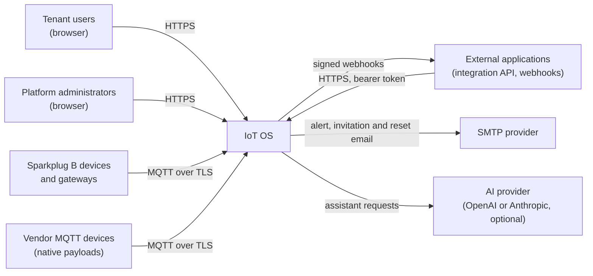
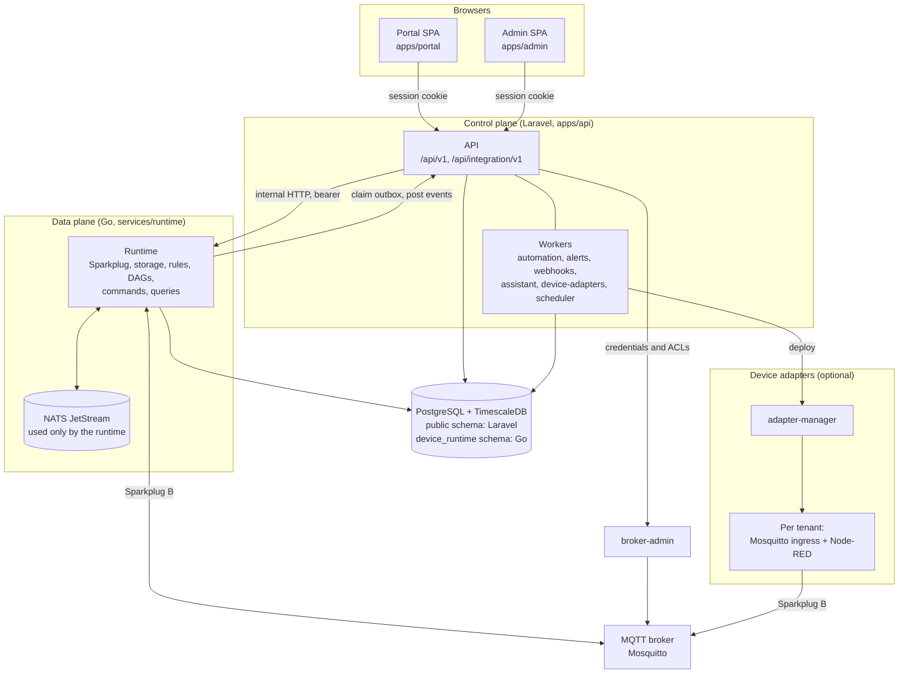

# Architecture overview

IoT OS is a multi-tenant industrial IoT platform. Organizations register
devices, describe them with versioned device profiles, receive their telemetry
over Sparkplug B, store and chart it, control devices with confirmed commands,
automate on live data, raise alerts, and expose data to external applications.

This page describes the system as built. Terms are defined in the
[glossary](glossary.md); decisions are in the [ADRs](../adr/README.md).

## The core rule

> Laravel owns intent: definitions, authorization, AI orchestration and the
> public API. Go executes activated definitions in the data plane.

Principles that follow from it and hold in the code today:

1. **Immutable versions, explicit activation.** Profiles publish immutable
   artifacts; devices run immutable configuration snapshots; workflows run
   immutable deployment snapshots; adapters deploy immutable revisions. Editing
   creates a new draft. Nothing becomes live until someone activates it and the
   runtime acknowledges it.
2. **Desired and applied state are separate.** Laravel records what should run;
   Go reports what does run. Both sides fence work by generation
   ([ADR-014](../adr/ADR-014-control-plane-data-plane-http-integration.md)).
3. **Go never asks Laravel how to process a message.** Definitions are pushed to
   the runtime; telemetry keeps flowing while Laravel is briefly down.
4. **Clients only talk to Laravel.** The portal, admin, SDK and assistant never
   reach the database, NATS, the broker or the runtime directly.
5. **Tenant identity comes from the authenticated connection, never the payload.**
   Broker credentials are scoped to an organization's Sparkplug group; adapter
   ingress brokers are per tenant ([ADR-010](../adr/ADR-010-per-tenant-adapter-runtimes.md)).
6. **Protocol details stay at the edge.** Sparkplug groups and edge nodes are
   source addresses, not the domain model; a device is a platform record bound to
   a source by its configuration.
7. **AI is optional and never bypasses authorization.** Assistant tools call the
   same domain services as the UI under the user's permissions; writes become
   proposals that a person reviews; deployment, publication and device commands
   are never assistant actions ([assistant](../features/assistant.md)).
8. **Uncertainty is shown, not hidden.** Missing data is unknown, not zero;
   stale values are labelled; a command that may have been sent is "uncertain"
   and is never resent automatically.

## System context



## Containers



| Container | Code | Notes |
| --- | --- | --- |
| Portal | [`apps/portal`](../../apps/portal) | Tenant app: devices, profiles, dashboards, automations, alerts, integrations, settings |
| Admin | [`apps/admin`](../../apps/admin) | Platform administration: organizations, users, roles, permission ceilings, retention |
| API | [`apps/api`](../../apps/api) | Laravel 13, Sanctum, spatie/laravel-permission, Laravel AI. Code is organized by domain under `app/Domain` |
| Workers | `apps/api` Artisan commands | `automation:work`, `integrations:webhooks-work`, `queue:work` for `alerts`, `assistant`, `device-adapters`, `default`; `schedule:work` in release ([`compose.app.yml`](../../deploy/compose/compose.app.yml), [`deploy/release/compose.yml`](../../deploy/release/compose.yml)) |
| Runtime | [`services/runtime`](../../services/runtime) | One Go process (`cmd/runtime`); only one instance may run (Postgres advisory lock) |
| broker-admin | [`services/runtime/cmd/broker-admin`](../../services/runtime/cmd/broker-admin) | Applies credentials and ACLs to Mosquitto Dynamic Security ([ADR-009](../adr/ADR-009-mosquitto-default-broker.md)) |
| Adapters | [`services/adapters`](../../services/adapters) | adapter-manager plus per-tenant runtimes ([adapters](../features/adapters.md)) |
| Database | TimescaleDB 2.29 on PostgreSQL 17 | Laravel owns the `public` schema; Go owns `device_runtime` (telemetry, latest state, outboxes, rule and DAG state) |
| NATS | JetStream | Four streams, created and consumed only by the runtime ([events](../reference/events.md#nats-jetstream)) |

The local development stack also starts Redis, MinIO and a stock Node-RED; the
application does not use them ([local setup](../dev/local-setup.md)).

## Key flows

### Telemetry: device to chart

```mermaid
sequenceDiagram
    participant D as Device / gateway
    participant B as MQTT broker
    participant R as Runtime
    participant J as JetStream
    participant DB as TimescaleDB
    participant A as API
    participant P as Portal

    D->>B: NBIRTH / DBIRTH, then NDATA / DDATA (spBv1.0/<group>/...)
    B->>R: subscription per broker connection
    R->>R: session, alias and sequence checks; map metrics to parameters;<br/>conversions, validation, calculations
    R->>J: IOT_DEVICE_TELEMETRY
    J->>R: devices-storage consumer
    R->>DB: observations, latest values, diagnostics + committed-telemetry outbox (one transaction)
    R->>J: IOT_COMMITTED_TELEMETRY (relay)
    P->>A: poll latest / history
    A->>R: GET /internal/measurements/...
    R->>DB: query
```

Only good-quality readings become observations; invalid readings are stored as
diagnostics and keep the last valid value visible but marked
([devices](../features/devices.md#measurements-and-history)).

### Activation: Laravel intent to running configuration

1. A user activates a device (or a workflow). Laravel writes an immutable
   snapshot, bumps the generation, sets the desired pointer and writes a
   `device_outbox` row in one transaction.
2. The runtime claims the row over internal HTTP, places it on
   `IOT_DEVICE_CONTROL`, acknowledges the claim, then applies it.
3. The runtime reports `device.applied.v1` (or `device.failed.v1`) through its
   own outbox and `POST /api/internal/devices/events`.
4. Laravel moves the applied pointer only for the matching generation and
   operation. The UI shows "pending" until then.

Commands, workflow deployments and broker-connection changes use the same path
([ADR-014](../adr/ADR-014-control-plane-data-plane-http-integration.md)).

### Automation: telemetry to action

1. The runtime's `workflow-evaluator-v1` consumer reads committed telemetry and
   evaluates geofence rules (v1) and DAGs (v2) in one transaction with their
   state, timers and checkpoint ([automation](../features/automation.md)).
2. Geofence rules emit transitions; DAGs emit action intents. Both reach Laravel
   as runtime events.
3. Laravel projects transitions into alert episodes. `automation-worker`
   re-authorizes each DAG intent (deployment, grants, stop switch, rate limits)
   and then raises an alert, journals an integration event or sends a command
   through the normal command pipeline.
4. Alert episodes queue email on the `alerts` worker and append to the
   integration event journal, which `webhooks-worker` delivers
   ([alerts](../features/alerts.md), [integrations](../features/integrations.md)).

### Vendor device through an adapter

A vendor device publishes its own JSON to its tenant's ingress broker; the
tenant's Node-RED runtime runs the decoder in QuickJS and republishes the result
as Sparkplug B to the platform broker; from there it is an ordinary Sparkplug
source ([adapters](../features/adapters.md)).

## Deployment shapes

| Shape | What runs | Docs |
| --- | --- | --- |
| Local development | Compose: `compose.dev.yml` (infrastructure) + `compose.app.yml` (API, workers, portal, admin) + `compose.devices.yml` (TLS broker and the runtime) | [local setup](../dev/local-setup.md) |
| Single-node release | Compose with Caddy, digest-pinned images and `tooling/release/manage.py` | [release](../ops/release.md) |
| Two-server pilot | Release profile with the database on a second host over WireGuard | [pilot](../ops/pilot.md) |

## What was not built

The August 2026 plan ([archived](../archive/2026-10/plan/architecture/target-architecture.md))
described more than exists. Not built:

- **Canonical JSON ingestion.** There is no native MQTT JSON or HTTP JSON ingestion
  path and no `iot.telemetry.v1` envelope. The runtime ingests **only Sparkplug
  B**; adapters translate vendor payloads into Sparkplug.
- **Node-RED protocol adapters** for OPC UA, CoAP or HTTP API polling. Adapters
  support MQTT sources only, uplink only.
- **Definition-activation events.** No `definition.activated.v1` envelope and no
  artifact store; definitions travel inline
  ([ADR-014](../adr/ADR-014-control-plane-data-plane-http-integration.md)).
- **A `packages/contracts` package** or generated cross-language types. Contracts
  are JSON Schemas and fixtures under [`contracts/`](../../contracts/README.md).
- **Generated API clients.** The OpenAPI description
  ([`contracts/openapi`](../../contracts/openapi)) is generated from Laravel and
  checked in CI, but `packages/api-client` and the SDK types are still hand-written
  ([API reference](../reference/api.md#contract)).
- **Realtime push.** No Reverb or WebSockets; the portal polls.
- **`packages/agent-ui`** (AI agents reach the platform through `/mcp`; see
  [agents](../features/agents.md)), the `platformctl` installer (release
  uses `manage.py`), Helm/Kubernetes, ClickHouse, Airflow, Neo4j, an edge
  runtime, high availability or more than one runtime instance.
- Redis and object storage are in the development stack but unused.

Future options are in the [roadmap](../roadmap.md).
