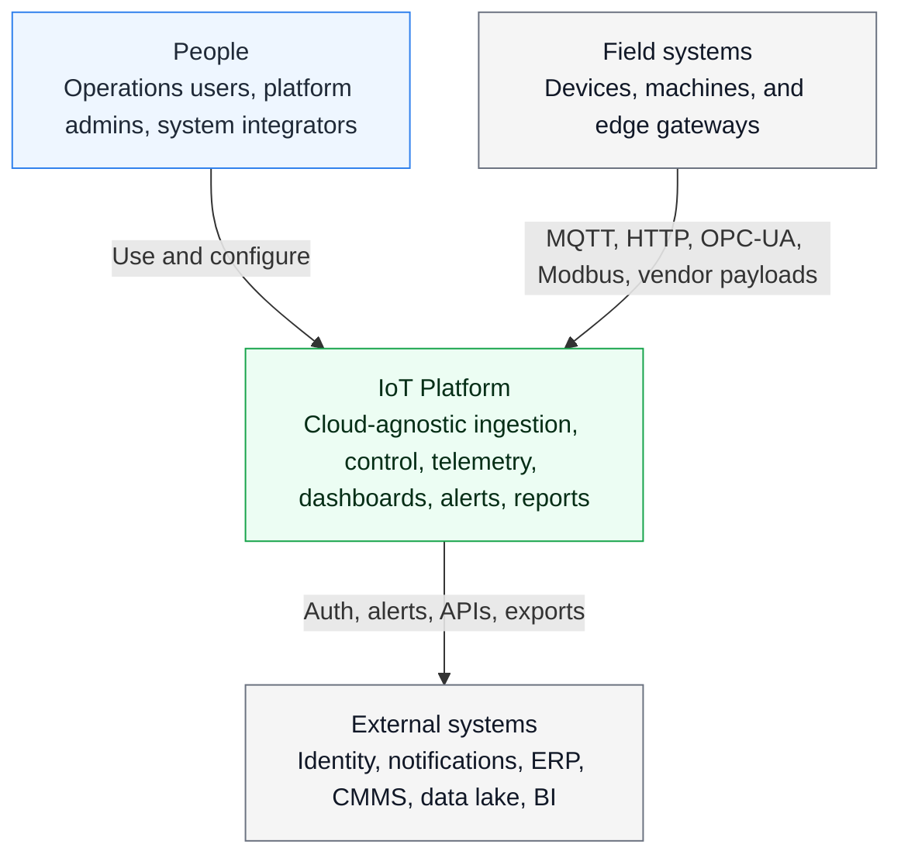
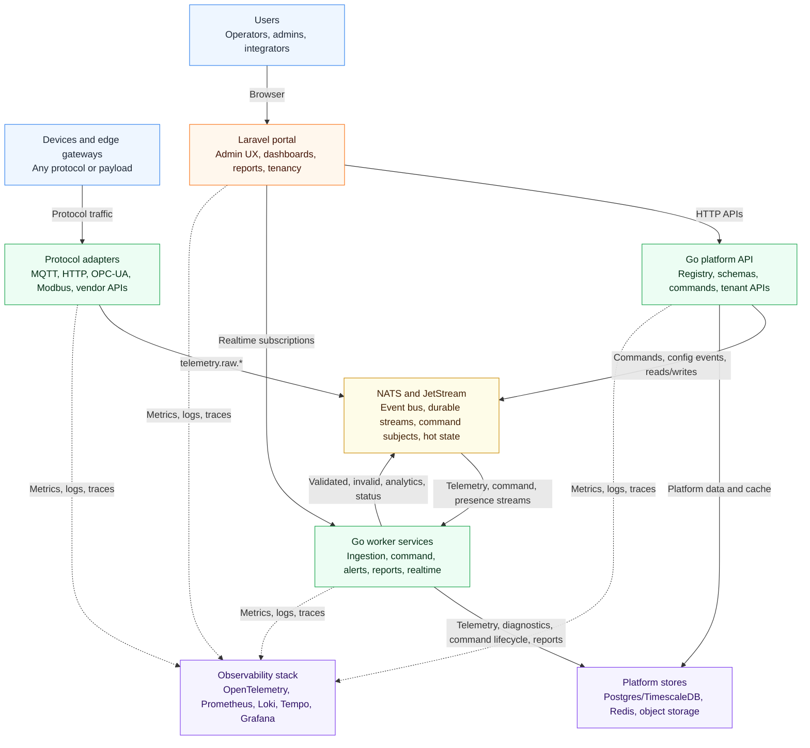
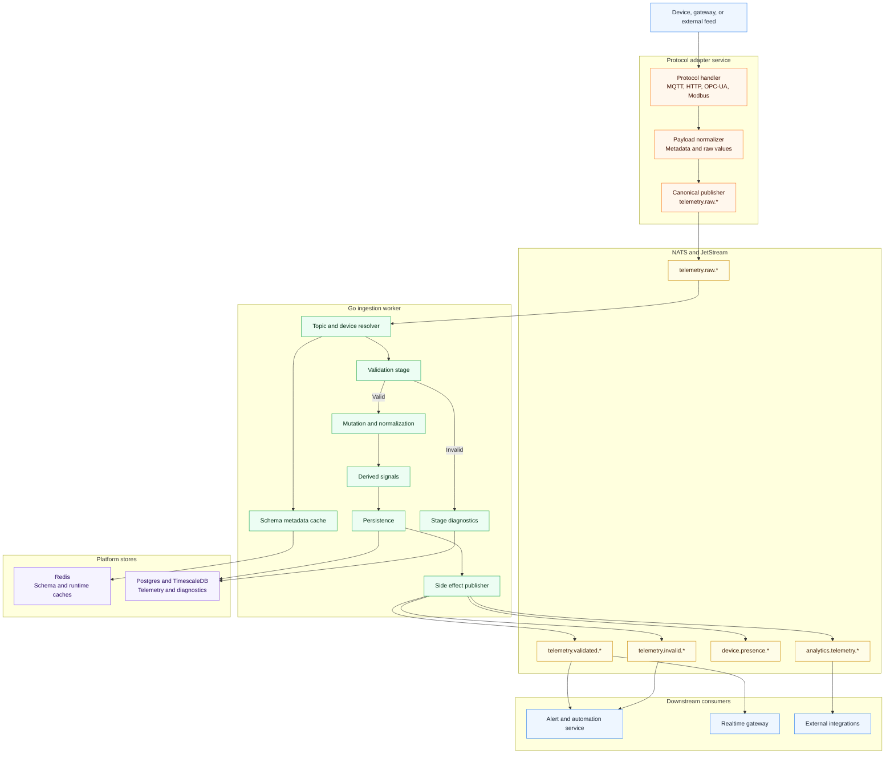
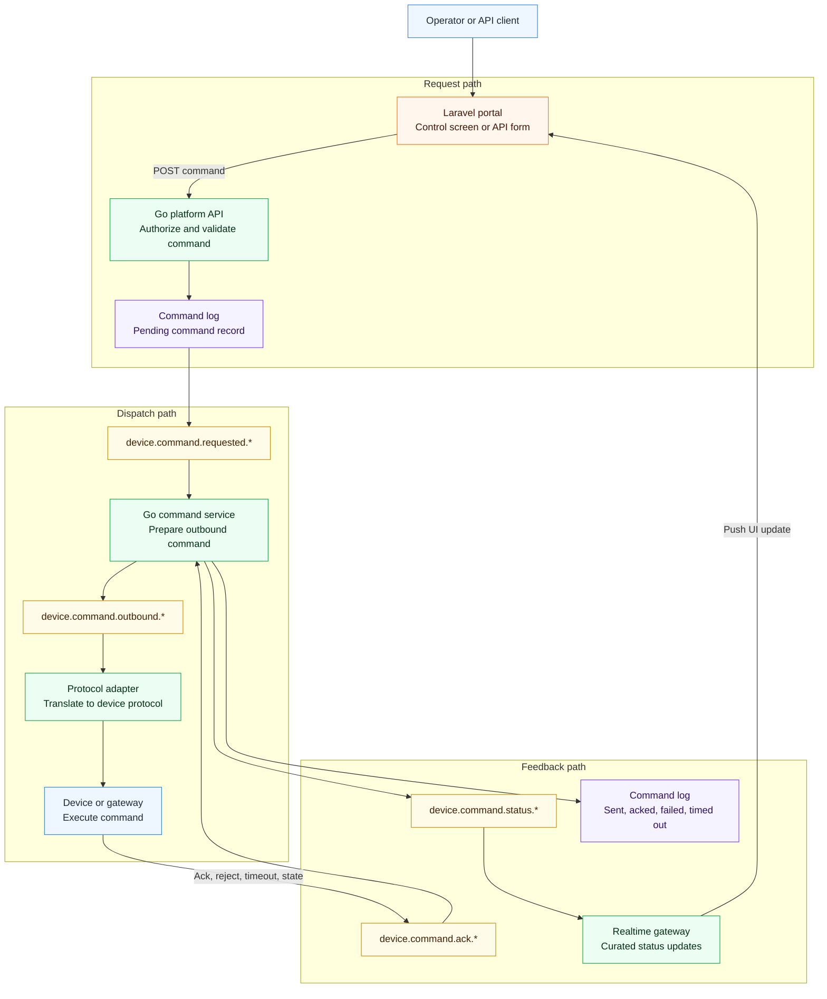
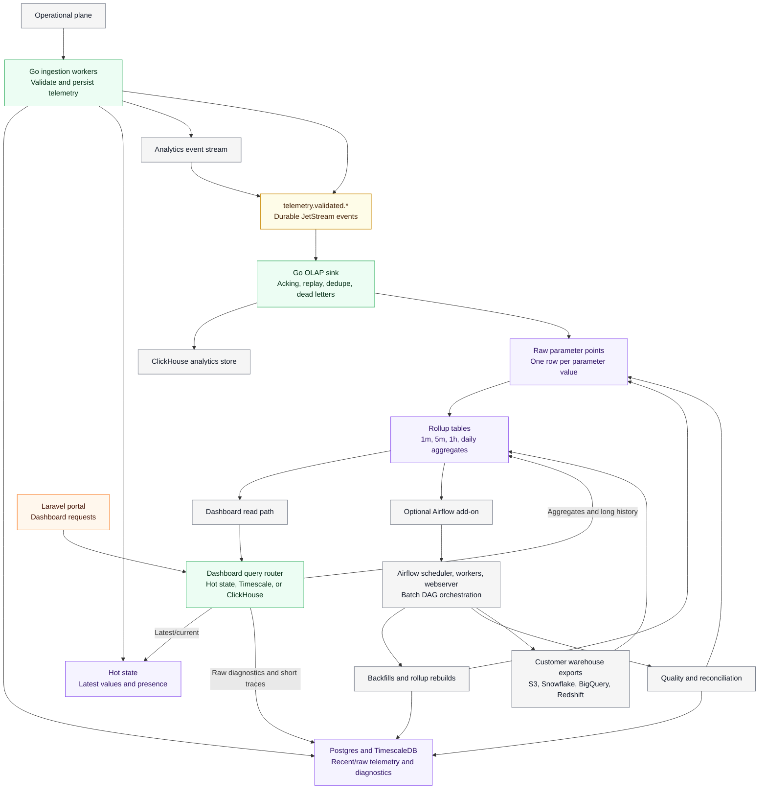
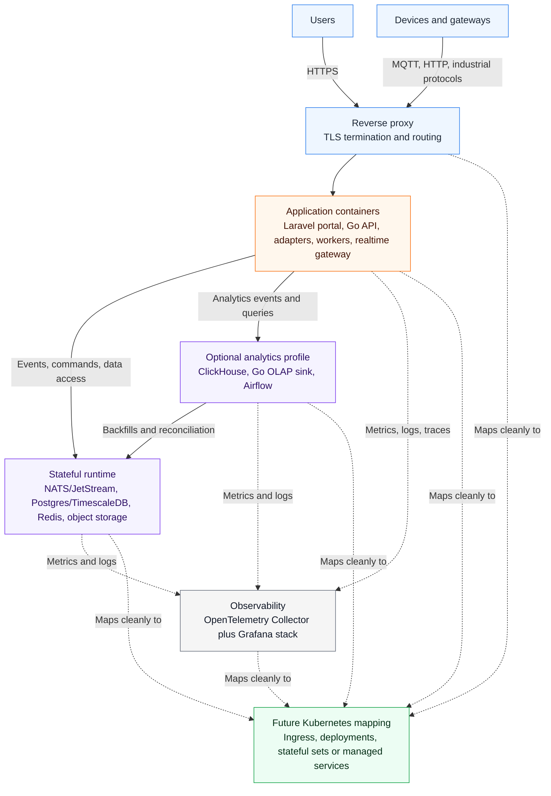

# C4 Architecture for the IoT Platform

This document defines the first architecture baseline for the cloud-agnostic IoT platform. It uses the existing `iot-portal` Laravel and NATS implementation as a reference, but moves high-throughput backend paths into Go services while keeping Laravel focused on the core portal user experience.

The diagrams are C4-style Mermaid diagrams. They are intentionally implementation-oriented without locking the platform into one cloud provider or one orchestrator.

## Architecture Defaults

- **Backend services:** Go for platform APIs, ingestion, command dispatch, state processing, alert evaluation, and adapter runtimes.
- **Frontend/core portal:** Laravel for authenticated portal UI, dashboards, tenancy, admin workflows, reporting views, and operational screens.
- **Event backbone:** NATS with JetStream for protocol ingress, internal pub/sub, durable streams, command topics, hot state, and replayable telemetry flows.
- **Data stores:** Postgres with TimescaleDB for tenant/config data and telemetry history, Redis for cache/rate limiting/session-adjacent runtime state, object storage for exports and artifacts.
- **Analytics plane:** ClickHouse is the default open-source OLAP store for long-range aggregates, fleet analytics, state durations, and counter rollups.
- **Pipeline orchestration:** Apache Airflow is an optional data-plane add-on for backfills, rollup rebuilds, quality checks, retention archives, and customer warehouse exports. It does not orchestrate real-time ingestion or command/control.
- **Observability:** OpenTelemetry Collector, Prometheus, Loki, Tempo, and Grafana as the default cloud-agnostic stack.
- **Deployment baseline:** Docker Compose first for small-company adoption, with container boundaries that map cleanly to Kubernetes later.

## Reference Lessons from `iot-portal`

The current `iot-portal` proves several useful platform concepts:

- NATS can act as both MQTT-facing protocol edge and internal pub/sub backbone.
- Laravel/Filament is productive for device registry, schemas, dashboards, reports, alerts, runtime settings, and operational workflows.
- Schema-driven ingestion should remain central: topic resolution, validation, mutation, derivation, persistence, analytics publishing, hot state, and stage diagnostics are core capabilities.
- Queue-separated side effects are valuable, but ingestion and control paths should move to Go for lower latency, better concurrency, and simpler horizontal scaling.
- Live UI updates remain important, but the UI should consume curated API/state streams rather than own the high-throughput processing loop.

## Current Analytics Drawbacks

The reference portal currently uses Timescale as the operational telemetry store and the dashboard analytics source. That is workable for early deployments, but it creates pressure as device count, parameter cardinality, dashboard concurrency, and retention windows grow.

- Dashboard widgets read `device_telemetry_logs`, extract JSON `transformed_values`, and often aggregate in application code.
- Timescale is responsible for raw diagnostics, operational history, dashboard history, and analytics workloads at the same time.
- Parameter categories are available as `measurement`, `counter`, and `state`, but query behavior is not consistently category-aware.
- Counter widgets calculate start/end deltas in widget code, which does not handle resets, rollups, or cross-device aggregation well.
- State parameters need transition and duration semantics instead of numeric aggregation.
- The platform needs an orchestration layer for historical backfills, warehouse syncs, data quality checks, rollup rebuilds, and customer-specific exports.

## Diagram Authoring Standard

Future platform diagrams should optimize for reading in Markdown, not for fitting every relationship into one wide canvas.

- Prefer top-to-bottom Mermaid layouts with grouped lanes.
- Split a broad concern into two focused diagrams instead of making one diagram span far horizontally.
- Keep node labels short and move detail into the paragraph below the diagram.
- Use subgraphs for C4 boundaries: people/systems, platform containers, components, and deployment nodes.
- Avoid sequence diagrams for flows with many participants unless ordering is more important than readability.
- Keep colors stable: blue for users/external systems, orange for Laravel/user-facing app pieces, green for Go services, yellow for event bus/streams, purple for data stores, gray for observability/runtime.

## 1. System Context

The platform boundary includes device onboarding, schema management, protocol normalization, telemetry ingestion, command dispatch, dashboards, alerts, reports, and integration APIs. Edge gateways and external identity/notification systems remain outside the core platform.

## 2. Container View

Laravel owns the human-facing portal. Go services own the backend control plane, ingestion plane, command plane, automation paths, reporting workers, and realtime gateway. NATS/JetStream keeps producers and consumers decoupled so services can scale independently.

The compact container view intentionally groups related worker containers so the diagram remains readable. The component views below expand ingestion and control flows where the lower-level detail matters.

## 3. Ingestion Component View

Adapters absorb protocol-specific concerns and publish canonical events. The ingestion worker is protocol-agnostic and can scale by stream partition, tenant, device group, or workload class.

## 4. Device Control Component View

The command log is the source of truth for command lifecycle. NATS carries command requests, outbound protocol commands, acknowledgements, timeouts, and UI-visible status events.

## 5. Data and Analytics Plane

The live IoT path remains Go services plus NATS/JetStream. Airflow is deliberately outside that path: it handles finite, retryable data workflows such as backfills, rollup rebuilds, quality reconciliation, retention archives, and customer warehouse exports.

The Go OLAP sink is preferred over a direct ClickHouse NATS table for the initial platform because it gives the platform explicit control over JetStream acknowledgements, replay windows, idempotency, schema evolution, tenant throttling, and dead-letter behavior.

## 6. Deployment View

The first deployable shape should be one Compose project with clear service boundaries. ClickHouse and Airflow should be enabled through an optional analytics profile so small deployments can stay light, while larger deployments can add OLAP storage and data orchestration without changing the core runtime architecture.

The same boundaries map to Kubernetes deployments and stateful components without changing the core platform architecture.

## Dashboard Data Source Decisions

Dashboard queries should declare intent so the Go API can route them to the right store. Timescale remains the operational store; ClickHouse is the analytics store; hot state is the latest-value path.

| Dashboard need | Default source | Reason |
| --- | --- | --- |
| Latest gauge, status card, current value | Hot state, then Timescale fallback | Avoids scanning history for the most recent value. |
| Raw diagnostic trace | Timescale | Preserves raw and transformed payload context for troubleshooting. |
| Short recent line chart | Timescale or ClickHouse by range/cardinality | Keeps small operational traces simple while allowing scale-out. |
| Long-range line chart | ClickHouse rollups | Avoids repeated row scans and JSON extraction from Timescale. |
| Fleet comparison | ClickHouse | Better fit for high-cardinality grouping and aggregation. |
| Counter consumption | ClickHouse reset-aware rollups | Handles resets, rates, deltas, and daily/hourly usage consistently. |
| State timeline | ClickHouse state events, Timescale fallback | Supports transitions and history drilldown. |
| State duration, uptime, downtime | ClickHouse rollups | Duration semantics are aggregate analytics, not raw row reads. |
| Customer BI or warehouse export | Airflow export destination | Keeps user-specific analytics exports out of the live runtime path. |

If ClickHouse is disabled, the query router may fall back to Timescale for aggregate views, but the UI should treat that as a limited mode with shorter recommended history windows and lower dashboard concurrency expectations.

## Parameter Query Semantics

Parameter categories should control default aggregation behavior.

| Category | Query semantics |
| --- | --- |
| `measurement` | Latest, min, max, average, count, percentiles, first/last, bucketed line charts. |
| `counter` | Increase, rate, delta, reset-aware rollups, daily/hourly consumption. |
| `state` | Latest state, transition count, duration per state, uptime/downtime windows, state timeline. |

Dashboard widget configuration should declare one of these data intents: `latest`, `raw_series`, `bucketed_aggregate`, `counter_increase`, `counter_rate`, `state_duration`, or `state_timeline`.

## Analytics Data Model

Timescale should keep raw operational telemetry and diagnostics. ClickHouse should store analytics-ready, parameter-level rows.

| Field | Purpose |
| --- | --- |
| `organization_id` | Tenant partition and query filter. |
| `device_id` | Device filter and grouping key. |
| `topic_id` | Source topic or schema topic reference. |
| `parameter_id` | Stable parameter definition reference. |
| `parameter_key` | Human-readable parameter key for schema evolution and debugging. |
| `category` | `measurement`, `counter`, or `state`. |
| `recorded_at` | Event time used for rollups and dashboards. |
| `value_float` | Numeric value for measurements and counters. |
| `value_string` | String value for text/state payloads. |
| `value_bool` | Boolean value for binary state. |
| `state_key` | Normalized state value for timelines and duration rollups. |
| `ingestion_message_id` | Idempotency, traceability, and reconciliation link. |

ClickHouse materialized views should build 1 minute, 5 minute, 1 hour, and daily rollups. Use aggregate table engines for measurement statistics, reset-aware counter summaries, and state duration/transition summaries.

## Airflow DAGs

Airflow should ship as an optional data-plane package with these initial DAGs:

| DAG | Responsibility |
| --- | --- |
| `sync_dimensions_to_olap` | Sync tenants, devices, schemas, topics, and parameter definitions from Postgres to ClickHouse dimension tables or dictionaries. |
| `backfill_timescale_to_clickhouse` | Replay historical Timescale telemetry into ClickHouse after schema changes or OLAP enablement. |
| `rebuild_clickhouse_rollups` | Rebuild aggregate tables for selected tenants, devices, and time windows. |
| `analytics_quality_reconciliation` | Compare Timescale counts/checksums with ClickHouse ingested counts and report mismatches. |
| `export_customer_warehouse` | Export curated datasets to S3, Snowflake, BigQuery, Redshift, or another customer-preferred destination. |
| `retention_archive` | Archive raw telemetry before Timescale retention drops old chunks. |

## Canonical Event Subjects

The first implementation should keep event shapes small and stable, while allowing adapters to preserve raw protocol context for diagnostics.

| Subject family | Purpose | Typical producers | Typical consumers |
| --- | --- | --- | --- |
| `telemetry.raw.*` | Canonical inbound telemetry after protocol normalization | Adapter services | Ingestion workers |
| `telemetry.validated.*` | Valid telemetry after schema validation, mutation, and derivation | Ingestion workers | Realtime gateway, alerts, analytics, integrations |
| `telemetry.invalid.*` | Invalid payloads with validation failures | Ingestion workers | Alerting, diagnostics, operator UI |
| `device.presence.*` | Online, offline, heartbeat, and last-seen state | Adapters, ingestion workers, presence service | Portal, alerting, integrations |
| `device.command.requested.*` | Command requests accepted by the API | Platform API | Command service |
| `device.command.outbound.*` | Protocol-ready command dispatch | Command service | Adapter services |
| `device.command.ack.*` | Device acknowledgements and rejects | Adapter services | Command service |
| `device.command.status.*` | User-visible command lifecycle updates | Command service | Portal realtime gateway, integrations |
| `analytics.telemetry.*` | Clean analytics/event stream for downstream systems | Ingestion workers | Integrations, data lake exporters |
| `analytics.olap.dead_letter.*` | OLAP sink failures that need replay or operator action | Go OLAP sink | Airflow reconciliation, operator UI |

## Initial Implementation Guidance

- Keep the Laravel portal thin at runtime: authenticated UI, forms, dashboards, admin workflows, and report views should call Go APIs instead of owning ingestion loops.
- Keep protocol adapters replaceable and independently deployable. Adding a new protocol should not require changing ingestion worker internals.
- Treat NATS/JetStream as the durable integration boundary between protocol ingress, ingestion, control, realtime UI, automation, and external integrations.
- Preserve stage-level diagnostics from the reference portal so operators can explain why telemetry was accepted, rejected, transformed, or skipped.
- Use Timescale for operational history and raw diagnostics; use ClickHouse for long-range aggregates, fleet analytics, counter rollups, and state duration calculations.
- Keep Airflow out of the live ingestion and command/control paths. Use it for finite data workflows that need scheduling, retries, backfills, exports, and reconciliation.
- Implement the dashboard query router in the Go API so Laravel can request dashboard snapshots without knowing whether the answer came from hot state, Timescale, ClickHouse, or a fallback path.
- Avoid cloud-specific primitives in the core architecture. Use interfaces compatible with local Compose, self-hosted Kubernetes, and managed cloud services.

## References

- [Apache Airflow documentation](https://airflow.apache.org/docs/apache-airflow/stable/index.html)
- [Apache Airflow asset scheduling](https://airflow.apache.org/docs/apache-airflow/stable/authoring-and-scheduling/asset-scheduling.html)
- [ClickHouse materialized views](https://clickhouse.com/docs/materialized-views)
- [ClickHouse AggregatingMergeTree](https://clickhouse.com/docs/engines/table-engines/mergetree-family/aggregatingmergetree)
- [ClickHouse NATS table engine](https://clickhouse.com/docs/engines/table-engines/integrations/nats)
