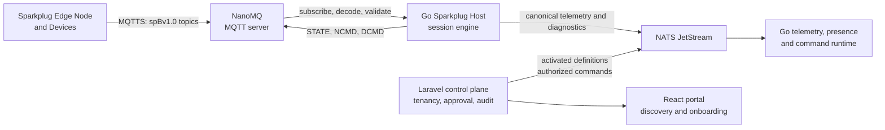

# Sparkplug-First Device Domain Plan

**Status:** Superseded implementation proposal — see [accepted Devices v1 plan](devices-v1.md). The approved broker is the existing EMQX deployment; NanoMQ references below are historical proposal context.
**Scope:** First production-capable Device Domain path after the Administration baseline.  
**Protocol:** Eclipse Sparkplug 3.0, Sparkplug B payload (`spBv1.0`).  
**Source:** [Sparkplug 3.0.0 specification](../../docs/sparkplug-specification-3.0.0.pdf), especially Topics and Messages (pp. 18-30), Operational Behavior (pp. 31-58), Payloads (pp. 59-96), Security (pp. 97-99), and Conformance (pp. 106-108).

## 1. Decision

Build the first Device Domain onboarding and runtime path around Sparkplug B. The user-facing unit is one **Device Definition** wizard, not a Profile -> Binding -> Schema Version hierarchy.

The platform is a Sparkplug **Host Application**. It accepts and validates Sparkplug session traffic, publishes its own `STATE` certificate, discovers Edge Nodes and Devices from birth certificates, and sends controlled `NCMD` and `DCMD` messages.

NanoMQ is an MQTT server choice, not the Host Application or system of record. Its Sparkplug support is valuable only after an interoperability spike proves that the exact deployed version satisfies the required MQTT broker behavior. Go owns protocol execution; Laravel owns tenant meaning, approval, authorization, activation, and audit.

### Non-negotiable boundaries

- Sparkplug `group_id`, `edge_node_id`, `device_id`, metric name, alias, `bdSeq`, and `seq` remain source-protocol metadata. They do not replace organization, Gateway, logical Device, or stable platform Parameter identifiers.
- A birth certificate is evidence of a discoverable source, not permission to create a production Device or write trusted telemetry.
- A published Device Definition is an immutable snapshot. The UI shows **Draft** and **Published**, never a user-managed schema-version tree.
- MQTT delivery or a broker PUBACK is not command success. A command succeeds only when the definition's configured observable result is received and validated, otherwise it times out or fails.
- Sparkplug A is out of scope. The only namespace accepted in this path is `spBv1.0`.

## 2. What the specification requires us to implement

| Concern | Required platform behavior |
| --- | --- |
| Topic identity | Parse only `namespace/group_id/message_type/edge_node_id/[device_id]`; enforce valid IDs and the message-type/device-ID combinations. |
| Host presence | Use a unique, stable Host ID. On connect, set a QoS 1 retained MQTT Will on `spBv1.0/STATE/{host_id}`, subscribe to that topic, then publish retained JSON `online=true`. Publish `online=false` before a deliberate shutdown. |
| Birth and death | Treat `NBIRTH`/`DBIRTH` as the full session declaration and `NDEATH`/`DDEATH` as immediate presence-quality changes. Match `NDEATH.bdSeq` to the active NBIRTH before acting. An NDEATH makes its Node, attached Devices, and their metrics stale at the Host receipt time. |
| Message ordering | Maintain session-scoped `seq` per Edge Node, validate modulo-256 increments across node and device messages, suppress duplicates, diagnose gaps/out-of-order messages, and issue `Node Control/Rebirth=true` when a new birth sequence is required. |
| Metric registry | A birth defines every expected metric for that session, including name, datatype, current value, metadata, and aliases. Do not accept an unknown alias or a data metric that was absent from the active birth. Reset aliases on a new birth sequence. |
| Telemetry | Decode Google Protocol Buffers, preserve source and receive timestamps, distinguish source value quality from transport/session staleness, and process `NDATA`/`DDATA` as change-oriented updates. |
| Commands | Encode `NCMD` for Node metrics and `DCMD` for Device metrics only when a published definition declares a compatible writable metric. Support mandatory `Node Control/Rebirth`; treat all other controls as explicit opt-in policies. |
| Security | Require MQTTS in production, unique MQTT client identities, tenant-scoped broker ACLs, and least-privilege publish/subscribe permissions over the exact Sparkplug topics. |

## 3. NanoMQ decision gate

Do not make a product claim based only on a NanoMQ feature label. Pin the exact NanoMQ release, image digest, configuration, and license posture we will deploy, then run this interoperability gate with an independent Sparkplug client or Eclipse Tahu fixtures.

### Required broker evidence

1. MQTT 3.1.1 and/or MQTT 5 connection behavior used by the chosen Edge clients.
2. QoS 0 and QoS 1 publish/subscribe.
3. MQTT Will delivery with QoS 1 and retain, including abrupt disconnect.
4. Retained `STATE` messages delivered to a newly connected Edge client.
5. TLS and per-client credentials; ACLs restrict an Edge Node to its own `NBIRTH`, `NDATA`, `NDEATH`, device topics, `NCMD`/`DCMD` subscriptions, and permitted Host `STATE` topic.
6. The chosen HA topology preserves the behavior above through broker failover.

The base Sparkplug broker conformance profile requires QoS 0/1, Will messages, and retained messages. A **Sparkplug Aware MQTT Server** additionally retains and exposes birth certificates on `$sparkplug/certificates/...`; that is optional for our first release. The Host must work without it by maintaining its own received birth registry and issuing a rebirth request when required.

## 4. Product model and onboarding flow

### One Device Definition aggregate

The control plane stores one authoring draft containing:

- human name, organization, optional site/asset placement, and logical Device identity;
- Sparkplug source selector: broker connection, `group_id`, `edge_node_id`, and optional `device_id`;
- Parameter mappings: stable platform UUID, label/key, allowed semantic type/unit/constraints/presentation, source metric name, expected datatype, and quality policy;
- command policies: source metric, allowed values/range, confirmation requirement, and observed-result rule; and
- captured birth/data fixtures plus a compiler result.

Publishing creates one immutable execution snapshot. Internally it may contain separate semantic and Sparkplug protocol artifacts, but that split is not exposed as a catalog-management task to the user.

### Smooth onboarding

1. **Connect gateway** - create or select the tenant's NanoMQ connection; validate TLS, credentials, Host `STATE`, and allowed namespace. No Device exists yet.
2. **Discover** - list quarantined NBIRTH/DBIRTH candidates with exact source identifiers, session freshness, `bdSeq`, metric count, diagnostics, and raw-message access subject to permission.
3. **Map metrics** - select a candidate and map only declared birth metrics to friendly Parameters. Keep protocol names as read-only source metadata. Explicitly classify diagnostics, telemetry, and writable controls.
4. **Verify** - replay the recorded birth and representative data messages through the Go compiler. Display extracted values, aliases, types, quality, command encodings, and errors before publication.
5. **Activate** - publish the immutable snapshot, attach it to the logical Device, begin trusted ingestion, and show live session state. A re-birth with incompatible metrics returns to review; it never silently edits an active definition.

This follows the generated mockups: connection confidence first, discovery review second, metric mapping third. The portal must always show four distinct states: **unseen**, **candidate**, **active/current**, and **stale/offline**.

## 5. Delivery sequence

Each stage is independently reviewable. Do not start the following stage until the stated evidence exists.

### S0 - Architecture and broker spike

**Work**

- Replace the Native-MQTT-first Device Domain decision with a Sparkplug-first ADR that supersedes the current implementation direction while preserving the accepted control-plane/data-plane ownership model.
- Run the NanoMQ evidence gate above against a pinned local deployment and an independent Sparkplug client fixture set.
- Select one Host ID strategy: one active Host identity per broker/trust boundary, with standby instances fenced so they never publish competing `STATE` messages.
- Choose initial HA scope: one broker cluster is supported first; multiple isolated brokers are deferred because the Host must maintain state per broker.

**Acceptance evidence**

- Version-pinned compose configuration, recorded broker test output, and a failure drill for abrupt Edge disconnect.
- ADR records the Host ID, broker scope, HA scope, NanoMQ version, and whether `$sparkplug/certificates` is used.

### S1 - Wire contract and fixtures

**Work**

- Add the official Sparkplug B protobuf source as a pinned, checksummed upstream dependency and generate Go code reproducibly; do not hand-maintain a partial protobuf model.
- Define internal schemas for parsed topic, raw packet reference, session key, source timestamps, metric name/alias, `bdSeq`, `seq`, type, and diagnostics.
- Build golden fixtures for NBIRTH, DBIRTH, NDATA, DDATA, NDEATH, DDEATH, NCMD, DCMD, STATE, malformed topics, invalid protobuf, alias-before-birth, sequence gap, duplicate death, and rebirth.
- Support initial scalar mappings: signed/unsigned integers, float/double, boolean, string/text, DateTime, UUID, and bytes. Parse Dataset, Template, File, and arrays losslessly into diagnostics/raw artifacts but do not expose them as typed platform Parameters until a later approved type model exists.

**Acceptance evidence**

- Contract tests decode every valid fixture deterministically and reject each invalid fixture with a stable diagnostic code.
- Generated protobuf output is reproducible in CI from the pinned source.

### S2 - Go Sparkplug Host session engine

**Work**

- Implement broker connection lifecycle, retained Host `STATE`, MQTT Will, subscriptions, topic parsing, protobuf decoding, and per-broker Host state timestamp.
- Implement Node and Device state machines: awaiting birth, online/current, stale, offline, and rebirth-pending.
- Track active birth registries, aliases, `bdSeq`, `seq`, timestamps, and session ownership. On a valid NDEATH, mark the whole affected Node subtree stale using Host receipt time.
- Emit canonical telemetry, presence, discovery, and diagnostic events to JetStream without synchronously calling Laravel.

**Acceptance evidence**

- Deterministic tests cover normal establishment, reconnect, premature DBIRTH, duplicate NDEATH, stale NDEATH, alias reset, sequence wrap at 255, and rebirth recovery.
- A real NanoMQ integration test proves the Host's Will/STATE behavior and live presence transitions.

### S3 - Laravel control plane and authorization

**Work**

- Add tenant-owned records for Sparkplug broker connections, approved source namespaces, discovery candidates, candidate metric snapshots, Device Definitions, immutable published snapshots, and command policies.
- Add roles/permissions for connection management, candidate view/review/reject, definition publication, command issue, and raw-payload diagnostic access. Preserve the Administration baseline as the authority for these decisions.
- Consume Go events idempotently; Laravel records business state and audit history but does not reinterpret protocol messages.
- Define a rule for incompatible rebirth: retain the active definition, create a reviewable drift event, and block new metrics from trusted storage until approval.

**Acceptance evidence**

- Tenant-isolation and negative authorization tests for every endpoint.
- Audit events contain actor, candidate/snapshot identity, decision, source identifiers, and compiler result without secrets or unrestricted raw payloads.

### S4 - Definition compiler, mapping, and activation

**Work**

- Compile one Device Definition draft into an immutable runtime snapshot containing the exact source selector, accepted birth contract, stable Parameter UUIDs, metric-name mappings, type rules, quality rules, and command policies.
- Replay recorded Sparkplug birth/data fixtures before publication. Require the compiler to prove that every mapped metric exists in the birth, has a compatible datatype, and has a valid alias relationship.
- Validate the normal command path as a separate rule: authorized request -> `NCMD`/`DCMD` emitted -> configured later `NDATA`/`DDATA` observation -> business status. Never equate broker receipt with completion.

**Acceptance evidence**

- Valid edge-level and device-level examples compile and activate.
- Incompatible type, undeclared metric, alias mismatch, unavailable command result, and sequence failure examples cannot publish.

### S5 - React discovery and onboarding

**Work**

- Build the five-step wizard described above using the existing shared UI system: connection check, discovery inbox, metric mapping, fixture verification, and activation.
- Build a supportable live session panel showing last birth, last data, `bdSeq`, `seq`, freshness, current/stale/offline state, and actionable diagnostics.
- Keep raw protobuf/decoded payload details behind an explicit diagnostic view and authorization check.
- Implement accessible loading, empty, permission-denied, failed connection, invalid-birth, sequence-gap, and stale-device states.

**Acceptance evidence**

- Browser tests cover candidate approval, reject/ignore, metric mapping, invalid fixture blocking, activation, session loss, rebirth request, and command status progression.
- Manual visual review confirms the wizard does not expose a Profile/Binding/Version hierarchy.

### S6 - Production hardening

**Work**

- Lock down MQTTS, certificate/credential rotation, topic ACL provisioning, secret references, tenant rate limits, raw-payload retention, structured diagnostics, and health/readiness checks.
- Run broker and Host failure drills: Edge crash, Host restart, broker restart, delayed/duplicate data, stale `STATE`, incompatible rebirth, and command timeout.
- Document operating procedures for candidate backlog, stale presence, rebirth, changing a definition, and emergency command disablement.

**Acceptance evidence**

- Security and failure-drill evidence is recorded before any physical-device claim.
- Deployment, rollback, metrics, traces, and operator runbooks are reviewed.

## 6. Explicit deferrals

- Native MQTT JSON authoring as a peer onboarding path.
- Automatic promotion of discovered Edge Nodes or Devices to production assets.
- Sparkplug A.
- Multiple isolated MQTT brokers and Host state federation.
- Typed first-class support for Templates, Datasets, Files, PropertySets, and array metrics.
- Fleet rollout, bulk onboarding, AI-created definitions, and zero-touch credentials until the reviewed Sparkplug path is proven.

## 7. First implementation task

Start with **S0 only**. The first pull request should contain no Device Domain persistence or portal screens. It should pin NanoMQ, add the broker/Host interoperability harness, record the selected Host identity and HA model, and establish the Sparkplug B fixture corpus. That gives us objective proof that the edge transport behaves as assumed before we build the product around it.
