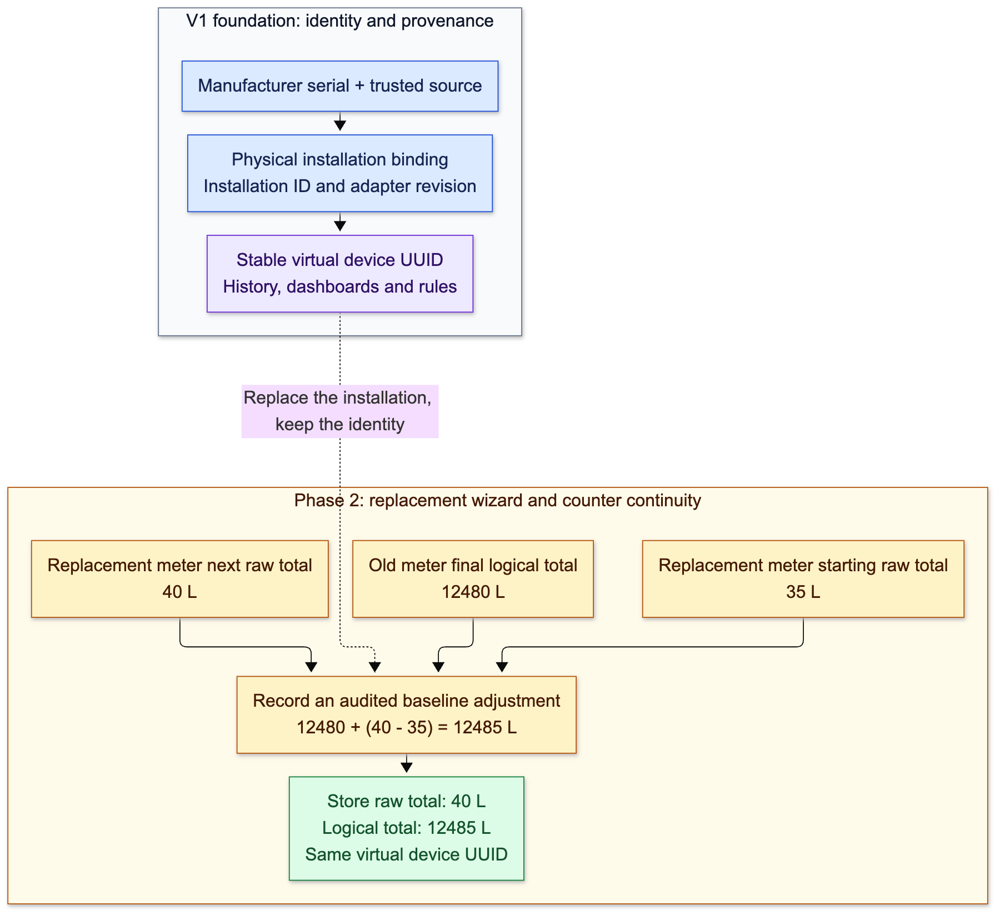

# Device integration and replacement plan

Status: v1 adapter implementation is present in source, October 7, 2026. Disposable MQTT/Node-RED/Go integration verification passed. Rebuilding and verifying the existing Docker-served platform is pending Docker Desktop recovery. The replacement wizard and counter adjustments remain phase two.

Provide one onboarding experience for native Sparkplug devices and manufacturer-specific MQTT devices. Use AI to prepare a reusable, versioned device-type adapter from documentation and real payload samples. The platform validates and deploys the adapter; it owns authorization, credentials, identity binding, history, and counter continuity.

## Visual guide

These diagrams describe the implemented v1 architecture and the planned phase-two replacement flow. Mosquitto is the release broker choice. The existing local development stack retains its current broker settings; the adapter overlay adds isolated Mosquitto ingress brokers without migrating that stack. These diagrams do not establish that a staging or production adapter runtime has been deployed.

### 1. Tenant isolation and connectivity

Each tenant gets its own ingress broker and Node-RED runtime. Devices can preserve fixed manufacturer topics because the ingress brokers are separate. Node-RED subscribes to the tenant or authorized vendor broker, then publishes Sparkplug B upstream. The portal deploys through private management APIs.

[Editable Mermaid source](diagrams/device-integration-01-tenant-isolation.mmd)

### 2. What a new user does

The user selects a profile, configures a source, tests a decoder, deploys, and reviews a discovered device. AI prepares draft changes; the user reviews deployment. Success means readings are stored, not merely that MQTT is connected.

[Editable Mermaid source](diagrams/device-integration-02-onboarding.mmd)

### 3. How the water-meter payload becomes telemetry

JavaScript converts manufacturer fields into profile metrics. The managed publisher handles Sparkplug B protocol details. A candidate must be linked and activated before production readings are stored under its virtual device UUID.

[Editable Mermaid source](diagrams/device-integration-03-water-meter.mmd)

### 4. How replacement preserves history

V1 establishes the stable virtual device UUID and physical installation provenance. The replacement wizard and counter adjustment are phase two: changing the physical meter preserves dashboard and rule references, raw readings, and the accumulated logical total.

[Editable Mermaid source](diagrams/device-integration-04-replacement.mmd)

## Onboarding paths

| Device capability | Connection path |
| --- | --- |
| Native Sparkplug B | Existing direct or gateway onboarding |
| Customizable MQTT broker, vendor payload | Device publishes its unchanged payload and native topics to a dedicated tenant Mosquitto ingress broker; Node-RED decodes and maps it |
| Fixed manufacturer MQTT broker | Adapter subscribes to the vendor broker using customer-authorized vendor credentials |
| Local-only broker or protocol | Deferred to an edge-runtime or tunnel phase; v1 supports internet-reachable brokers |

An MQTT device normally publishes to a broker; it does not connect directly to Node-RED. Node-RED subscribes to the broker and transforms messages. Some vendor products lock the broker or encrypt undocumented payloads. Ask for supported integration access or an approved vendor decoder when documentation and samples are insufficient.

## User experience

1. Choose **Vendor MQTT device**, select a published profile, and create or reuse a tenant-private device-type adapter.
2. Configure the MQTT source: download a tenant-ingress connection kit for configurable-broker devices, or enter customer-authorized vendor-broker credentials and topics. V1 uses cloud runtimes and reachable brokers.
3. Add manufacturer/model, firmware version, documentation, topic examples, and sample messages. Write JavaScript in the workbench or ask AI for a draft. Show **Raw payload → Mapped measurements → Profile validation**, including identity, values, types, units, timestamps, and source evidence. Test malformed payloads and missing fields as well as valid examples.
4. Review the exact tested revision and deploy it. Templates contain no credentials; the platform resolves secret references and verifies runtime acknowledgement. AI changes remain drafts until reviewed.
5. Receive a real message and review discovered serial numbers. Create or link a virtual device, activate the installation binding, and verify good-quality stored readings. Unknown candidates do not store production readings. Report broker connectivity, decoder health, gateway status, and individual sensor freshness separately.

The portal is the only editing surface in v1: guided setup, a JavaScript workbench, samples, output validation, and AI proposals. Keep the native Node-RED editor and Admin API private. AI edits create draft revisions and readable diffs; do not rewrite running flows during a conversation. Preserve user edits, reject stale revisions, and provide rollback to previously tested revisions. Code or profile changes invalidate deployment eligibility until the exact revision passes tests again.

## Adapter ownership and runtime boundaries

- **Device-type adapter template:** vendor/model/firmware compatibility, source documentation, versioned decoding and mapping specification, fixture tests, approved node dependencies, and profile compatibility. Publish a reviewed revision for reuse.
- **Adapter deployment:** belongs to one organization, references a pinned tenant-private template revision and published profile artifact, uses a managed cloud runtime in v1, and records desired/applied revisions, health, diagnostics, and secret references. Vendor command encoding and dispatch are deferred.
- **Physical installation binding:** maps an enrolled source identity to a stable virtual device UUID for a defined installation and effective interval. Identity comes from trusted enrollment and connection scope; payloads cannot choose arbitrary tenant or virtual-device IDs.
- **Node-RED runtime:** executes platform-generated flows in a separate container per organization. Separate tenant Mosquitto ingress brokers preserve manufacturer topics without cross-tenant collisions. Give each runtime and broker its own storage, secrets, and credentials; tenants and AI receive no administration access. A narrow runtime manager owns provisioning and deployment, without mounting a Docker socket into Laravel or tenant containers.

Use per-runtime storage, scoped credentials and topic ACLs, resource limits, approved node packages, and restricted network access. Keep secrets and administration APIs out of model context. User- or AI-authored JavaScript runs in a custom decoder node backed by QuickJS WASM in a worker, with a fresh context per message, a 100 ms execution deadline, a 16 MiB script-memory limit, and a 1 MiB input limit. Terminate stalled workers. Allow JavaScript built-ins and versioned approved decoding helpers; expose no filesystem, network, secrets, dynamic npm installation, or persistent decoder state. Native Node-RED Function nodes are not the tenant code boundary.

## Mosquitto broker topology

V1 uses a dedicated Mosquitto ingress broker per tenant alongside that tenant's Node-RED runtime. Provision a tenant-specific TLS endpoint, hardware credentials, and a separate adapter subscriber credential. Device accounts publish only to approved manufacturer topics and cannot access other tenants or broker-control topics. Node-RED accesses its tenant broker using private connectivity.

A normal MQTT subscription does not reliably expose the original publisher's authenticated username. Do not depend on EMQX-style username republishing rules or select a tenant from a payload field. The private ingress broker establishes tenant scope. Within that scope, reviewed source configuration and enrolled manufacturer identifiers select candidate devices; payload identifiers cannot select arbitrary platform device UUIDs.

The existing shared platform Mosquitto broker receives managed Sparkplug B traffic using distinct tenant-scoped gateway credentials. Extend the release branch's private broker-admin provisioning service for tenant ingress roles and lifecycle, retaining deny-by-default permissions. A tenant ingress failure must not interrupt other tenant runtimes or native Sparkplug ingestion.

## AI and Node-RED API integration

Node-RED supports an authenticated Admin HTTP API:

- `GET /flows` with `Node-RED-API-Version: v2` returns the active configuration and revision.
- `POST /flow` adds a flow; `PUT /flow/:id` replaces one flow and restarts its nodes.
- `POST /flows` with API v2 and the last observed `rev` supports optimistic concurrency; a stale revision returns 409. Its deployment header can limit restarts to changed nodes or flows. The request still describes the complete configuration, so the controller must preserve unrelated flows and shared configuration nodes.

Expose narrow platform tools to the assistant, such as preparing an adapter proposal, validating mappings, running fixture tests, and proposing a revision. An authenticated platform deployment service selects the runtime, checks organization and adapter ownership, resolves secrets, serializes changes, deploys the exact approved artifact, and verifies health and storage. The model receives test results and nonsecret diagnostics, not a generic HTTP tool with Node-RED administrator access.

Existing assistant attachment processing, evidence handling, immutable proposals, revision checks, and approval services are useful foundations. Adapter authoring needs a separate capability and target; the current profile assistant does not manage broker connections or deploy Node-RED flows.

## Platform publishing contract

For the first release, output through a platform-owned, tested Sparkplug B publisher so adapters use the current discovery, profile, activation, and storage path. This publisher must own typed birth messages, metric aliases and sequence numbers, persistent bdSeq, death/last-will behavior, reconnect and rebirth, and gateway/downstream device identity. Do not ask AI to reimplement this lifecycle in every flow or treat MQTT JSON output as Sparkplug B.

A platform-owned custom Node-RED publisher node implements this lifecycle; test it against the existing runtime before releasing adapters. JavaScript returns source identity and named metric values, while the pinned profile defines types and units. The publisher resolves enrolled bindings and constructs Sparkplug B messages. A future normalized JSON ingress API could remove this translation step, but v1 uses the existing ingestion path.

Keep output bound to the deployment's enrolled device and profile. Define missing-field, timestamp, retain, duplicate, offline, and partial-update behavior explicitly. Missing readings remain absent or invalid, never invented zeroes. Preserve a bounded diagnostic view of raw input and mapping provenance with tenant authorization and configured retention.

## Credential delivery

For devices that accept a custom broker, supply endpoint, CA certificate, client identity, scoped device credentials, allowed publish topics, and manufacturer-specific setup instructions. The device keeps its native payload. Provision a separate credential for the adapter's subscription and upstream publishing; do not share an administrator credential with hardware.

For vendor-hosted brokers, the user supplies the vendor's existing authorized connection details. The platform can issue upstream platform credentials, but cannot manufacture vendor credentials or force locked firmware to change endpoints. Inject deployment secrets from references at runtime and support rotation/revocation without changing the reusable template.

## Physical device replacement

Add **Replace physical device** to the existing virtual device. Retain its UUID, historical readings, dashboards, rules, and business identity. Archiving and creating a new virtual device remains a separate operation; it does not automatically merge histories.

The replacement flow records the old installation, final usable reading and observation time, replacement identity/serial number, starting raw reading, units, effective cutover, reason, actor, and a versioned adjustment per counter. Preview continuity and obtain replacement readings before applying the switch. Confirm the runtime applies the new binding before declaring completion.

For a counter in common units:

`logical_total = previous_logical_total + (new_raw_reading - new_raw_baseline)`

If units differ, apply the validated unit scale before taking the delta. Example: the previous lifetime total is 12,480 L and a replacement starts at 35 L. Its next reading of 40 L produces a logical total of 12,485 L. Instantaneous flow rate requires normal unit conversion, not this counter offset.

Store the raw value, normalized value, logical total, installation ID, binding/configuration revision, adjustment revision, and timestamps together. Counter baselines belong to the installation and virtual device, not the shared device-type template. Preserve previously stored history. Handle corrected baselines through explicit versioned corrections rather than silent historical rewrites.

Reject or quarantine old-source messages after cutover; distinguish late observations from genuinely new measurements. Detect counter decreases, resets and documented rollover separately. Do not assume a reset means zero or automatically add the previous total after every decrease. Mark a gap when a verified final or starting reading is unavailable; continuity must not imply measured consumption during an unobserved interval. Prevent conflicting replacements and overlapping bindings, and fence old device commands and credentials as appropriate to the installation.

## Delivery order and acceptance

1. Define and test the JavaScript decoder contract and trusted identity binding with a vendor-style JSON water meter. Build a non-AI path first so AI uses an established validation contract.
2. Provision tenant Node-RED runtimes and tenant Mosquitto ingress brokers with private authenticated management, per-tenant storage/secrets, and a managed Sparkplug publisher. Keep the existing shared platform Mosquitto broker for upstream Sparkplug B traffic. Verify TLS, deny-by-default ACLs, restart, and isolation.
3. Add portal onboarding, scoped credential kits, raw/mapped previews, health, draft/review/deploy, and rollback. Prove stored readings using unchanged manufacturer-style MQTT payloads.
4. Extend the assistant with documentation-based adapter proposals and revision edits. Test evidence handling, missing assumptions, authorization, secret isolation, stale edits, and deployment recovery.
5. In phase two, add the guided replacement workflow and counter adjustments. V1 already records physical installation bindings and provenance under stable virtual device UUIDs. Test a second meter starting below the previous total, counter reset/rollover, late old-source messages, duplicates, restart, and cutover across failure/retry.

First acceptance scenario: a simulated manufacturer meter sends unchanged JSON with serial WM-1042, flow_ml_min 12000, and total_ml 8400000 to its native topic. The decoder produces 12 L/min and 8,400 L through both tenant-ingress and reachable-vendor broker paths. Unknown serials remain preview candidates; users review and create or link a virtual device before activating production storage. Restart preserves identity and lifecycle state. Phase-two acceptance adds a replacement meter with a recorded baseline and verifies counter continuity.

## Main branch integration requirement

The completed implementation belongs on `main`. Reconcile the active automation/onboarding checkout with `codex/hetzner-pilot-release`, which already contains committed automation work and the Mosquitto migration. Preserve relevant uncommitted source work and resolve overlapping files against the newer release implementation. Keep credentials, logs, simulator state, and recovery files out of Git.

Validate the combined source, rebuild affected local containers, and verify the served onboarding and simulator flow before merging into `main`. A merge does not itself establish deployment. The diagrams and feature plan remain proposed until implementation and acceptance are complete.

## Current development instance and references

The local container was inspected read-only on October 7, 2026: Node-RED 4.1.13, one flow tab, no user-installed node packages, no configured `adminAuth`, and external Function modules enabled. An unauthenticated `GET /flows` returned 200. This is a development instance; it must not become the shared production tenant execution boundary. No flow, runtime setting, or credential was changed while preparing this plan.

- [Node-RED Admin API](https://nodered.org/docs/api/admin/)
- [Read flows and revision](https://nodered.org/docs/api/admin/methods/get/flows/)
- [Deploy flows and concurrency checks](https://nodered.org/docs/api/admin/methods/post/flows/)
- [Add a flow](https://nodered.org/docs/api/admin/methods/post/flow/)
- [Update a flow](https://nodered.org/docs/api/admin/methods/put/flow/)
- [Secure the editor and Admin API](https://nodered.org/docs/user-guide/runtime/securing-node-red)
- [Current native onboarding](device-onboarding.md)
- [Current assistant contracts](ai-assistant-v1.md)

## Implementation and verification

The portal workbench is `/organizations/{organization_uuid}/device-adapters`. V1 includes tenant-private adapters, pinned published profiles, immutable decoder revisions and fixtures, broker connection testing, reviewed deployment/pause/rollback, hardware credential ZIP kits/rotation/revocation, discovery review, virtual device activation, installation history, and AI proposals that cannot deploy flows.

The managed publisher emits Sparkplug B and enrollment provenance. Stored observations, committed events and history records retain `installation_uuid`, `adapter_revision_uuid` and manufacturer serial alongside the stable virtual device UUID. Native Sparkplug devices retain their existing path.

Current decoder outputs support numeric, safe-integer, boolean and string profile metrics. Binary manufacturer input is supported through byte arrays and the approved helpers. Other profile output types require a later publisher extension. Partial messages update only their supplied measurements; the publisher retains the accumulated birth schema. Retained samples remain previews. Missing values are never replaced with zero, and decreased monotonic counters require review.

Verification so far:

- Real disposable Mosquitto brokers and separate Node-RED processes: same manufacturer topics remain tenant-isolated; credentials from tenant A fail at tenant B; managed ingress and vendor subscription paths both decode the unchanged water-meter payload.
- Actual Node-RED Admin API: bearer protection, private editor, encrypted credentials, reviewed flow replacement and stale revision rejection.
- Captured Sparkplug messages accepted by the platform Go parser: preview-only discovery, activated DDATA, 12 L/min, 8,400 L, stable virtual identity and enrolled installation/revision provenance.
- Laravel tests exercise tenant scope, secret storage, immutable revisions, asynchronous deployment acknowledgement, failure preservation, atomic activation, idempotent retries and AI proposal review.
- Browser tests exercise first-time creation, fixture testing, deployment gating, unsaved-edit protection, kit download and candidate activation with deterministic API fixtures. They do not prove the existing Docker application has been updated or that production storage is live.

See [adapter operation and setup](device-adapters.md) for local and release configuration. Rebuild/served verification of the existing Docker stack and a stored-reading test are the remaining local acceptance gate. Do not report those as complete while Docker Desktop is unresponsive.
