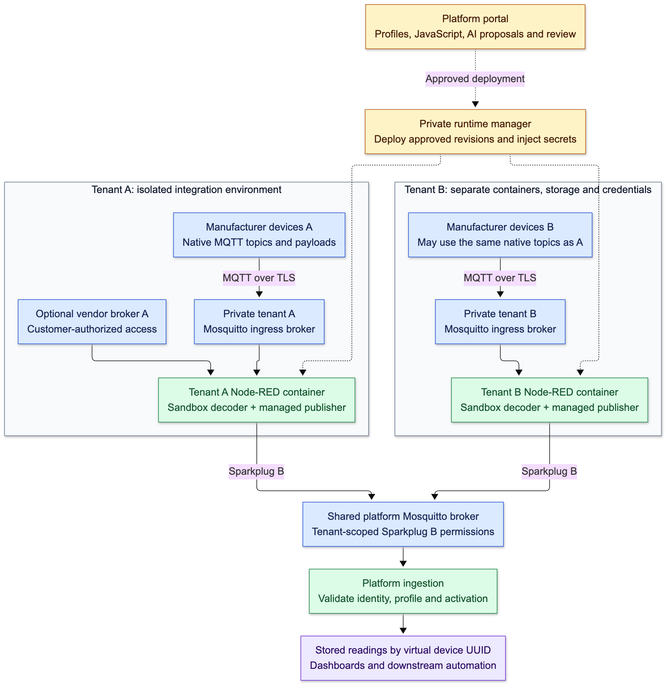
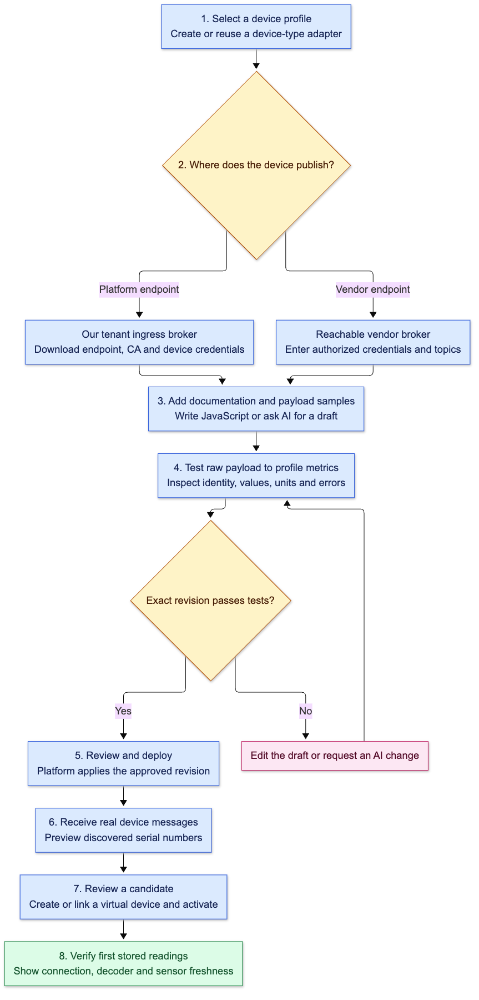
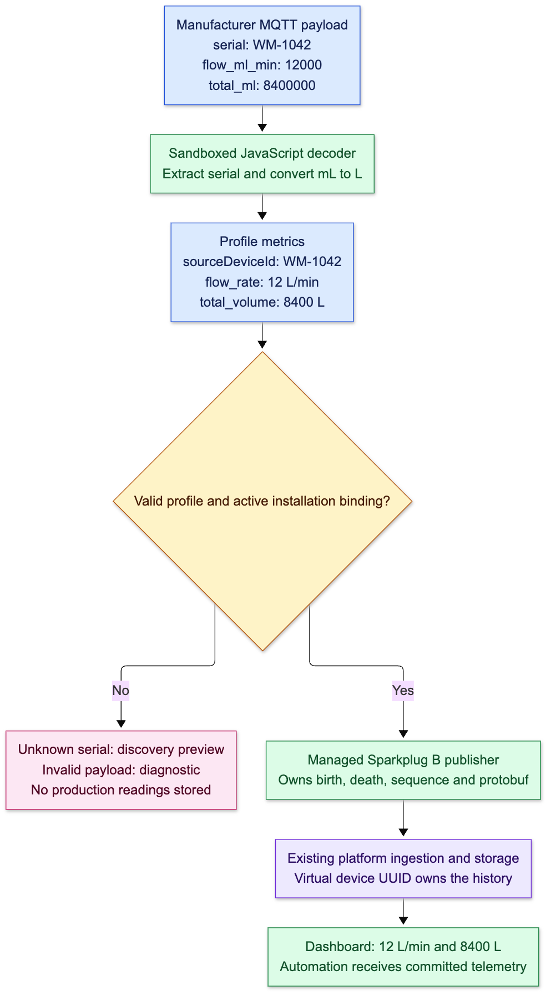

# Device adapters

Adapters connect devices that speak their manufacturer's own JSON (or bytes) instead
of Sparkplug B: devices that publish MQTT, vendor MQTT brokers, vendor clouds that push
webhooks, and vendor REST APIs the platform polls. A tenant writes a small JavaScript
decoder; the platform runs it in a sandbox and republishes the result as Sparkplug B,
so the rest of the pipeline is the normal [device path](devices.md). The isolation
model is [ADR-010](../adr/ADR-010-per-tenant-adapter-runtimes.md), amended for webhooks
by [ADR-022](../adr/ADR-022-webhook-receiver.md); later protocols follow
[ADR-023](../adr/ADR-023-protocol-connectors.md).

Code: Laravel [`Domain/DeviceAdapters`](../../apps/api/app/Domain/DeviceAdapters);
manager, webhook receiver and runtime [`services/adapters`](../../services/adapters); portal
[`src/adapters`](../../apps/portal/src/adapters). Simulators:
[`vendor_water_meter.py`, `vendor_env_sensor.py`](../dev/simulators-and-fixtures.md#vendor-mqtt-simulators-adapter-path),
and for HTTP sources `vendor_webhook_cloud.py` and `vendor_tracker_api.py`
([simulators](../dev/simulators-and-fixtures.md)). Spec: [020](../../specs/020-http-adapter-sources/spec.md).

Adapters are off unless `IOT_ADAPTERS_ENABLED=true` (the adapter Compose overlay
sets it); when off, the routes return 404 and the menu item is hidden. They appear
under **Build → Device adapters** for users with `Device.manage`.

## How it fits together



([Mermaid source](diagrams/device-integration-01-tenant-isolation.mmd))

- Each organization gets its own **Mosquitto ingress broker** (TLS, one public
  port per tenant) and **Node-RED runtime** (no public port, editor disabled),
  created by `adapter-manager`. Devices keep their fixed manufacturer topics
  without colliding with other tenants.
- An adapter's **source** is one of:
  - **Tenant broker**: devices publish to the tenant ingress broker with a downloaded
    connection kit.
  - **Vendor broker**: the adapter subscribes to a reachable vendor MQTT broker with
    credentials the customer supplies.
  - **HTTP webhook**: the vendor cloud posts to the adapter's ingest URL. The platform
    **webhook receiver** checks the secret and limits and hands the delivery to the
    tenant ingress broker on a reserved topic (`iot-os/webhook/<adapter uuid>`), which
    the adapter subscribes to. The tenant runtime still has no inbound port.
  - **HTTP polling**: the tenant runtime calls the vendor REST API on a schedule and
    resumes from a cursor.
- The generated flow runs the decoder, then a platform-owned **managed Sparkplug
  B publisher** that owns births, deaths, aliases, sequence and `bdSeq`, and
  publishes to the platform broker as group `adapters-<organization uuid>`,
  edge node `adapter-<adapter uuid>`.
- Laravel owns adapters, revisions, fixtures, credentials and discovery. It calls
  the manager's private API from the `device-adapters` queue
  (`adapter-worker`); the runtime reports back to `POST /api/internal/adapters/events`
  with a per-tenant token.

## Sources in detail

### HTTP webhook

- **Ingest URL**: `{IOT_WEBHOOK_PUBLIC_URL}/w/<identifier>`, stable for the adapter's
  life. Paths below it reach the decoder as `input.topic`. Only `POST`; bodies up to
  1 MiB after decompression (gzip, deflate, br), headers up to 16 KiB.
- **Authentication**, chosen in the source settings: **HMAC signature** (recommended:
  HMAC-SHA256 of the raw body, after decompression, in a header you name, hex or
  base64, optional prefix such as `sha256=`; with a timestamp header the signed string
  is `<timestamp>.<body>` and must be within 5 minutes), **header token** (`Bearer` or
  raw), or **URL token** (a path segment after the identifier; the weakest, for clouds
  that cannot set headers; removed before the decoder sees the path).
- **Secrets**: generated (shown once) or, for HMAC, pasted from the vendor. At most two
  are active: creating a second rotates, and the first keeps working for 7 days or
  until revoked. Revocation reaches the receiver within seconds; neither needs a new
  revision. Each change is audited with the secret's label, never its value.
- **Answers**: `202 {"delivery_id"}` once the tenant broker acknowledged the delivery;
  `401` for any authentication failure (same body); `404` unknown URL; `405`; `413`;
  `429` and `503` with `Retry-After`. Until a revision is deployed, deliveries are
  answered `202` and kept as samples (the last 20, 7 days) to turn into fixtures.
- **Limits** (operator-configurable): 10 a second per adapter with bursts of 100, 50 a
  second per organization, 30 failed authentications a minute per address (then `429`
  for 5 minutes). While the adapter's runtime is offline, at most 500 deliveries or
  32 MiB wait in its broker session; after that the receiver answers `503`.

### HTTP polling

- The request is a settings form: `GET` or `POST`, an HTTPS URL, query parameters and
  headers (and a JSON body for `POST`) with placeholders `{cursor}`, `{window_start}`,
  `{window_end}`, `{now}` and `{page_size}`; a time format (ISO 8601, epoch seconds or
  milliseconds); a page size and its parameter; where the records are (a JSON
  Pointer, empty for a top-level array); and the cursor: a **timestamp** or a
  **next-page token** read from the response by JSON Pointer, or a **time window**.
- Credentials (an API key in a header or a query parameter, a bearer token, or basic
  authentication) are stored encrypted with the revision's secrets and redacted from
  everything shown, including Fetch now and the assistant's view.
- Runs every 5 minutes by default (1 minute to 24 hours), with jitter. A run fetches
  up to 20 pages; when it reaches the limit the next run follows after 5 seconds. Each
  page becomes one batch: every record is one decoder input, results are published
  oldest first, and the cursor file is committed only after the page is settled. An
  organization makes at most 60 polling requests a minute.
- `408`, `429`, `5xx` and network errors back off from the interval to 1 hour,
  honouring `Retry-After`. `400`, `401`, `403`, `404`, a non-JSON body or a missing
  records location stop polling with the reason until a new revision is deployed or
  the person resumes it. A full page whose cursor did not move ends the run with
  **Cursor did not advance**.
- Only public addresses: every address a host resolves to must be public, the
  connection uses the address that was checked, and redirects (at most 3) are checked
  again, with credentials sent only to the original host. Pages are limited to 8 MiB
  and 5,000 records, requests to 30 seconds.
- **Fetch now** runs one request with the saved draft and credentials, shows the
  status, a redacted excerpt, the first 20 records and the next cursor, and moves
  nothing. It is limited to 6 a minute per adapter, shared with the assistant.
- The first deployment asks where the cursor starts (1 hour back by default, at most
  30 days). **Reset cursor** and **Resume** redeploy the applied revision; reset is
  audited. Records fetched again are deduplicated by `messageId`.

## User flow



([Mermaid source](diagrams/device-integration-02-onboarding.mmd))

The workbench shows a **setup checklist** above its tabs, worked out from the
adapter's saved state: device type, connect, capture samples, decoder, test and
deploy, activate devices. Each step says what is done, what it is waiting for (for
example **Waiting for the first delivery**) and opens the place to act. The **device
onboarding assistant** ([assistant](assistant.md#device-onboarding-assistant)) walks
the same steps in the workspace panel: **Ask the assistant** on the checklist, or the
header **Assistant** on any adapter page.

1. Create an adapter: pick a published profile and name the reusable device-type
   adapter.
2. Choose the source and connect it: the tenant broker; a vendor broker URL with
   credentials, CA and topic filters (passwords never go in the URL); a webhook
   (create a secret and paste the URL and secret into the vendor cloud); or a polling
   request with its credentials, checked with **Fetch now**.
3. Capture samples: webhook deliveries, Fetch now records and discovered sources can
   be added to the fixtures in one click, with the input fields the decoder will see.
4. Write the decoder, or let the onboarding assistant draft it from the samples and
   documentation. Assistant changes are proposals you apply to the draft; the
   assistant cannot deploy.
5. Test the exact revision. Only a revision that passed its test can be deployed.
6. **Deploy**. Applied status changes when the tenant runtime acknowledges the
   revision. Broker and publisher connectivity are reported separately. Pause and
   rollback to a previously tested revision are available.
7. For devices that can be pointed at a broker, create a hardware credential and
   download its kit (`device-config.json`, `ca.crt`, `quickstart.md`). Credentials
   can be rotated and revoked.
8. Activate a discovered serial number: a new device named after the serial, or an
   inactive registered one, gets every profile reading mapped and applied in one
   step. Unknown serials and retained messages stay previews; nothing is stored as
   production telemetry until a device is activated. The same **Activate** appears
   wherever the source shows up: the adapter's Devices tab, **Discovery** and
   **Add device** (which list it by serial, not by its `src-…` Sparkplug ID), and the
   onboarding assistant once serials are waiting. Adapter sources never go through
   manual mapping: the device configuration page does not offer them, and the API
   refuses them for a device not activated through the adapter, so readings always
   keep their installation and adapter revision.

Stored observations and committed events keep `installation_uuid`,
`adapter_revision_uuid` and the manufacturer serial next to the stable device
UUID, so replacing hardware later can keep the device's history.

**Delete** (the workbench's ⋯ menu, or the list's row menu) removes an adapter
nothing uses: no device was ever activated through it, and no device or onboarding
uses a source its gateway reported. Otherwise the menu says why and the API answers
409. Deleting removes the runtime first (the flow, the tenant broker identities,
the webhook route and the cursor, dedup and birth files), retires the gateway's
platform broker identity, then deletes the adapter's records and its gateway in
one transaction ([`AdapterService::delete`](../../apps/api/app/Domain/DeviceAdapters/Services/AdapterService.php)).
Presence and birth events never recreate an adapter gateway, so a death the
publisher sends while stopping cannot bring it back.

## Decoder contract

```js
function decode(input, helpers) {
  const p = input.payload;
  return {
    sourceDeviceId: p.serial,
    metrics: [
      { name: "flow_rate", value: p.flow_ml_min / 1000, unit: "L/min" },
      { name: "total_volume", value: p.total_ml / 1000, unit: "L" }
    ]
  };
}
```



([Mermaid source](diagrams/device-integration-03-water-meter.mmd))

- `input` has `payload` (parsed JSON or null), `bytes`, `payloadBase64`, `topic`,
  `receivedAt`, `retained`, `qos` and `source` (`mqtt`, `webhook` or `poll`). Webhook
  deliveries add `http` (`method`, `path`, `query`, `contentType`, `headers`,
  `deliveryId`; credentials and proxy headers removed) and use the path below the
  ingest URL as `topic`; polled records add `poll` (`page`, `index`, `count`,
  `cursor`). `helpers` provides `uint16BE` and `uint32BE`.
- Output: one result or a list of 1–500 results, each `sourceDeviceId` and `metrics`,
  plus optional `observedAt` (ISO timestamp) and `messageId`. Units must match the
  pinned profile, so device mappings use `conversion_mode: none`. Each result is
  validated alone.
- **Timestamps.** A result with `observedAt` is source-timed. Without it the readings
  are **receipt-timed** (the time the platform received the message, delivery or
  page), for every source; location bindings then report an untrusted time instead
  of a position. Return `observedAt` whenever the vendor gives one. A result older
  than the newest already published for that source is kept as history and never
  replaces the latest value; one older than the organization's telemetry retention is
  refused. `php artisan adapters:timestamp-audit` lists deployed adapters whose
  location devices are affected.
- **Deduplication.** Results with `messageId` are stored once per adapter and source
  for 7 days or the last 100,000 identifiers, across restarts and redeployments.
- **No drops.** A source acknowledges a message only after it is published or
  recorded as a failure, so a busy decoder or an unreachable platform broker leaves
  the backlog in the source broker (or the next page) instead of dropping it.
- Metric values can be numbers, safe integers, booleans or strings.
- Sandbox ([`lib/decoder.cjs`](../../services/adapters/lib/decoder.cjs),
  [`lib/decoder-worker.cjs`](../../services/adapters/lib/decoder-worker.cjs)):
  QuickJS with a fresh context per message, 100 ms execution budget (CPU time
  of the decoder's own code; creating the context and parsing the input do not
  count), 16 MiB memory, 1 MiB raw input, 64,000-character decoder. QuickJS
  cannot interrupt a single long built-in call, such as a backtracking regular
  expression, so the worker is also stopped after 500 ms of CPU time from the
  start of the decoder's code. Loading QuickJS and preparing the input may use
  at most 5 s of the worker's CPU ("Decoder setup exceeded its CPU limit"). A
  worker whose CPU time stops advancing for 30 s is stopped too ("Decoder
  worker did not start" before QuickJS loads, "Decoder worker stopped
  answering" after). No limit counts wall time, so a busy host slows decoding
  down without failing it. No host APIs, filesystem, network, secrets, modules,
  async or persistent state.
- Invalid messages produce diagnostics. Partial messages update only the metrics
  they carry. Missing values are never replaced with zero, and a decreasing
  monotonic counter needs review.

## Diagnostics

The **Activity** tab shows outcome counts for 24 hours and 7 days (accepted,
unauthenticated, stale signature, too large, rate limited, paused, broker
unavailable, decoded, decode or validation failed, duplicate, historical), the last
rejected and failed deliveries (with the decoder error and an excerpt you can add as
a fixture; bodies of unauthenticated deliveries are never kept), and for polling the
last runs with their cursor, the next run, **Reset cursor** and **Resume**. The
directory, the workbench and the device's ingestion diagnostics (and the
`get_ingestion_diagnostics` agent tool) show the source state: **Receiving**, **No
deliveries yet**, **Rejecting**, **Polling**, **Retrying** or **Stopped** with the
reason. Records are kept 7 days (`adapters:prune`, daily). The receiver exports
`iot_webhook_deliveries_total{outcome}` and `iot_webhook_handoff_seconds` on its
private port 9105.

## Running locally

Adapters need the Devices stack plus [`compose.adapters.yml`](../../deploy/compose/compose.adapters.yml)
and a private env file (keep it under `.local/`) with:

| Variable | Purpose |
| --- | --- |
| `IOT_ADAPTER_MANAGER_TOKEN` | Bearer token between API and manager; at least 32 random bytes |
| `IOT_ADAPTER_HOST_STATE_DIR` | Absolute private host directory for tenant state (mounted as `/state`) |
| `IOT_ADAPTER_DOCKER_NETWORK` | Network tenant containers join (default `iot-os-dev_internal`) |
| `IOT_ADAPTER_PUBLIC_HOST`, `IOT_ADAPTER_BIND_ADDRESS` | Hostname in kits and the interface tenant brokers bind to (`localhost` / `127.0.0.1` for simulators) |
| `IOT_ADAPTER_PORT_BASE`, `IOT_ADAPTER_PORT_LIMIT` | Tenant broker port range (default 19000–19999) |
| `IOT_WEBHOOK_PUBLIC_URL` | The webhook receiver's public address (`http://localhost:8095` locally); empty disables webhook sources |
| `IOT_WEBHOOK_RECEIVER_TOKEN` | Bearer token for the receiver's reports to the API; at least 32 random bytes |
| `IOT_ADAPTER_ALLOW_PRIVATE_BROKERS` | Development only: lets vendor brokers and polling reach private addresses, and polling use plain HTTP, for simulators |

Build `adapter-runtime-image` before starting `adapter-manager` and
`adapter-worker`, and include the adapter env file every time you rebuild the API
family ([gotchas](../dev/gotchas.md#local-stack)). The `webhook-receiver` service
mounts `${IOT_ADAPTER_HOST_STATE_DIR}/webhooks` read-only and listens on
`127.0.0.1:8095`.

Tests: `npm test --prefix services/adapters` (sandbox and flows). The integration
test (`npm run test:integration`) needs Node-RED 4.1.13 installed into
`.local/adapter-tests` and Mosquitto on `PATH` (`MOSQUITTO_BIN` to override); it
starts temporary brokers and Node-RED processes, checks both source paths and
tenant isolation, and feeds captured packets through the Go Sparkplug parser.

## Operations

In a release, adapters require the Mosquitto broker profile and pinned
`ADAPTER_MANAGER_IMAGE` and `ADAPTER_RUNTIME_IMAGE`. Tenant broker data,
encrypted flows, sequence state, certificates and keys live under
`${STATE_DIR}/device-adapters/<tenant uuid>`; backups stop the manager, worker and
tenant containers and restart only those that were running
([release](../ops/release.md)).

- Open and firewall the tenant port range before connecting real hardware.
- **Webhooks**: add a DNS record for the receiver's host (for example
  `hooks.<domain>`), set `IOT_WEBHOOK_PUBLIC_URL` and a 64-hex
  `IOT_WEBHOOK_RECEIVER_TOKEN`; the release renders a Caddy site that passes only
  `/w/*` to `webhook-receiver`. Its routing file,
  `${STATE_DIR}/device-adapters/webhooks/routes.json`, holds tenant broker passwords
  and HMAC secrets and is backed up with the rest of the adapter state.
- **Polling** needs outbound HTTPS from the tenant runtime containers to the vendor
  APIs.
- Tenant certificates last one year; renewal is manual.
- Tenant containers are recreated from the configured image on the next deploy if
  its digest changed.
- Known risks (Docker socket on the manager, tenant containers on the platform
  network) are in [ADR-010](../adr/ADR-010-per-tenant-adapter-runtimes.md).

## API and permissions

Under `/api/v1/organizations/{organization}/device-adapters`
([routes](../../apps/api/app/Domain/DeviceAdapters/routes.php)): list, create,
read, update and delete adapters; `test`, `connection-test`, `deploy`; `candidates` and
`candidates/{c}/activate`; `credentials` with `kit`, `rotate` and `revoke`;
`webhook`, `webhook/secrets` and `…/revoke`, `deliveries`; `fetch-now`, `poll-runs`,
`cursor`, `resume`; assistant `proposals` and `decision`. Reads need `Device.view`,
changes need `Device.manage`, and broker sources, webhook secrets, polling
credentials, Fetch now, cursor resets and hardware credentials also need
`Device.manage-connections`. The webhook receiver reports to
`POST /api/internal/adapters/receiver-reports` with its own token.

Not built yet: vendor command encoding (downlink), local-only brokers behind
customer firewalls, and the guided hardware replacement flow with counter
continuity ([roadmap](../roadmap.md#next)).
