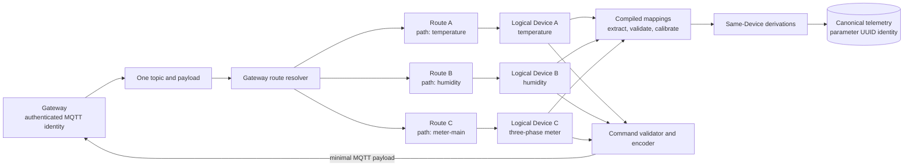

# ADR-013: Logical Devices, Stable Parameters, and Gateway Routing

**Status:** Accepted
**Date:** 2026-08-29
**Partially supersedes:** [ADR-009](./ADR-009-device-capability-and-component-model.md) and [ADR-010](./ADR-010-device-definition-versioning.md)
**Canonicalization:** [ADR-014](./ADR-014-pre-production-device-domain-canonical-cutover.md)

## Context

The first M1a implementation treated a Device Profile as a mostly static capability document with an implicit root, optional one-level components, and a Native MQTT Binding assigned directly to one Device. That model can describe a fixed temperature/humidity example, but it does not provide the authoring or runtime identity model needed by real installations.

A single authenticated hub or Gateway can publish one payload containing values for several independently managed logical Devices. Conversely, a three-phase energy meter is usually one logical Device with many measured parameters, such as three voltages, three currents, and total power. The platform must not infer logical Device identity from physical sensor packaging.

Parameters also need stable identities independent of labels, JSON keys, and Profile revisions so time-series data remains addressable when presentation metadata evolves. Calibration and derivation must be deterministic, restricted, and compiled before runtime. Command definitions need rich metadata for validation and generated controls without copying that metadata into MQTT command payloads.

## Decision

### Identity and routing

- A **Gateway** is the authenticated MQTT communication identity. Broker credentials and connection state belong to the Gateway, not to each downstream logical Device.
- A **Device** is a tenant-owned logical platform identity to which telemetry, state, Commands, alarms, and history belong. Physical composition does not determine the Device boundary.
- A **Gateway Route** links one Gateway to one Device and supplies the concrete route path or binding variables used to recognize inbound data and address outbound Commands.
- One inbound Gateway message may match several routes. Each matched route executes the compiled Binding for its target Device, allowing one payload to fan out to several logical Devices.
- A directly connected product still uses the same model: its communication identity is represented by a Gateway with a route to its logical Device. This avoids a second ingestion path.

### Device Profile

A Device Profile Version is a dynamically authored semantic blueprint containing arrays of:

- measured parameters;
- derived parameters;
- properties;
- events; and
- Commands with typed request and optional response fields.

Every measured and derived parameter has a required stable UUID. Human-readable keys and labels may change without changing time-series identity. Cloning a compatible Profile Version preserves parameter UUIDs; adding a new semantic parameter creates a new UUID; replacing the meaning of an existing parameter also requires a new UUID. A published Version remains immutable.

A parameter may include optional label, description, value type, UCUM unit, constraints, and presentation hints. Presentation hints can select generated input widgets such as a slider, number input, switch, select, segmented buttons, or text input, and display widgets such as a gauge, value card, chart, or status badge. These fields are authoring and UI metadata, not telemetry wire fields. Missing and invalid wire-value behavior is explicit on each Binding mapping.

The `critical` flag is removed. It has no deterministic runtime meaning. Telemetry presence is expressed with explicit `on_missing` behavior and invalid values with `on_invalid` behavior. For Commands, `required` means the platform must collect an input field before publishing, or expects a declared output field in a successful correlated response.

### Mappings, calibration, and derivation

- Native MQTT Binding Versions remain separate, reusable, immutable transport definitions tied to an exact Profile Version.
- A telemetry mapping targets a parameter UUID and declares its source JSONPath, conversion, `on_missing`, and `on_invalid` behavior.
- Calibration belongs to the Binding mapping because it converts manufacturer wire values into Profile semantics. Common calibration uses ordered structured operations; exceptional formulas use restricted CEL compiled by the Go compiler.
- Derived parameters are evaluated from already normalized parameters on the same Device. Dependencies are parameter UUIDs, checked for cycles, and compiled before publication.
- Cross-Device calculations are excluded from Profile derivation. A later virtual or calculated Device aggregate will own those calculations explicitly.
- Command definitions remain semantic Profile data. Separate Binding request/response mappings define publish topics, payload field placement, correlation, and response extraction.
- Labels, units, constraints, presentation hints, formulas, and `required` markers are not copied into MQTT payloads. Only values and binding-required routing or correlation fields are encoded.

### Runtime and storage identity

The compiler produces an immutable Runtime Bundle for an exact Profile Version, Binding Version, and routing contract. Every canonical telemetry value carries at least:

- `organization_uuid`;
- `gateway_uuid`;
- `device_uuid`;
- `parameter_uuid`;
- `profile_version_uuid`;
- source and received timestamps;
- typed value and quality;
- message identity; and
- Runtime Bundle hash.

TimescaleDB series identity uses `device_uuid` plus `parameter_uuid`; labels and keys remain query/display metadata. The Runtime Bundle hash makes the transformation executable and auditable.

## Consequences

- Device Profile and Command forms must use dynamic repeaters rather than fixed temperature/humidity fields.
- Gateway, Gateway Route, stable parameter identity, and route-aware assignment persistence must be added before live ingestion.
- The compiler must target parameter UUIDs, compile calibration and derivation graphs, and emit route-aware Runtime Bundles.
- ADR-014 adopts this model as the first canonical pre-production contract; the rejected fixed model has no migration or compatibility path.
- AI/MCP onboarding remains paused until canonical schemas, persistence, compiler behavior, and guided forms share the same contract.
- This ADR does not claim broker ingestion, command delivery, deployed runtime behavior, or physical-device verification.
