# ADR-014: Pre-production Device Domain Canonical Cutover

**Status:** Accepted  
**Date:** 2026-08-29  
**Supersedes:** Device Domain compatibility and migration clauses in [ADR-013](./ADR-013-logical-devices-stable-parameters-and-gateway-routing.md)

## Context

The first Device Domain implementation was rejected before production because it modeled fixed capabilities and direct Device-to-Binding assignment. The corrected design introduced dynamic parameters with stable UUIDs, Native MQTT mappings, Gateways, Gateway Routes, calibration, derivation, and route-aware Runtime Bundles under temporary `v2` names.

The application has not entered production. No external consumer or retained production data requires the rejected model, so maintaining two internal models would add ambiguity and make every later compiler, UI, ingestion, and AI/MCP class choose between obsolete and canonical behavior.

## Decision

- The corrected Gateway-routed design is the only Device Domain.
- Public JSON Schema and OpenAPI identities use `v1` because this is the first supported contract.
- Internal PHP, Go, and TypeScript names are unversioned. Version suffixes are reserved for simultaneous production implementations, not implementation history.
- The Laravel schema represents the intended fresh database directly. It contains no contract-version, identity-model, or compatibility-state columns.
- Laravel exposes one `/api/v1` Device Domain route set. There are no legacy aliases or `/api/v2` routes.
- Generated TypeScript is produced from one OpenAPI document and committed in one generated file.
- The rejected fixed Go compiler endpoint and fixed React authoring/onboarding UI are removed. Their canonical replacements are implemented in D4R3 and D4R4 respectively.
- Git history is the recovery mechanism for rejected code. Runtime compatibility code is not.
- The persistent developer database is not reset automatically. Fresh migrations and tests use disposable databases; resetting a developer database remains an explicit human action.

## Canonical boundary

[Mermaid source](../diagrams/adr-014-canonical-cutover.mmd)

## Consequences

- Existing local rows created by the rejected schema may require a deliberate local database reset before manual UI testing.
- There is no migration milestone from the rejected fixed model. D4R5 is integration, acceptance, and handoff only.
- Contract checks, API tests, generated types, and cross-language vocabulary checks all target the same canonical `v1` identities.
- D4R3 must implement the route-aware compiler before the internal compile endpoint is re-enabled.
- D4R4 must implement dynamic repeaters and onboarding against canonical Profile, Binding, Gateway, Route, and Device APIs before the tenant UI is considered complete.
- Broker ingestion, TimescaleDB writes, command delivery, deployment, and physical-device behavior remain unverified until their own milestones.

Once the product is declared production, incompatible contract or persistence changes require a new ADR with an explicit compatibility and migration policy.
