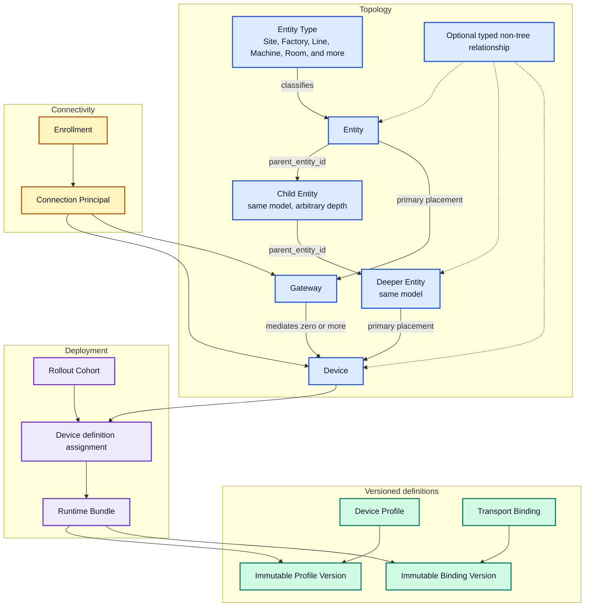
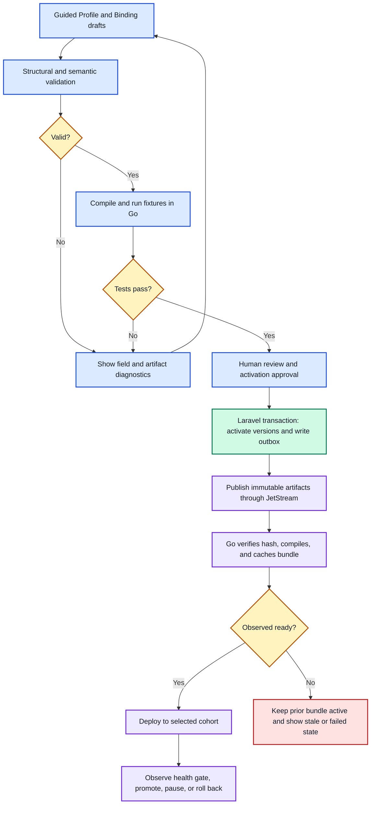
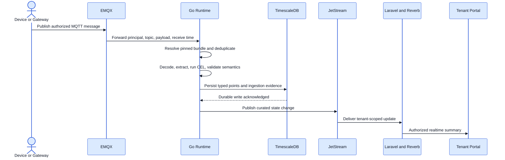
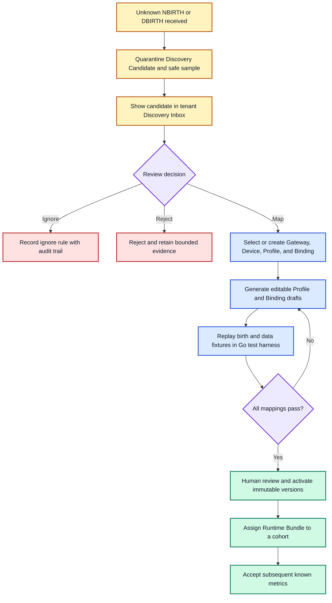
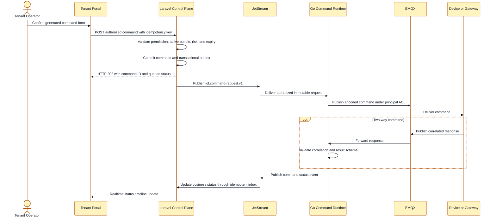

# Device Domain M1 Implementation Plan

**Status:** Draft implementation plan; domain direction agreed
**Last updated:** 2026-08-26
**Target:** First production-capable device ingestion and control vertical slices

## 1. Outcome

Build the Device Domain as the platform's governed boundary for organizing, enrolling, describing, connecting, observing, and controlling devices. The first milestone must prove two complete paths:

1. Native MQTT JSON device enrollment, telemetry, attributes, events, presence, and commands.
2. Sparkplug B 3.0 gateway discovery, reviewed mapping, telemetry, state, and commands.

The implementation is informed by the working patterns in `/Users/tharindarodrigo/Herd/iot-portal`, but it is greenfield. It must not copy the legacy coupling between semantic profile versions, protocol configuration, Laravel-side telemetry processing, and transport-specific channels.

This document plans information architecture and interaction behavior for `apps/admin` and `apps/portal`. It intentionally contains no wireframes or UI mockups.

## 2. Verified Starting Point

As of 2026-08-26:

- The administration foundation in `apps/api`, `apps/admin`, `packages/api-client`, and `packages/ui` is a separate, uncommitted checkpoint. It must be reviewed and committed before Device Domain implementation starts.
- `apps/portal` contains only a planning README and is not scaffolded.
- `services/runtime` is a health/build-information Go skeleton.
- EMQX, NATS JetStream, TimescaleDB, Redis, Node-RED, and object storage are present in the local Compose dependency profile.
- `contracts/definitions`, `contracts/events`, `contracts/ingestion`, and `contracts/openapi` are placeholders rather than executable contracts.
- Existing architecture plans already assign intent, tenancy, definitions, public APIs, and authorization to Laravel; deterministic runtime ingestion and command execution belong to Go.

Nothing in this plan is marked implemented until code, contracts, tests, and runtime evidence exist.

## 3. Decisions Locked for M1

- Use ThingsBoard-informed concepts where they help users, but do not implement ThingsBoard wire or API compatibility.
- Model tenant topology as an arbitrary-depth recursive Entity hierarchy. Every Entity has an Entity Type; Site, Building, Floor, Room, Area, Zone, Factory, Line, Machine, Warehouse, and Asset are examples rather than hard-coded tables or levels. Keep Gateways and Devices as distinct operational aggregates and give each a primary Entity placement, which may be optional during enrollment and required by Organization policy before activation.
- Separate semantic Device Profile versions from protocol-specific Transport Binding versions.
- Support Native MQTT JSON and Sparkplug B 3.0 in M1.
- Support telemetry, device events, presence, and the three attribute scopes.
- Present attribute scopes in the UI as:
  - `server` -> **Platform properties**
  - `shared` -> **Desired configuration**
  - `client` -> **Reported configuration**
- Support server-to-device Commands first. Commands may be one-way or two-way and may define persistence, expiry, retries, and an explicit response contract.
- Support X.509 enrollment through a device-generated CSR, plus MQTT access-token and basic credentials. Never receive or store a device private key.
- Use JSONPath for extraction and CEL for transformations, validation expressions, and derived values.
- Quarantine unknown Sparkplug entities as Discovery Candidates. A candidate may generate drafts, but a human must review, test, and activate them.
- Pin every Device to immutable Device Profile and Transport Binding versions through a generated Runtime Bundle.
- Roll definitions out through cohorts with visible desired versus observed runtime state and rollback to a known immutable bundle.
- Put tenant operations in `apps/portal`; put platform-owned templates and explicitly authorized cross-tenant support views in `apps/admin`.
- Use guided authoring forms with a generated artifact preview. Raw JSON Schema or artifact editing is not the primary experience.
- Retain raw payloads for failures and a configurable sample of successful messages, subject to retention and access policy.
- Implement administrator-led enrollment first. Zero-touch provisioning and a legacy `iot-portal` importer are later milestones.

## 4. Standards and Conceptual Alignment

ThingsBoard conventions are product concepts, not themselves industry standards. M1 should use the useful vocabulary while grounding interoperability in open standards.

| Concern | M1 approach | Alignment |
| --- | --- | --- |
| Device type | Versioned Device Profile | ThingsBoard-inspired concept |
| Transport settings | Separate versioned Transport Binding | Deliberate improvement over a combined profile |
| Time-series data | Typed telemetry signals | ThingsBoard-inspired concept; RFC 3339 UTC timestamps |
| Attributes | Platform, desired, and reported scopes | ThingsBoard server/shared/client model with clearer UI labels |
| Remote procedure calls | Governed Commands | ThingsBoard RPC concept with an explicit lifecycle and audit model |
| Provisioning | Enrollment plus Connection Principal | ThingsBoard-inspired provisioning concept |
| MQTT interoperability | Native JSON and Sparkplug B 3.0 | MQTT 3.1.1/5.0 and Eclipse Sparkplug specification |
| Units | Canonical unit codes | UCUM |
| Definition validation | Executable schemas | JSON Schema 2020-12 |
| Public API | Versioned REST contract | OpenAPI 3.1 |
| Trace propagation | Stable trace identifiers | W3C Trace Context |
| Device certificates | Public-key enrollment | X.509 CSR; private key remains on the device |

Contract timestamps are UTC RFC 3339 values. Contract schemas use JSON Schema 2020-12. Public APIs are described with OpenAPI 3.1. Unit definitions use UCUM codes even when the UI renders a friendlier label.

### 4.1 Herd `iot-portal` pattern disposition

| Proven pattern in `iot-portal` | M1 disposition |
| --- | --- |
| Versioned Device Profiles with active/draft behavior | Retain immutable versioning, while moving protocol configuration out of the Profile Version. |
| Profile channels and parameter definitions | Retain semantic signals, properties, events, and commands; express wire channels only in a Transport Binding. |
| Device Signal Bindings with JSON-path extraction and decoder metadata | Retain configurable extraction, replace open-ended decoder metadata with schema-governed JSONPath and restricted CEL. |
| Ingestion-message deduplication, stage diagnostics, validation outcomes, and raw snapshots | Retain the observability model; execute it in Go, keep raw data behind object references, and sample successful messages by policy. |
| Desired state, command logs, feedback reconciliation, and generated command controls | Retain the operator experience; strengthen it with explicit one-way/two-way semantics, correlation, expiry, retry, risk, and immutable policy snapshots. |
| MQTT, NATS hot state, and Laravel telemetry processing in one application | Replace with EMQX at the device edge, JetStream internally, and a Go-owned runtime/Timescale boundary. |
| Recursive Sections, configurable Section Types, and `devices.section_id` in the earlier Herd application | Retain the capability as recursive `Entity` and `EntityType` aggregates with Device/Gateway placement; strengthen cycle prevention, tenant isolation, subtree moves, and deletion safety. |
| Parent/child Devices representing hubs | Replace with distinct Gateway and Device aggregates plus explicit topology relationships. |
| X.509 provisioning/rotation actions | Retain enrollment and lifecycle UX, require device-generated CSRs, and never accept or persist private keys. |
| Filament guided authoring and browser-tested onboarding | Retain guided, testable workflows in React using shared shadcn primitives; do not reproduce the Filament information architecture. |

## 5. Scope Boundary

### In scope

- Tenant topology: recursive typed Entities, platform and tenant Entity Types, attached Gateways/Devices, and governed non-tree relationships.
- Platform and tenant Device Profiles, immutable semantic versions, validation, tests, activation, retirement, and lineage.
- Platform and tenant Transport Bindings for Native MQTT JSON and Sparkplug B 3.0.
- Device registration, administrator-led enrollment, credential issuance, rotation, revocation, and connection ACLs.
- Typed telemetry, events, presence, platform properties, desired configuration, and reported configuration.
- Server-to-device command authorization, dispatch, retries, expiry, response correlation, audit, and status.
- Sparkplug session handling and a reviewed Discovery Inbox.
- Cohort deployment, desired/observed runtime status, pause, rollback, and support diagnostics.
- Admin and tenant portal API/UI flows, including loading, empty, error, permission, stale-runtime, and responsive behavior.

### Deferred

- ThingsBoard API, SDK, topic, rule-chain, dashboard, or migration compatibility.
- Zero-touch fleet provisioning, just-in-time ownership claim, and manufacturing claim certificates.
- Legacy `iot-portal` import tooling.
- HTTP ingestion, OPC UA, CoAP, Node-RED adapter authoring, and proprietary codecs.
- OTA firmware delivery, remote shell, device-originated RPC, and bulk fleet commands.
- General rule-engine authoring, automations, alarms, dashboards, and digital-twin simulation.
- Native mobile applications and customer access to the Node-RED or EMQX administration interfaces.

## 6. Experience and Ownership Boundary

```mermaid
flowchart LR
    PlatformUser(["Platform administrator"])
    TenantUser(["Tenant operator or engineer"])

    subgraph AdminApp["apps/admin - platform scope"]
        EntityTypeCatalog["Platform Entity Type templates"]
        TemplateCatalog["Profile and binding templates"]
        TemplateUsage["Version usage and retirement"]
        SupportView["Authorized runtime support view"]
    end

    subgraph PortalApp["apps/portal - organization scope"]
        TopologyUI["Recursive Entity hierarchy and types"]
        FleetUI["Gateways, devices, and enrollment"]
        DefinitionUI["Tenant profiles and bindings"]
        OperationsUI["Telemetry, properties, events, and commands"]
        DiscoveryUI["Sparkplug Discovery Inbox"]
        RolloutUI["Cohorts and rollback"]
    end

    Laravel["Laravel control plane and public API"]
    Runtime["Go runtime"]
    Broker["EMQX and JetStream"]
    Stores[("PostgreSQL and TimescaleDB")]

    PlatformUser --> AdminApp
    TenantUser --> PortalApp
    AdminApp --> Laravel
    PortalApp --> Laravel
    Laravel --> Broker
    Broker --> Runtime
    Laravel --> Stores
    Runtime --> Stores

    classDef actor fill:#FFF3BF,stroke:#B45309,stroke-width:2px,color:#111827
    classDef experience fill:#DBEAFE,stroke:#1D4ED8,stroke-width:2px,color:#111827
    classDef control fill:#D1FAE5,stroke:#047857,stroke-width:2px,color:#111827
    classDef runtime fill:#EDE9FE,stroke:#6D28D9,stroke-width:2px,color:#111827
    classDef data fill:#E5E7EB,stroke:#374151,stroke-width:2px,color:#111827

    class PlatformUser,TenantUser actor
    class EntityTypeCatalog,TemplateCatalog,TemplateUsage,SupportView,TopologyUI,FleetUI,DefinitionUI,OperationsUI,DiscoveryUI,RolloutUI experience
    class Laravel control
    class Runtime,Broker runtime
    class Stores data
```



The admin application does not become a second tenant operations portal. A platform administrator manages reusable templates and platform health. Viewing an individual tenant's runtime data requires an explicit support permission, a selected organization, an audit reason, and read-only behavior unless a later break-glass policy is approved.

## 7. Ubiquitous Language

| Term | Meaning and invariant |
| --- | --- |
| Organization | The authorization and data-isolation boundary. Product copy may call it a tenant or customer. |
| Entity Type | A stable classification for an Entity, such as Site, Factory, Building, Floor, Room, Area, Zone, Line, Machine, Warehouse, Freezer, or Asset. Platform types are reusable defaults; an Organization may add its own types. |
| Entity | A tenant-owned topology node with one Entity Type and an optional parent Entity. The same model supports roots and descendants at arbitrary depth. |
| Entity hierarchy | The primary containment tree formed by `parent_entity_id`. Multiple roots are allowed; every parent/child pair belongs to the same Organization and cycles are forbidden. |
| Entity placement | The primary Entity to which a Gateway or Device belongs for navigation, topology context, operational rollups, and breadcrumbs. It is not an M1 authorization boundary by itself. |
| Gateway | A managed connection endpoint that represents downstream devices or a Sparkplug edge node. |
| Device | A controllable or observable endpoint. It may connect directly or through one Gateway. |
| Typed relationship | A governed non-tree link such as `monitors`, `mounted_on`, `feeds`, or `depends_on`. It supplements, but never replaces, the single-parent Entity hierarchy. |
| Device Profile | The semantic contract for telemetry signals, properties, events, and commands. It contains no broker host, topic, or protocol credential. |
| Device Profile Version | An immutable semantic artifact after activation. Semantic versions communicate compatibility; the version ID is the runtime identity. |
| Transport Binding | A protocol-specific mapping between wire messages and a Device Profile contract. |
| Transport Binding Version | An immutable Native MQTT JSON or Sparkplug mapping, extraction, transformation, and encoding artifact. |
| Runtime Bundle | The resolved immutable combination of Device, Profile Version, Binding Version, command policy, sampling policy, and connection scope that Go executes. |
| Connection Principal | The authenticated identity and publish/subscribe scope for one Device or Gateway. It contains no plaintext reusable secret in artifacts or logs. |
| Discovery Candidate | A quarantined Sparkplug group, edge node, device, or metric that is not yet trusted as production topology. |
| Rollout Cohort | A selected set of Devices receiving one Runtime Bundle revision with health gates and rollback history. |

## 8. Aggregate and Relationship Model



The three Entity nodes in the diagram are rows of the same recursive table, not different models. The hierarchy is the canonical containment structure. A Gateway or Device has one nullable primary `entity_id` in M1; additional operational links use endpoint-specific governed relationship records only when needed. The API accepts Entity Type IDs or stable keys resolved within the platform/Organization catalog, never arbitrary unvalidated type strings.

### 8.1 Entity Type model

- Seed reusable platform types such as Site, Industrial Plant, Factory, Building, Floor, Room, Area, Zone, Line, Machine, Warehouse, Freezer, Fridge, Shelves, and Asset.
- Allow an Organization to create its own Entity Types without a migration or deployment.
- Give each type a stable scope-qualified key, display name, icon, description, optional validated property schema, and lifecycle state.
- Let a platform type be used read-only or forked into an Organization-owned type. Retiring a type prevents new Entities but does not silently rewrite existing rows.
- Support optional allowed-parent rules, for example `Floor` under `Building`. With no rule, nesting remains unrestricted; configured rules are server-enforced.
- Do not infer hierarchy from type. A `Machine` can contain another typed Entity when the Organization's model requires it.

### 8.2 Entity hierarchy invariants

- `parent_entity_id` is nullable for a root and always references an Entity in the same Organization.
- An Entity cannot parent itself or any descendant. Create, reparent, and bulk-move services perform cycle checks inside a transaction.
- Multiple roots and arbitrary depth are supported, subject to a configurable safety limit that protects recursive queries and malformed imports.
- Sibling order is explicit. Breadcrumbs, ancestors, descendants, child counts, and attached Device/Gateway counts are returned by purpose-built queries rather than recursive Eloquent serialization.
- PostgreSQL adjacency-list storage is authoritative. Start with indexed recursive CTEs; decide in C1 whether expected topology size warrants a rebuildable `ltree`/materialized-path read projection.
- Reparenting preserves Entity UUIDs and Device/Gateway attachments and emits one audited subtree-moved event.
- Deletion is restricted while descendants, Gateways, Devices, dashboards, or other governed links remain. The normal lifecycle is archive, move, or detach rather than cascading destruction.
- A Device or Gateway may remain unattached during a controlled enrollment draft, but activation requires a primary Entity when Organization policy says placement is mandatory.
- M1 authorization remains Organization-scoped. Entity-subtree permissions may be added later and must not be inferred accidentally from hierarchy alone.

## 9. Laravel Domain Modules and Control-Plane Storage

Create the following module boundaries under `apps/api/app/Domain`:

| Module | Owns | Does not own |
| --- | --- | --- |
| `Topology` | Entity Types, recursive Entities, subtree operations, placement, and typed non-tree relationships | Device connections or telemetry |
| `DeviceManagement` | Gateways, Devices, lifecycle, assignments, rollout cohorts | Definition contents or transport execution |
| `DeviceProfile` | Profiles, Profile Versions, Transport Bindings, tests, activation, lineage | Secrets or per-message ingestion |
| `Connectivity` | Enrollment, Connection Principals, credential metadata, certificates, Sparkplug discovery review | Private keys or broker runtime sessions |
| `DeviceControl` | Platform properties, desired configuration intent, command authorization, business status, audit | Transport attempts and protocol acknowledgements |

### 9.1 Proposed Laravel tables

| Table group | Records and key constraints |
| --- | --- |
| Topology | `entity_types`; optional `entity_type_parent_rules`; recursive `entities` with `parent_entity_id`, `entity_type_id`, sibling order, and validated properties; `entity_relationships` for Entity-to-Entity links; `device_entity_relationships` only for secondary Device semantics beyond primary placement |
| Fleet | `gateways`; `devices`; optional primary `entity_id`; optional `gateway_id` on Devices; stable UUID; unique organization-scoped external key; lifecycle state independent of presence |
| Definitions | `device_profiles`; `device_profile_versions`; `transport_bindings`; `transport_binding_versions`; `definition_test_runs`; `definition_activations` |
| Assignment | `device_definition_assignments` with desired and observed Runtime Bundle hashes; `rollout_cohorts`; `rollout_cohort_members`; immutable history |
| Connectivity | `connection_principals`; `device_enrollments`; `device_credentials`; `device_certificates`; `sparkplug_discovery_candidates` |
| Device intent | `device_property_values` for Platform properties and Desired configuration; optimistic version number and actor metadata |
| Commands | `device_commands`; `device_command_status_events`; correlation ID, idempotency key, policy snapshot, expiry, terminal outcome |
| Reliability | Transactional `outbox_messages` and idempotent `inbox_messages`, shared infrastructure but never used to bypass a domain service |

Use UUIDs or ULIDs in public contracts. Internal numeric keys may be used only when they cannot leak across the public boundary. Every tenant-owned row carries or can unambiguously derive `organization_id`; frequently queried boundaries should carry it directly for defense in depth.

### 9.2 Definition persistence strategy

Each Profile or Binding has a mutable catalog record and immutable version records. A version stores:

- `schema_version`, semantic version, lifecycle status, creator, and timestamps.
- Canonical `definition_json` validated against its executable JSON Schema.
- SHA-256 artifact hash and optional object-storage URI.
- Parent/source version for lineage and platform-template forks.
- Validation and fixture-test summary.
- Activation and retirement metadata.

Drafts use optimistic concurrency through an ETag or revision integer. Activated versions cannot be edited. A tenant may assign an active platform template directly or fork it into a tenant-owned draft. Retirement blocks new assignments but never invalidates existing pinned Devices.

## 10. Executable Definition Contracts

Add these first-class schemas and fixtures:

| Artifact | Purpose | Proposed location |
| --- | --- | --- |
| `iot.device-profile.v1` | Semantic telemetry, properties, events, commands, types, units, constraints, risk metadata | `contracts/definitions/device-profile/v1/` |
| `iot.transport-binding.v1` | Protocol mode, topic/message maps, JSONPath extraction, CEL programs, response correlation, Sparkplug identifiers | `contracts/definitions/transport-binding/v1/` |
| `iot.device-runtime-bundle.v1` | Fully resolved, device-pinned execution snapshot | `contracts/definitions/device-runtime-bundle/v1/` |
| `iot.connection-principal.v1` | Broker identity, allowed subjects/topics, rates, credential metadata, revocation state | `contracts/definitions/connection-principal/v1/` |

### 10.1 Device Profile contents

A Profile Version defines semantic keys without transport details:

- Telemetry signals: key, type, UCUM unit, quality policy, ranges, required/optional, and display metadata.
- Platform properties: server-owned metadata visible to the Device Domain but not published by the device.
- Desired configuration: server-authored keys, validation, default, and whether a device acknowledgement is required.
- Reported configuration: device-authored keys and compatibility rules against desired values.
- Events: key, severity, stateful/stateless behavior, payload fields, and deduplication guidance.
- Commands: key, input schema, one-way/two-way mode, result schema, risk level, confirmation text, offline persistence allowance, timeout, and retry ceiling.

Display metadata may help generate forms, labels, units, and safe controls, but it cannot weaken validation or authorization.

### 10.2 Transport Binding contents

A Binding Version defines how one transport realizes a compatible Profile Version:

- Protocol mode: `native_mqtt_json` or `sparkplug_b_v3`.
- Inbound channel/message kind, topic pattern, payload size, QoS, and timestamp/sequence source.
- Semantic target key, JSONPath extraction, source type, CEL transform, CEL validation, and derived-value expressions.
- Attribute and event mappings.
- Outbound command topic/message type, payload template, value encoding, correlation strategy, acknowledgement strategy, and response mapping.
- Sparkplug group, edge-node, device, metric name/alias mapping and rebirth policy where applicable.
- References to credential and secret requirements, never secret values.
- Recorded fixtures with expected canonical output or expected failure diagnostics.

### 10.3 Validation gates

Activation requires all gates:

1. JSON Schema structure is valid.
2. Semantic keys, types, units, command modes, and lifecycle rules are valid.
3. JSONPath expressions parse and required Profile keys are covered.
4. CEL expressions compile and are type-compatible with their semantic targets.
5. Topic wildcards and connection scopes cannot escape the Organization or assigned Device/Gateway.
6. Golden success and failure fixtures pass in the Go runtime compiler/test harness.
7. A human with activation permission reviews the generated artifact and compatibility report.

Laravel performs structural, domain, tenancy, and authorization validation. Go performs the authoritative runtime compile and fixture execution. React calls Laravel only; Laravel records the test request and observed runtime result.

## 11. Definition Activation and Rollout



Activation and assignment are separate. Activating a version makes it eligible; assigning a Runtime Bundle makes it desired for a Device. Go reports the loaded bundle hash as observed state. The UI must never label a Device updated until desired and observed hashes match.

Rollback creates a new assignment to a previous immutable bundle and keeps the failed deployment history. It never edits an active artifact or erases evidence.

## 12. Canonical Runtime Contracts

Create schemas and golden fixtures for:

| Contract | Required meaning |
| --- | --- |
| `iot.telemetry.v1` | Typed signal points, observed/received time, quality, sequence, bundle version, trace context |
| `iot.attribute-update.v1` | Platform, desired, or reported scope; key/value/type; version; actor/source; timestamps |
| `iot.device-event.v1` | Event key, severity, state, payload, dedupe key, timestamps |
| `iot.presence.v1` | Connected, disconnected, stale, or unknown transition with evidence and session identity |
| `iot.command-request.v1` | Authorized command snapshot, correlation, mode, persistence, expiry, retry policy, trace context |
| `iot.command-status.v1` | Attempt and business status, protocol evidence, safe error code, response reference |
| `iot.definition-activation.v1` | Immutable artifact identity, hash, URI/payload, desired scope |
| `iot.definition-runtime-status.v1` | Loaded/rejected status, compiler diagnostics, observed hash, runtime instance |

All consumers are idempotent. JetStream messages use stable event IDs, correlation IDs, causation IDs, trace context, schema version, and explicit producer version. Organization identity comes from an authenticated principal or activated adapter context, never from an untrusted device payload.

## 13. Go Runtime Modules and Data Ownership

Keep one deployable `services/runtime` binary for M1, organized into modules:

| Package | Responsibility |
| --- | --- |
| `internal/definitions` | Consume, verify, compile, cache, and report immutable artifacts |
| `internal/principals` | Connection-principal cache and broker authorization integration |
| `internal/mqtt` | Native MQTT topic parsing, identity binding, envelope decoding |
| `internal/sparkplug` | Protobuf decode/encode, aliases, sessions, sequence, birth/death, rebirth, host state |
| `internal/ingestion` | Canonical validation, idempotency, JSONPath/CEL execution, diagnostics, routing |
| `internal/telemetry` | Typed Timescale persistence, latest values, query service, retention |
| `internal/attributes` | Reported state and desired-state delivery/reconciliation |
| `internal/presence` | Connection/session state and stale policy |
| `internal/commands` | Dispatch, persistence, retry, expiry, correlation, responses, attempts |
| `internal/runtimeapi` | Narrow internal query, compiler-test, health, readiness, and diagnostic APIs |

### 13.1 Go-owned runtime schema

| Store | Proposed records |
| --- | --- |
| TimescaleDB | `telemetry_points` hypertable with one typed value column populated; `device_events`; `presence_transitions`; time-bucket aggregates later |
| PostgreSQL runtime tables | `ingestion_messages`; `ingestion_diagnostics`; `device_attribute_state`; `device_latest_state`; `command_attempts`; `sparkplug_sessions`; `sparkplug_aliases`; stream checkpoints |
| Object storage | Encrypted raw failure payloads and sampled success payloads referenced by opaque ID |
| Redis | Bounded hot-state cache only where latency requires it; database/runtime events remain recoverable authority |

Laravel never writes these tables. Go never updates Laravel-owned definitions, authorization, assignments, or business command rows. Cross-boundary changes use JetStream events or narrowly scoped internal APIs.

Raw payload policy is configured per Organization or Binding with platform maximums. Failures retain a payload reference by default for a short governed period; successful payload capture defaults to off or sampling. Raw content is excluded from ordinary logs, list APIs, and realtime broadcasts.

## 14. Native MQTT JSON Contract

Use a stable platform topic namespace with connection-level authorization:

```text
iot/v1/devices/{device_uuid}/telemetry
iot/v1/devices/{device_uuid}/attributes/reported
iot/v1/devices/{device_uuid}/events
iot/v1/devices/{device_uuid}/presence
iot/v1/devices/{device_uuid}/attributes/desired
iot/v1/devices/{device_uuid}/commands/{command_key}/request
iot/v1/devices/{device_uuid}/commands/{command_key}/response/{correlation_id}

iot/v1/gateways/{gateway_uuid}/presence
iot/v1/gateways/{gateway_uuid}/devices/{device_uuid}/telemetry
iot/v1/gateways/{gateway_uuid}/devices/{device_uuid}/attributes/reported
iot/v1/gateways/{gateway_uuid}/devices/{device_uuid}/attributes/desired
iot/v1/gateways/{gateway_uuid}/devices/{device_uuid}/events
iot/v1/gateways/{gateway_uuid}/devices/{device_uuid}/presence
iot/v1/gateways/{gateway_uuid}/devices/{device_uuid}/commands/{command_key}/request
iot/v1/gateways/{gateway_uuid}/devices/{device_uuid}/commands/{command_key}/response/{correlation_id}
```

The exact topic grammar must become an ADR and executable authorization fixture before broker integration. A direct Device principal may publish only its uplink topics and subscribe only to its desired/command topics. A Gateway principal receives an explicit list or governed namespace for downstream Devices. Payload-supplied UUIDs cannot expand that scope.

Native payloads may already match the canonical envelope or may be mapped by a Transport Binding. The successful flow is:



An invalid or unknown message produces a structured diagnostic and, when policy permits, a raw-payload reference. It does not enter typed telemetry storage and does not silently disappear.

## 15. Sparkplug B 3.0 Boundary

Go owns the device-facing Sparkplug state machine:

- Parse `spBv1.0/{group_id}/{message_type}/{edge_node_id}[/{device_id}]` topics.
- Decode and encode Sparkplug Protobuf payloads.
- Handle `NBIRTH`, `NDEATH`, `NDATA`, `DBIRTH`, `DDEATH`, `DDATA`, `NCMD`, and `DCMD`.
- Maintain aliases, `seq`, `bdSeq`, birth certificates, rebirth requests, and host `STATE` behavior.
- Map known metrics through an activated Transport Binding into canonical signals, properties, and events.
- Treat MQTT delivery acknowledgement as transport evidence, not proof that physical action occurred.

Laravel owns Gateway registration, discovered-entity review, mappings, profile/binding drafts, activation, command permission, and audit. Sparkplug group and edge-node identifiers remain transport metadata; they do not replace the tenant Entity hierarchy, Entity Types, Gateways, or Devices.

### 15.1 Discovery workflow



Known entities may continue ingesting known metrics when an additional unknown metric appears, but that metric is quarantined until reviewed. Unknown entity identity never auto-creates production topology in M1.

## 16. Device Commands and Desired Configuration

### 16.1 Command semantics

| Concern | Required behavior |
| --- | --- |
| Authorization | Laravel authorizes Organization, Device, command key, role, risk level, and optional approval policy before creating the request. |
| Input | Generated form validates against the active Profile command schema; server validation remains authoritative. |
| One-way | Completion means the configured delivery criterion was met. It must not claim the physical action happened. |
| Two-way | Allowed only when the Binding defines correlation and a response schema. Completion requires a matching valid response. |
| Persistence | If disabled, an offline Device fails promptly. If enabled, Go may queue until expiry under bounded retry policy. |
| Retry | Only idempotent commands or definitions with an explicit idempotency strategy may retry automatically. |
| Expiry | Required for persisted commands. An expired command is terminal and cannot later be delivered. |
| Risk | `low`, `medium`, or `high`; medium/high commands require explicit confirmation copy, and high-risk execution requires a distinct permission. |
| Audit | Record actor, reason where required, Profile/Binding versions, validated input, policy snapshot, each status transition, and safe response metadata. |

Desired configuration uses the same authorization, outbox, runtime, reconciliation, and audit principles but is modeled as versioned attribute intent rather than a Command. Reported configuration never overwrites desired intent; the UI displays drift explicitly.

### 16.2 Command flow



The visible lifecycle is `requested -> queued -> dispatched -> acknowledged or response received -> succeeded`, with terminal alternatives `rejected`, `failed`, `expired`, and `cancelled`. Protocol attempts remain Go-owned evidence; the Laravel business status is the public API authority.

## 17. Public API and Realtime Surface

All browser and future mobile traffic goes through Laravel under `/api/v1`. Tenant routes use the existing Organization resource boundary and resolved organization context. Route-model binding and the `X-Organization-UUID` context must agree where both are present.

### 17.1 Tenant route groups

| Route group | Representative operations |
| --- | --- |
| `/organizations/{organization}/entity-types` | List platform defaults; create/update/retire Organization types; inspect usage and optional parent rules |
| `/organizations/{organization}/entities` | Root/child queries, create/update/archive, breadcrumb, ancestors/descendants, transactional reparent, sibling order, attached Devices/Gateways, and typed links |
| `/organizations/{organization}/gateways` | Gateway registration, detail, principal status, downstream devices |
| `/organizations/{organization}/devices` | Directory, registration, assignment, overview, lifecycle |
| `/organizations/{organization}/device-profiles` | Tenant/profile-template catalog, drafts, versions, validate, test, activate |
| `/organizations/{organization}/transport-bindings` | Native MQTT and Sparkplug mapping drafts, fixtures, activation |
| `/organizations/{organization}/enrollments` | Create, retrieve one-time material, rotate, revoke, certificate CSR |
| `/organizations/{organization}/sparkplug-discoveries` | List, inspect, ignore, reject, generate draft, map |
| `/organizations/{organization}/rollout-cohorts` | Preflight, deploy, pause, promote, rollback, desired/observed state |
| `/organizations/{organization}/devices/{device}/telemetry` | Authorized query through Laravel to Go's internal query API |
| `/organizations/{organization}/devices/{device}/properties` | Composite platform, desired, reported values and drift |
| `/organizations/{organization}/devices/{device}/events` | Device events and presence transitions |
| `/organizations/{organization}/devices/{device}/commands` | Available command schemas, submit, status, timeline, cancel if eligible |
| `/organizations/{organization}/devices/{device}/diagnostics` | Runtime status and sanitized ingestion evidence |

### 17.2 Admin route groups

| Route group | Representative operations |
| --- | --- |
| `/admin/entity-type-templates` | Platform Entity Type defaults, optional property schemas/parent rules, usage, and retirement |
| `/admin/device-profile-templates` | Platform template catalog, drafts, versions, validate, test, activate, retire |
| `/admin/transport-binding-templates` | Platform Native MQTT/Sparkplug binding templates and fixtures |
| `/admin/device-definition-usage` | Version lineage, adoption counts, assignment health, retirement blockers |
| `/admin/device-runtime-support` | Explicitly authorized, audited, read-only cross-tenant runtime summaries |

OpenAPI is the source for a generated `packages/api-client`. Handwritten feature-specific fetch types must not become a second contract. CI rejects OpenAPI/client drift.

### 17.3 Realtime

- Initial screen state comes from an authorized REST snapshot.
- Go publishes curated state changes to JetStream; Laravel authorizes and broadcasts through Reverb.
- Realtime events carry stable contract versions and resource IDs, not full raw payloads.
- Clients refetch after reconnect, sequence gaps, bundle changes, or authorization-context changes.
- High-rate telemetry charts query bounded time windows; raw telemetry is not streamed through Laravel.

## 18. Authorization Model

Implement typed enum permissions and test every positive path with cross-Organization and denied cases.

| Persona | Default capabilities |
| --- | --- |
| Platform Super Admin | Manage platform templates and permissions; support access remains audited rather than implicit UI navigation |
| Platform Template Manager | Manage platform Entity Type defaults and author, test, activate, and retire Profile/Binding templates; see aggregate usage |
| Platform Support Viewer | Read authorized tenant runtime summaries after selecting tenant and reason; no commands or tenant edits |
| Organization Owner | Manage all tenant Device Domain resources, custom Entity Types, hierarchy policy, and role assignments |
| Device Manager | Manage Entities and placements; register Devices/Gateways, enroll, rotate credentials, assign active versions, and manage cohorts |
| Integration Engineer | Author/test tenant Profiles and Bindings, review Sparkplug discovery, inspect sanitized diagnostics |
| Operator | View operations and run explicitly allowed Commands; no definition or credential changes |
| Viewer | Read permitted topology and operational state only |

Separate permissions are required for managing Entity Types, reparenting/archiving Entities, moving Device/Gateway placement, viewing raw payload samples, issuing/rotating credentials, activating definitions, executing high-risk commands, and cross-tenant support. Hiding a UI action is not authorization; every Laravel endpoint and internal Go request validates scope.

## 19. Admin Application Information Architecture

Add **Topology Templates** and **Device Templates** navigation groups to `apps/admin` after the administration checkpoint is complete.

| Route | User outcome | Primary actions |
| --- | --- | --- |
| `/topology-templates/entity-types` | Maintain reusable Entity Type defaults without fixing tenant hierarchy depth | Search/filter; create or edit metadata/rules; inspect usage; retire safely |
| `/device-templates/profiles` | Find platform Profile templates and active versions | Search/filter; create draft; fork version; inspect status |
| `/device-templates/profiles/:profileId/versions/:versionId` | Author and prove one semantic version | Guided sections for signals, properties, events, commands; artifact preview; validate; fixtures; activate |
| `/device-templates/bindings` | Find Native MQTT/Sparkplug Binding templates | Search/filter; create; inspect compatibility and status |
| `/device-templates/bindings/:bindingId/versions/:versionId` | Map and test one transport version | Topic/message mapping; JSONPath/CEL; sample replay; generated artifact; activate |
| `/device-templates/usage` | Understand adoption and safely retire versions | Lineage; tenant/device counts; desired/observed health; retire eligibility |
| `/device-runtime-support` | Diagnose platform-wide runtime incidents when authorized | Tenant selector; fleet health; activation failures; safe trace lookup; read-only deep link |

Entity Type templates classify topology and do not deploy to Go. Their UI emphasizes stable keys, optional parent/property rules, tenant forks, usage, and safe retirement.

Admin templates are reusable, not automatically deployed. The version editor must clearly separate **Save draft**, **Validate**, **Run fixtures**, and **Activate**. Activation is never implied by saving.

## 20. Tenant Portal Information Architecture

Scaffold `apps/portal` on the existing React/Vite/shared-shadcn foundation. Use the same Sanctum session and Organization selector contract as the admin application, but create a tenant-oriented navigation model.

| Navigation group | Routes and purpose |
| --- | --- |
| Topology | `/entities`, `/entity-types`; recursive hierarchy, type catalog, placement, breadcrumbs, and non-tree links |
| Operations | `/devices`; attention, presence, recent events, and operational state organized by Entity subtree |
| Connectivity | `/gateways`, `/enrollment`, `/sparkplug/discovery`; connection identity and onboarding workflows |
| Definitions | `/profiles`, `/transport-bindings`; tenant and read-only platform templates, authoring, tests, activation |
| Deployments | `/rollouts`; cohort preflight, desired/observed progress, pause, promotion, rollback |

### 20.1 Major tenant screens

| Route | User outcome | Primary actions |
| --- | --- | --- |
| `/entities` | Navigate any-depth tenant topology without assuming fixed levels | Browse roots/children; search by name/type/path; create child/root; reparent/archive; inspect rollup health |
| `/entities/:entityId` | Understand one Entity in context | Show breadcrumb, type/properties, parent/children, attached Gateways/Devices, relationships, and recent operational state |
| `/entity-types` | Extend the tenant vocabulary beyond platform defaults | Browse platform/tenant types; create or fork type; configure optional parent/property rules; inspect usage; retire |
| `/gateways` and `/gateways/:gatewayId` | Operate direct and Sparkplug gateway connections | Register; enroll; rotate/revoke; inspect sessions/downstream Devices |
| `/devices` | Find Devices by Entity subtree/type/path, Gateway, profile, presence, or rollout state | Search/filter; register; move primary placement; select cohort-safe bulk assignment only |
| `/devices/new` | Register and enroll a Device safely | Choose primary Entity and optional Gateway; Profile/Binding versions; credential mode; verify connection |
| `/devices/:deviceId` | See identity, presence, active bundle, latest values, drift, events, and attention | Navigate detail tabs; edit allowed metadata; start safe tasks |
| `/devices/:deviceId/telemetry` | Inspect bounded time-series and event history | Choose signals/range; quality overlays; export later; inspect gap diagnostics |
| `/devices/:deviceId/properties` | Compare Platform properties, Desired configuration, and Reported configuration | Edit allowed intent; detect drift; review acknowledgement |
| `/devices/:deviceId/commands` | Run allowed schema-generated Commands and follow outcomes | Confirm; submit with idempotency; view timeline/result; cancel queued request |
| `/devices/:deviceId/connectivity` | Diagnose identity, principal, sessions, and bundle state | Rotate/revoke credentials; view safe topic ACL; reconnect guidance |
| `/devices/:deviceId/diagnostics` | Explain ingestion or runtime failures without broker/database access | Trace lookup; sanitized stages; sampled payload access with extra permission |
| `/profiles` and version detail | Select a platform template or author tenant semantics | Guided authoring; preview; validate; test; activate; fork |
| `/transport-bindings` and version detail | Map Native MQTT/Sparkplug payloads to semantics | Guided mapping; JSONPath/CEL; fixture replay; activate |
| `/sparkplug/discovery` | Turn quarantined births/metrics into reviewed drafts | Group candidates; map/ignore/reject; replay; activate |
| `/rollouts` and `/rollouts/:rolloutId` | Safely deploy a bundle to a cohort | Preflight; start; observe; pause; promote; rollback |

The Device detail is the operational hub. It composes authorized data from Laravel and Go but preserves ownership: metadata and desired state are control-plane records; telemetry, reported state, presence, and attempts are runtime records.

## 21. UI State Contract

Every major admin and portal route implements all six states below. A route is not complete when only the populated desktop state works.

| Code | Required behavior |
| --- | --- |
| `L` Loading | Preserve application chrome and route context; use structural skeletons for lists/cards/tabs; disable mutations; avoid layout shift. |
| `E` Empty | Explain why no records exist and present the next permitted action. View-only users receive explanatory copy without a dead create button. |
| `X` Error | Show a safe message, trace ID, and retry. Preserve unsaved drafts locally where safe. Never render secrets, raw payloads, or another tenant's identifiers. |
| `P` Permission denied | Use a deliberate 403 state and do not disclose resource existence. Hide unavailable navigation/actions, while the API remains authoritative. |
| `R` Runtime stale | Show desired versus observed version/hash, last report time, impact, and permitted recovery. Disable commands or rollout promotion when safety cannot be established. |
| `M` Mobile/responsive | Work at 360 CSS px; stack filters/actions; turn dense rows into labeled cards or deliberate horizontal regions; use full-height sheets for long forms; preserve keyboard/focus behavior. |

### 21.1 Admin screen-state matrix

| Screen | L | E | X | P | R | M |
| --- | --- | --- | --- | --- | --- | --- |
| Entity Type templates | Catalog skeleton | Explain seeded defaults and create permission | Preserve filters and unsaved metadata/rules | No usage or tenant-type leakage | Show usage/retirement blockers rather than runtime state | Rows become labeled cards; parent/property rules stack |
| Profile templates | Catalog skeleton | Explain first template and create permission | Retry catalog; preserve filters | No catalog metadata leakage | Badge versions with failed runtime compile | Template rows become labeled cards |
| Profile version editor | Section and artifact skeleton | New draft starts guided required sections | Preserve draft; field and artifact diagnostics | Read-only active version or 403 | Activation blocked until observed compiler result | Single-column sections; artifact preview in full-height sheet |
| Binding templates/editor | Mapping skeleton | Protocol choice starts first draft | Keep sample and mappings; safe compiler trace | No secret requirement disclosure | Show compiler/runtime mismatch and keep prior version | Mapping rows stack; samples use scrollable code region |
| Usage and retirement | Aggregate skeleton | Explain no adoption or no eligible versions | Retry counts without guessing | Aggregate-only or 403 based permission | Surface tenant cohorts not converged | Summary cards before detailed table |
| Runtime support | Fleet-health skeleton | Explain no authorized tenant selection/incidents | Safe trace and retry | Require support role, tenant selection, and reason | Staleness is primary incident signal | Read-only cards; no tiny dense command controls |

### 21.2 Tenant screen-state matrix

| Screen | L | E | X | P | R | M |
| --- | --- | --- | --- | --- | --- | --- |
| Entity hierarchy/detail | Tree/list/detail skeleton | Guide creation of the first root Entity or clearing filters | Preserve path, expansion state, filters, and safe edits | Do not reveal topology names, paths, or counts | Mark Device/Gateway rollups derived from stale runtime | Tree becomes breadcrumb-driven drill-in cards; create/move forms stack |
| Entity Types | Catalog skeleton | Explain platform defaults and first custom type | Preserve filters and unsaved metadata/rules | Hide unavailable tenant/platform type details | Show usage/retirement blockers rather than runtime status | Type rows become labeled cards; rule editor stacks |
| Gateways | Directory/detail skeleton | Register first Gateway | Retry session/principal separately | Hide credential operations | Show last session and loaded bundle mismatch | Gateway rows become status cards |
| Devices directory | Filter and row skeleton | Register first Device or clear filters | Keep filters; safe trace | No Device-count leakage | Dedicated rollout/presence badges | Cards show name, location, presence, attention first |
| Enrollment | Step skeleton | Not applicable after route entry; explain missing prerequisites | Preserve non-secret choices; never restore expired secret | Credential permission required | Verification waits for observed connection/bundle | One step per view; download/copy actions remain reachable |
| Device overview | Identity and latest-state skeleton | Explain no telemetry/events yet | Isolate failed panels and allow retry | Generic 403/404 boundary | Persistent banner with command safety effect | Priority status first; tabs scroll accessibly |
| Telemetry/events | Chart and event skeleton | Explain no points in range versus never seen | Retry bounded query; show gap/trace | Hide signal names | Mark range or latest values as stale | Responsive chart with minimum readable width and accessible table fallback |
| Properties | Scope-group skeleton | Explain no definitions for a scope | Preserve desired edits; reconcile on retry | Edit controls depend on scope permission | Highlight desired/reported drift and last acknowledgement | Scope groups become accordions; values stay labeled |
| Commands | Form/history skeleton | Explain Profile has no allowed commands | Preserve safe input; no blind resubmit | Hide command schema if unauthorized | Disable unsafe execution; explain required recovery | Form is single column; confirmation uses full-height sheet |
| Connectivity/diagnostics | Independent panel skeletons | Explain no session or diagnostic records | Panel retry plus trace | Raw payload and credential actions separately guarded | Show principal/bundle/session ages | Code/topic values scroll; actions stack |
| Profile/Binding catalogs | Catalog skeleton | Create or adopt a platform template | Preserve search and draft state | Read-only template or 403 | Deployment eligibility badge | Cards and stacked filters |
| Version authoring/test | Guided-section skeleton | New draft guidance | Preserve sample, CEL, and field errors | Read-only active version or 403 | Activation/assignment blocked | Sections stack; artifact/sample viewers use sheets |
| Sparkplug Discovery Inbox | Grouped candidate skeleton | Explain how a birth creates candidates | Preserve review selection; safe replay trace | Hide candidate identifiers | Show candidate age and session staleness | Candidate groups become expandable cards |
| Rollout cohorts | Progress skeleton | Create first cohort after active bundle exists | Preserve cohort selection; allow retry/pause | Promotion and rollback separately guarded | Desired/observed mismatch is central status | Progress steps/cards replace wide matrix |

### 21.3 Guided authoring rules

- Start from intent: semantic signal/property/event/command first, transport mapping second.
- Show validation next to the field and in one aggregated compatibility report.
- Always expose a read-only generated artifact preview and artifact hash before activation.
- Provide recorded input, expected canonical output, actual output, and safe diff for fixtures.
- CEL is entered in a focused expression editor with available variables and inferred result type; the primary form is not a raw JSON editor.
- Active versions render read-only with **Create new draft from this version**.
- AI-assisted drafts, when added later, follow the identical validation, fixture, review, activation, and audit path.

## 22. Enrollment and Credential UX

Administrator-led enrollment is a resumable workflow except for one-time secret display:

1. Select or create the primary Entity at any hierarchy depth, choose a Gateway if applicable, and define Device identity.
2. Pin an active Profile Version and compatible Binding Version.
3. Choose access token, MQTT basic, or X.509 CSR.
4. Generate a one-time token/password or submit a CSR. The secret is displayed/downloaded once; X.509 returns the signed certificate and chain only.
5. Show the exact principal identity, allowed topic shape, broker TLS endpoint, expiry, and rotation instructions.
6. Wait for EMQX connection, Go principal recognition, and matching observed Runtime Bundle.
7. Mark enrollment verified only when connection and bundle evidence agree.

If the user leaves before copying a token/password, the platform revokes that material and requires rotation; it does not reveal it again. Certificate fingerprints, public certificates, expiry, revocation, and audit metadata may be stored. Private keys may not.

## 23. Security and Safety Requirements

- Derive Organization and Device/Gateway scope from the authenticated Connection Principal.
- Reject topic/payload identity mismatch before mapping or persistence.
- Store access-token/basic credential verification material using the selected EMQX-compatible one-way strategy; display plaintext once only.
- Keep secrets out of definition artifacts, events, fixtures, traces, raw-payload samples, and browser persistence.
- Support credential overlap during bounded rotation, immediate revocation, certificate expiry alerts, and audit.
- Enforce principal-specific publish/subscribe ACLs and ingress size/rate limits at EMQX and runtime boundaries.
- Validate all CEL programs in a restricted, deterministic environment with execution limits and no I/O.
- Treat raw payloads and command responses as potentially sensitive; encrypt, redact, authorize, audit access, and expire them.
- Require explicit confirmation for medium/high-risk Commands and a separate permission for high-risk execution.
- Never infer command success from MQTT PUBACK alone.
- Pass tenant scope to Go in signed internal claims or an equivalently authenticated internal request, and enforce it again in Go query APIs.

An ADR in the contracts checkpoint must select the EMQX authentication/authorization integration: either broker HTTP hooks backed by the Go principal cache or broker-native credential materialization. It must avoid a synchronous Laravel call for every MQTT message and define new-connection behavior during control-plane/runtime outages.

## 24. Operability and Support

### Required metrics

- MQTT connections accepted/rejected by principal and safe reason code.
- Messages received, accepted, duplicate, quarantined, validation-failed, persisted, and delayed by protocol/binding version.
- JSONPath/CEL compile and execution failures.
- Sparkplug sessions, birth age, alias errors, sequence gaps, rebirth requests, and discovery backlog.
- Definition desired/observed convergence and compile failures.
- Telemetry persistence latency and JetStream consumer lag.
- Commands queued, dispatched, retried, expired, failed, and response latency.
- Raw-payload capture volume, retention deletions, and denied access.

### Required diagnostics

- Stable trace from broker receipt through runtime persistence and curated UI update.
- Runtime Bundle ID/hash on every ingestion diagnostic and command attempt.
- Safe error taxonomy with stage, code, retryability, and operator guidance.
- Health/readiness checks for principal cache, definition cache, broker, JetStream, TimescaleDB, and object storage.
- Support UI and APIs that explain failures without direct database, broker, or container access.

Do not lock production SLOs without a measured load envelope. During the contracts checkpoint, record the M1 test envelope for device count, message rate, payload size, signal count, command concurrency, and retention. Load-test results become evidence for initial SLOs rather than assumptions in this plan.

## 25. Delivery Checkpoints

Each checkpoint is independently reviewable. Do not mix the existing administration diff with Device Domain commits.

```mermaid
flowchart LR
    C0["C0 - Commit administration foundation"] --> C1["C1 - ADRs and executable contracts"]
    C1 --> C2["C2 - Laravel domain foundation"]
    C2 --> C3["C3 - Portal and authoring foundation"]
    C3 --> C4["C4 - Native MQTT vertical slice"]
    C4 --> C5["C5 - Sparkplug vertical slice"]
    C4 --> C6["C6 - Cohort rollout and hardening"]
    C5 --> C6
    C6 --> Ready(["M1 production-capable boundary"])

    classDef checkpoint fill:#DBEAFE,stroke:#1D4ED8,stroke-width:2px,color:#111827
    classDef runtime fill:#EDE9FE,stroke:#6D28D9,stroke-width:2px,color:#111827
    classDef startEnd fill:#D1FAE5,stroke:#047857,stroke-width:2px,color:#111827

    class C0,C1,C2,C3 checkpoint
    class C4,C5,C6 runtime
    class Ready startEnd
```



### C0 - Administration checkpoint

**Deliver:** Review, test, and commit the existing administration API/UI foundation as its own scope.

**Exit evidence:** Explicit staged paths, API tests, TypeScript/build, browser tests, and clean review of the staged diff. Device Domain work has not started in that commit.

### C1 - ADRs and executable contracts

**Deliver:**

- ADRs for recursive Entity/Entity Type topology and query strategy, domain vocabulary/profile-binding split, Native MQTT topics, EMQX principal integration, command lifecycle, runtime storage/raw retention, and Sparkplug discovery.
- JSON Schemas for four definitions and eight canonical event types.
- Golden valid/invalid fixtures and compatibility rules.
- Initial OpenAPI groups and generated-client pipeline.
- Go contract-validation harness shared through fixtures, not imported Laravel code.
- Measured M1 load-envelope specification.

**Exit evidence:** Schemas validate all fixtures; Laravel and Go contract tests agree; Mermaid/plan docs and ADRs reviewed; no runtime feature is claimed.

### C2 - Laravel domain foundation

**Deliver:**

- `Topology`, `DeviceManagement`, `DeviceProfile`, `Connectivity`, and `DeviceControl` modules.
- Recursive Entity/Entity Type aggregates, hierarchy query/reparent services, primary Device/Gateway placement, optional parent rules, and safe archive behavior.
- Migrations, aggregates, policies, typed permissions, API resources, requests, services, and route groups.
- Draft/version/validation/test/activation state machines and transactional outbox/inbox.
- Organization isolation and platform-template lineage.
- Runtime Bundle generation and assignment history.

**Exit evidence:** Unit/feature tests include successful and denied/cross-tenant cases, recursive hierarchy traversal, cycle/cross-tenant-parent rejection, transactional subtree moves, deletion restrictions, immutable active-version enforcement, optimistic draft conflict, outbox atomicity, and rollback-safe migrations.

### C3 - Portal and authoring foundation

**Deliver:**

- Scaffold `apps/portal` with Sanctum auth, Organization context, shared UI, route guards, query/error conventions, and Reverb reconnect behavior.
- Entity hierarchy/type management, Device/Gateway directories and placement, template catalogs, guided draft editors, fixture results, artifact preview, and enrollment shell.
- Admin Entity Type/Profile/Binding template routes and version usage views.
- Generated `packages/api-client` adoption for the new route groups.

**Exit evidence:** Browser tests cover arbitrary-depth navigation, create-child/reparent/archive/attach workflows, role differences, tenant switching, loading/empty/error/403 states, draft preservation, keyboard/focus behavior, and 360 px plus desktop layouts.

### C4 - Native MQTT JSON vertical slice

**Deliver:**

- Connection Principal activation and selected EMQX auth/ACL integration.
- Access token/basic/X.509 CSR enrollment and rotation.
- Go definition compiler/cache, MQTT topic parser, ingestion, typed persistence, raw failure references, query API, and curated realtime update.
- Telemetry, events, reported properties, desired properties, presence, and one-way/two-way Commands.
- Device overview, telemetry, properties, command timeline, connectivity, and diagnostics screens.

**Exit evidence:** A real simulator/device connects through MQTTS, publishes mapped data, appears in the authorized portal, receives a command, returns a correlated response, survives duplicate delivery, and exposes safe failure diagnostics. A foreign principal/topic and cross-tenant API query are denied.

### C5 - Sparkplug B vertical slice

**Deliver:**

- Sparkplug B 3.0 session state, aliases, sequence, `bdSeq`, birth/death, data, command encoding, rebirth, and host state.
- Quarantined discovery persistence and Discovery Inbox.
- Draft generation, fixture replay, reviewed mapping, activation, and assignment.
- Gateway and downstream Device operational views.

**Exit evidence:** Recorded and live Sparkplug fixtures cover NBIRTH/DBIRTH/data/death, aliases, sequence errors, rebirth, unknown entity/metric quarantine, reviewed activation, and an allowed command. Unknown entities do not create production Devices or typed telemetry.

### C6 - Cohort rollout and hardening

**Deliver:**

- Preflight compatibility, cohort selection, deployment progress, health observation, pause, promotion, and rollback.
- Desired/observed stale-runtime behavior across APIs and all affected UI actions.
- Retention jobs, credential expiry alerts, metrics, traces, dashboards, runbooks, load tests, backup/restore checks, and failure drills.
- Production configuration documentation for TLS, secrets, broker ACLs, object-storage encryption, and service networking.

**Exit evidence:** Canary deployment and rollback are demonstrated without editing artifacts; runtime restart rebuilds caches; temporary Laravel, JetStream, broker, TimescaleDB, and object-storage failures have deliberate tested behavior; initial SLOs are based on load evidence.

## 26. Test Strategy

| Layer | Required tests |
| --- | --- |
| Contract | JSON Schema valid/invalid fixtures; OpenAPI drift; Laravel/Go golden parity; forward-compatible additive fields |
| Laravel unit/domain | Entity cycle/parent/type invariants, subtree moves, placement, aggregate invariants, version immutability, compatibility, permission decisions, state transitions, retention policy |
| Laravel feature | Recursive Entity queries, cross-tenant parent/placement denial, archive/delete restrictions, CRUD/API status codes, platform-template access, 403/404 behavior, outbox/inbox idempotency, command authorization |
| Go unit | Topic parsing, principal scope, JSONPath extraction, CEL compile/evaluate limits, typed conversion, idempotency, command expiry/retry |
| Sparkplug | Protobuf fixtures, aliases, `seq`, `bdSeq`, birth/death ordering, rebirth, host state, NCMD/DCMD, discovery quarantine |
| Integration | EMQX -> Go -> TimescaleDB -> Laravel query -> Portal; Laravel outbox -> JetStream -> Go -> EMQX -> response -> Laravel |
| Browser | Admin Entity Type and definition-template lifecycles; tenant recursive topology/enrollment/operation/discovery/rollout; all UI state contracts; keyboard and responsive behavior |
| Security | Cross-tenant route/header mismatch, topic spoofing, revoked/expired credentials, raw-payload permission, secret/log scanning, CEL limits |
| Reliability | JetStream redelivery, duplicate MQTT message, process restart, stale definition cache, offline persistent command, expiry, rollback |
| Performance | Deep/wide Entity-tree queries and moves, agreed M1 device load envelope, persistence/query latency, command concurrency, discovery bursts, browser large-directory behavior |

Tests use sanitized deterministic fixtures. No production credentials, certificates, tenant data, or unredacted raw payloads enter the repository.

## 27. M1 Acceptance Criteria

M1 is complete only when all of the following are evidenced:

- A tenant user can create platform-provided and custom Entity Types, model at least four recursive levels without a fixed Site/Area/Asset sequence, reparent a subtree safely, attach a Gateway or Device at any level, and cannot access or select another Organization's Entities.
- A platform administrator can publish a reusable Profile/Binding template without operating tenant Devices.
- A tenant engineer can use or fork a platform template, author guided semantic and transport versions, inspect the generated artifacts, run fixtures, and activate immutable versions.
- A Device pins exact Profile and Binding version IDs through a Runtime Bundle; desired and observed runtime state are visible.
- Native MQTT JSON supports telemetry, events, reported configuration, desired configuration, presence, and typed persistence end to end.
- Sparkplug B supports required birth/death/data/session behavior and quarantines unknown entities/metrics for review.
- Access-token/basic enrollment and X.509 CSR enrollment work; private keys are never sent to or stored by the platform.
- A permitted operator can send one-way and supported two-way Commands, follow the lifecycle, and distinguish transport acknowledgement from device response.
- Persistent commands respect retry and expiry; unsafe or stale-runtime execution is blocked with a clear reason.
- Cohort deployment, pause, promotion, and rollback preserve immutable history and keep the previous bundle available.
- Invalid, duplicate, unauthorized, and unmapped messages create deliberate safe outcomes rather than silent loss or corrupt telemetry.
- Admin and tenant screens meet the loading, empty, error, permission, stale-runtime, responsive, keyboard, and accessible-name requirements.
- Contracts, tests, metrics, traces, diagnostics, retention, and runbooks satisfy the repository Definition of Done.

## 28. Risks and Decisions to Close in C1

| Decision/risk | Required resolution before implementation |
| --- | --- |
| Entity hierarchy query strategy | Confirm recursive CTE-only versus a rebuildable `ltree`/materialized-path projection using representative depth, breadth, search, and move fixtures. |
| Entity Type governance | Confirm platform-default versus tenant-fork behavior, stable keys, optional property schemas, parent-rule enforcement, retirement, and import mapping. |
| EMQX credential integration | Choose HTTP auth/authz versus credential materialization; test revocation, cache outage, and principal-scale behavior. |
| MQTT protocol level | Confirm required MQTT 3.1.1 and 5.0 features and downgrade behavior. |
| JSONPath implementation | Select a standards-compatible Go library and define the supported subset with fixtures. |
| CEL environment | Define variables, functions, type rules, cost/time limits, error taxonomy, and version pinning. |
| Sparkplug library | Select or implement a library only after fixture coverage proves aliases, sequence, birth/death, and command behavior. |
| Runtime query API | Define authenticated internal transport, tenant-scope claim, pagination/downsampling, and timeout behavior. |
| Attribute conflict model | Finalize desired/reported version and acknowledgement rules, including devices that cannot carry correlation IDs. |
| Raw retention | Set platform maximums, tenant configurability, encryption, deletion proof, and support-access audit. |
| Performance envelope | Record realistic device/message/signal/payload/command targets before committing SLOs. |
| Platform-template visibility | Confirm whether aggregate usage is sufficient by default and define audited tenant-identifying support access. |

These are bounded design decisions, not reasons to expand M1 into adapters, automations, dashboards, or a legacy migration.

## 29. Expected Repository Shape

```text
apps/api/app/Domain/
  Topology/
  DeviceManagement/
  DeviceProfile/
  Connectivity/
  DeviceControl/

apps/portal/src/
  auth/
  layout/
  features/entities/
  features/entity-types/
  features/gateways/
  features/devices/
  features/device-profiles/
  features/transport-bindings/
  features/sparkplug-discovery/
  features/rollouts/

apps/admin/src/features/
  entity-type-templates/
  device-profile-templates/
  transport-binding-templates/
  device-definition-usage/
  device-runtime-support/

services/runtime/internal/
  definitions/
  principals/
  mqtt/
  sparkplug/
  ingestion/
  telemetry/
  attributes/
  presence/
  commands/
  runtimeapi/

contracts/
  definitions/
  events/
  ingestion/
  openapi/
  fixtures/
```

Shared `packages/ui` owns reusable accessible primitives and presentation patterns. Device-specific domain behavior remains in the owning application feature. `packages/api-client` is generated from OpenAPI and contains transport types/client behavior, not business rules.

## 30. Immediate Next Action

Finish and commit C0, then implement C1 as a documentation/contracts-only checkpoint. Do not begin Device tables or portal screens until the MQTT identity, profile-binding boundary, command lifecycle, and executable contract schemas have passed review.
