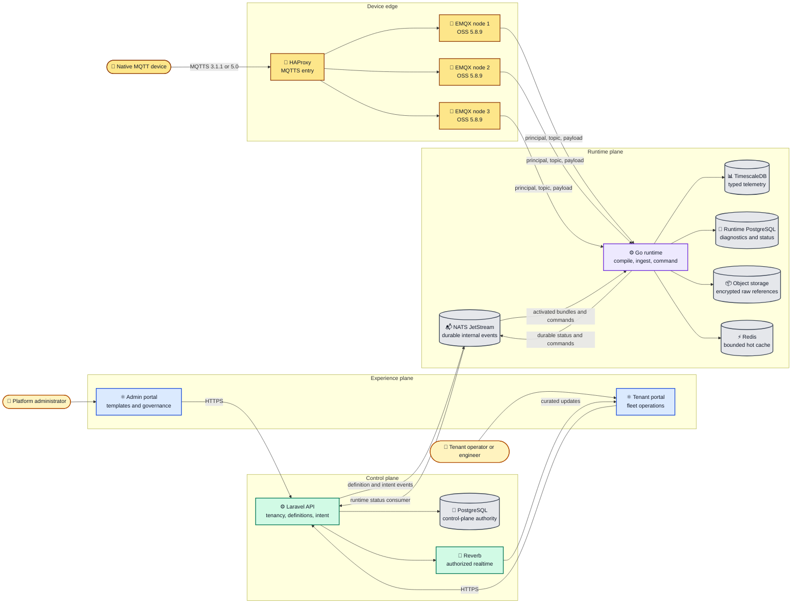
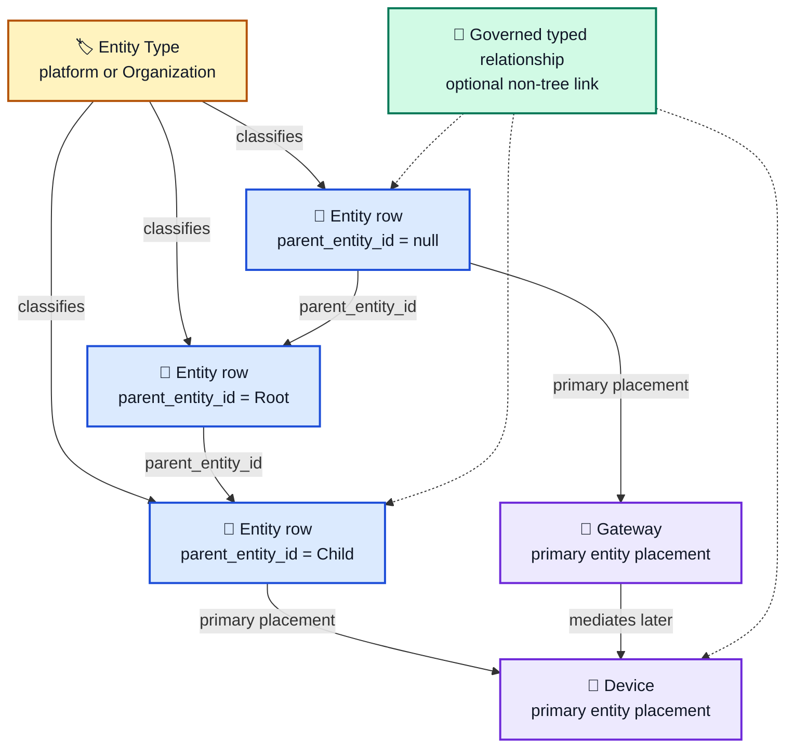
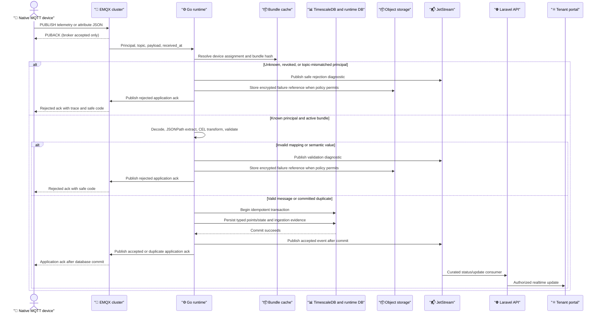
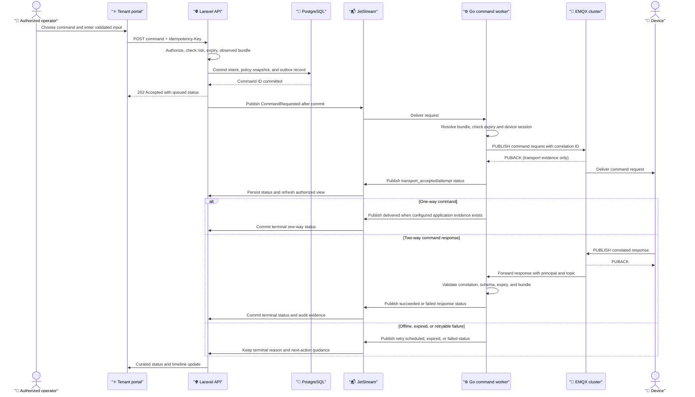

# Device Domain M1a Implementation Plan

- **Status:** Ready for implementation after C0
- **Last updated:** 2026-08-26
- **Parent plan:** [Device Domain M1](./device-domain-m1.md)
**Target:** A production-capable Native MQTT JSON device vertical slice

This is the execution plan for M1a. It is intentionally narrower than the full Device Domain M1 plan: it proves the platform boundary with direct Native MQTT JSON devices first. Sparkplug B, discovery, and generalized fleet rollout remain M1b work. The plan covers the admin and tenant portal behavior required to operate the slice, but it does not contain UI mockups.

## 1. Outcome

M1a is complete when a tenant engineer can create an arbitrary-depth typed Entity hierarchy, register and enroll a direct device, pin immutable semantic and transport definitions, and operate the device through the tenant portal. A real device or simulator must be able to:

1. Connect to EMQX over MQTTS using a scoped token/basic credential or an X.509 certificate issued from a device-generated CSR.
2. Publish Native MQTT JSON telemetry, reported configuration, and events.
3. Be represented by a trusted Connection Principal and an exact Runtime Bundle.
4. Persist typed telemetry, attributes, presence, and events with traceable diagnostics.
5. Receive desired configuration and one-way or supported two-way Commands.
6. Return a correlated application response whose status is distinct from MQTT transport acknowledgement.
7. Survive at-least-once delivery, duplicate messages, a Go restart, one EMQX node loss, and temporary control-plane unavailability without silently corrupting data or claiming false success.

The first end-to-end path is more important than broad adapter coverage. M1a should leave stable contracts and boundaries that M1b can reuse for Sparkplug B without changing the tenant-facing domain model.

## 2. Locked decisions

These decisions are fixed for M1a unless a reviewed ADR supersedes them:

| Area | Decision |
| --- | --- |
| Device broker | Keep EMQX. Use the community/Apache-2.0 path with `emqx/emqx:5.8.9` pinned by digest: `sha256:35b46f7aa7a0d51f3959e4344221ac5ec7f948b03e43099286b6c40a07bb393b`. Verify the digest in the deployment checkpoint before use. |
| Broker topology | Run three EMQX nodes behind HAProxy for the M1a drill. Do not make M1a depend on paid/BSL durable-session or shared-subscription features. |
| Internal messaging | Use NATS JetStream for durable control-plane events, runtime status, commands, redelivery, and replay. Keep device MQTT and internal NATS credentials separate. |
| Protocol | M1a supports direct devices using MQTT 3.1.1 and MQTT 5.0 over MQTTS. QoS 1 and idempotency are the reliability baseline; QoS 2 is not required. |
| Domain ownership | Laravel owns tenancy, authorization, definitions, public APIs, intent, assignment, command authorization, and audit. Go owns deterministic ingestion, definition compilation/cache, presence, typed runtime persistence, command execution, hot state, and runtime diagnostics. |
| Recursive topology | Use one recursive `Entity` model classified by `EntityType`. `parent_entity_id` is nullable, multiple roots are allowed, depth is arbitrary up to a safety limit, cycles are rejected transactionally, and type names are not hard-coded hierarchy levels. |
| Device placement | A Device and Gateway have one nullable primary `entity_id` for topology context. A device may remain unattached while enrollment is drafted; activation may require placement according to Organization policy. Entity hierarchy is not an authorization boundary in M1a. |
| Definition split | Keep semantic Device Profile Versions separate from protocol-specific Transport Binding Versions. Both are immutable after activation. |
| Runtime identity | Resolve an immutable Runtime Bundle from a device assignment. The bundle pins Profile Version, Binding Version, command policy, sampling/retention policy, and connection scope. |
| Enrollment | Prefer device-generated CSR/X.509 enrollment. Support access-token and MQTT basic compatibility. The platform never receives or stores a device private key. |
| Mapping | Use a supported deterministic JSONPath subset for extraction and restricted CEL for transformations, validation, and derived values. No I/O, dynamic code loading, or unbounded execution. |
| Acknowledgement | MQTT PUBACK proves broker acceptance only. Application acknowledgement is emitted after the relevant database transaction commits. A command is not successful until the device response satisfies the response contract. |
| Rollout | M1a supports direct per-device assignment, desired versus observed bundle state, and immutable rollback. Cohorts, canary promotion, and generalized rollout orchestration are M1b. |
| UI authoring | Guided forms and fixture-driven artifact previews are primary. Raw JSON is a read-only generated artifact view, not the default editing experience. |

## 3. Scope boundary

### In scope

- Platform and Organization Entity Types, recursive Entities, parent rules, reparenting, archive/delete safety, breadcrumbs, and placement.
- Gateway and Device aggregates, with direct-device operation in M1a. Gateway protocol mediation is reserved for M1b.
- Device Profiles, Profile Versions, Transport Bindings, Binding Versions, compatibility validation, fixtures, activation, lineage, and artifact hashes.
- Connection Principals, scoped MQTT ACLs, administrator-led enrollment, credential rotation/revocation, X.509 CSR signing, and connection evidence.
- Native MQTT JSON telemetry, reported configuration, desired configuration, events, presence, diagnostics, and curated realtime updates.
- Typed runtime persistence, idempotency, duplicate handling, raw-payload references, retention, trace propagation, and a narrow authorized query API.
- Server-to-device one-way and supported two-way Commands with authorization, confirmation, correlation, retry, expiry, response validation, and audit.
- Admin templates/governance views and tenant topology, fleet, definitions, enrollment, device operations, and diagnostics workflows.
- API/OpenAPI, AsyncAPI, JSON Schema 2020-12, Protobuf/Buf internal event contracts, deterministic fixtures, load evidence, and failure drills.

### Explicitly deferred to M1b or later

- Sparkplug B 3.0 session processing, aliases, birth/death, rebirth, discovery candidates, and reviewed Discovery Inbox.
- Gateway downstream protocol execution and Sparkplug edge-node/device views.
- Cohort selection, canary promotion, pause/resume, broad rollout orchestration, and fleet-wide rollback UX. M1a keeps the assignment model ready for these features.
- HTTP ingestion, OPC UA, CoAP, proprietary codecs, Node-RED adapter authoring, and ThingsBoard wire/API compatibility.
- Zero-touch provisioning, manufacturing claim certificates, OTA firmware, remote shell, device-originated RPC, bulk commands, rules, alarms, dashboards, and mobile apps.
- Legacy `iot-portal` import tooling. Its recursive hierarchy and guided authoring patterns inform the design, but M1a is not an importer.

## 4. Architecture

The public experience is always mediated by Laravel. Devices never call Laravel, TimescaleDB, NATS, or the portals directly. The broker authenticates a Connection Principal and forwards the message to Go; Go executes an already activated bundle without asking Laravel how to process each message.



### 4.1 Recursive topology model

The repeated Entity nodes below are rows in the same table. A Site-to-Area-to-Asset path is valid, but it is only one possible path. An Organization may use Site → Building → Floor → Room → Line → Machine → Asset, or any other typed structure allowed by its Entity Type rules.



Required invariants:

- Every tenant Entity has an Organization, an Entity Type, a stable UUID/ULID, and a nullable `parent_entity_id`.
- Parent and child must belong to the same Organization. A platform Entity Type can classify tenant Entities only through an explicit platform-template relationship.
- Multiple roots and arbitrary depth are supported up to a configured safety limit. Create, reparent, and bulk-move operations perform cycle checks in one transaction.
- Recursive CTEs are the authoritative query path initially. A rebuildable `ltree`/materialized-path projection may be added after measured topology fixtures, never as a second source of truth.
- Reparenting preserves Entity, Device, and Gateway identities and emits one audited subtree-moved event. Deletion is restricted while descendants or governed attachments remain; archive/move/detach is the normal path.
- Sibling ordering, ancestor/breadcrumb, descendant, and attached-device counts are explicit query concerns. Do not serialize recursive Eloquent relationships without a depth and count policy.
- Entity hierarchy is for navigation, context, and rollups in M1a. Authorization remains Organization-scoped unless a future reviewed decision adds subtree permissions.

## 5. Runtime flow contracts

### 5.1 Native MQTT topic contract

M1a uses a stable topic namespace without putting a user-controlled Organization identifier into the trust decision. The authenticated principal maps the device UUID to one Organization; the topic UUID must match that principal. A topic is not authorized merely because its string contains a valid UUID.

| Topic | Direction | QoS | Retained | Meaning |
| --- | --- | ---: | ---: | --- |
| `iot/v1/devices/{device_uuid}/telemetry` | Device → platform | 1 | No | Typed signal samples and source timestamps. |
| `iot/v1/devices/{device_uuid}/attributes/reported` | Device → platform | 1 | No | Device-reported configuration/state. |
| `iot/v1/devices/{device_uuid}/events` | Device → platform | 1 | No | Device event envelope with event key and payload. |
| `iot/v1/devices/{device_uuid}/presence` | Runtime → device/observers | 1 | Yes | Curated connected/disconnected state when a device is allowed to observe it. |
| `iot/v1/devices/{device_uuid}/attributes/desired` | Platform → device | 1 | Yes | Desired configuration snapshot and revision. |
| `iot/v1/devices/{device_uuid}/commands/{command_key}/request` | Platform → device | 1 | No | One command request, with correlation and expiry. |
| `iot/v1/devices/{device_uuid}/commands/{command_key}/response/{correlation_id}` | Device → platform | 1 | No | Typed command response or progress update. |
| `iot/v1/devices/{device_uuid}/acks/{message_id}` | Platform → device | 1 | No | Optional application acknowledgement after commit. |

M1a permits a direct Device principal to publish only its telemetry, reported attributes, events, and command-response/optional application-ack paths. It can subscribe only to its desired and command paths. A Gateway principal and downstream gateway topic namespace are M1b concerns. No wildcard ACL may grant one device access to another device's topic.

The initial native JSON envelope is deliberately small and versioned:

```json
{
  "schema": "iot.telemetry.v1",
  "message_id": "01J8M7H7M4Z1Q8C4R3S2T1V0X9",
  "observed_at": "2026-08-26T18:40:00Z",
  "sequence": 1842,
  "values": [
    { "key": "temperature", "type": "float64", "value": 22.4, "unit": "Cel", "quality": "good" },
    { "key": "running", "type": "boolean", "value": true, "quality": "good" }
  ]
}
```

`message_id` is required for every publishable application envelope. `observed_at` is source time and `received_at` is assigned only by the runtime ingress boundary. `sequence` is optional but, when present, is used for diagnostics and ordering policy rather than as the sole deduplication key. Payload-supplied `device_id` or Organization identity is advisory and must match the authenticated topic/principal or the message is rejected.

### 5.2 Ingestion sequence



The duplicate branch returns a stable duplicate/accepted outcome only after the original commit is known. A message that cannot be proven committed is retried or remains an explicit failure; it is never acknowledged as accepted merely because the broker returned PUBACK.

### 5.3 Canonical runtime contracts

The contract repository must contain JSON Schema 2020-12 definitions and sanitized fixtures for:

| Contract | Required meaning |
| --- | --- |
| `iot.telemetry.v1` | Typed signal points, source/receive time, quality, sequence, bundle identity, and trace context. |
| `iot.attribute-update.v1` | `platform`, `desired`, or `reported` scope; key/value/type; revision; actor/source; timestamps. |
| `iot.device-event.v1` | Event key, severity, stateful/stateless mode, payload, dedupe key, and timestamps. |
| `iot.presence.v1` | Connected, disconnected, stale, or unknown transition with session evidence and timestamps. |
| `iot.command-request.v1` | Authorized command snapshot, correlation, mode, persistence, expiry, retry policy, and trace context. |
| `iot.command-status.v1` | Attempt, business status, transport evidence, safe error code, response reference, and timestamps. |
| `iot.definition-activation.v1` | Immutable Profile/Binding/Bundle identity, hash, source, and desired scope. |
| `iot.definition-runtime-status.v1` | Loaded, rejected, stale, or failed status with observed hash and compiler diagnostics. |

Initial types are `float64`, `int64`, `uint64`, `boolean`, `string`, `bytes`, and `state`. Complex payloads are decomposed into governed signals or stored as a validated event payload; arbitrary unvalidated JSON must not become a typed signal by accident. Units use UCUM codes, even when the UI displays a friendlier label.

### 5.4 JSON Schema, JSONPath, and CEL

Proposed contract layout:

```text
contracts/
  definitions/
    device-profile/v1/schema.json
    transport-binding/v1/schema.json
    device-runtime-bundle/v1/schema.json
    connection-principal/v1/schema.json
  ingestion/
    telemetry/v1/schema.json
    attributes/v1/schema.json
    events/v1/schema.json
  fixtures/
    native-mqtt/valid/
    native-mqtt/invalid/
    mapping/
  openapi/
    device-domain.v1.yaml
  asyncapi/
    native-mqtt.v1.yaml
  events/proto/iot/events/v1/
    envelope.proto
    device.proto
```

The supported JSONPath subset is explicit and portable: root `$`, dot/bracket object access, numeric array indexes, and a bounded wildcard over arrays when the mapping declares how values are flattened. Filters, script expressions, recursive descent, environment access, and implementation-specific extensions are out of scope. Every required extraction path is parsed and exercised during activation fixtures.

CEL is evaluated in a pinned, deterministic environment. The initial variables are `payload`, `value`, `topic`, `observed_at`, `received_at`, `device`, `message`, and `bundle`. The initial function set is limited to safe type conversion, string/collection helpers, and unit/domain helpers approved in the ADR. Programs have compile-time type checking, a maximum instruction/cost budget, a maximum output size, and no network, filesystem, clock, randomness, reflection, or mutation access. CEL source and compiler version are included in the artifact hash.

### 5.5 Protobuf/Buf internal events

Use Buf for linting, breaking-change checks, and language generation. The envelope contains:

- `event_id`, `event_type`, `schema_version`, and `producer_version`;
- `organization_id`, `device_id`, and optional `gateway_id` from trusted scope;
- `occurred_at`, `trace_id`, `causation_id`, and `correlation_id`;
- `runtime_bundle_id` and `runtime_bundle_hash` where applicable; and
- a typed `oneof` payload rather than an unbounded `Any` for the M1a event set.

The eight canonical event payloads are `TelemetryAccepted`, `AttributeReported`, `DeviceEventReceived`, `PresenceChanged`, `CommandRequested`, `CommandStatusChanged`, `DefinitionActivation`, and `DefinitionRuntimeStatus`. Ingestion rejection diagnostics use the same envelope discipline on a dedicated diagnostics subject and are not counted as a successful domain event.

Initial JetStream subject families are:

```text
iot.events.telemetry.v1
iot.events.attributes.v1
iot.events.device-events.v1
iot.events.presence.v1
iot.commands.requested.v1
iot.commands.status.v1
iot.definitions.activated.v1
iot.definitions.runtime-status.v1
iot.runtime.diagnostics.v1
```

Consumers must be idempotent by `event_id`, and handlers must be safe under redelivery and consumer restart. Events are internal contracts; they are not a replacement for the public REST or MQTT contracts.

### 5.6 OpenAPI and AsyncAPI surface

OpenAPI 3.1 is the source for public REST types and the generated `packages/api-client` client. AsyncAPI documents the public Native MQTT topics and message schemas. The CI contract job must fail on schema/fixture errors, incompatible Buf changes, OpenAPI drift, or a generated-client diff that has not been reviewed.

#### Tenant API

All tenant routes require Sanctum authentication, `X-Organization-UUID`, membership permission, and an organization record that matches the request. The header is context selection, not a way to access an organization to which the user does not belong.

| Area | M1a routes |
| --- | --- |
| Entity Types | `GET/POST /api/v1/entity-types`; `GET/PATCH /api/v1/entity-types/{entityType}`; `POST /api/v1/entity-types/{entityType}/retire` |
| Entities | `GET/POST /api/v1/entities`; `GET/PATCH /api/v1/entities/{entity}`; `POST /api/v1/entities/{entity}/move`; `POST /api/v1/entities/{entity}/archive`; `GET /api/v1/entities/{entity}/ancestors`; `GET /api/v1/entities/{entity}/descendants` |
| Relationships | `GET/POST /api/v1/entity-relationships`; `DELETE /api/v1/entity-relationships/{relationship}` with governed endpoint/type validation |
| Fleet | `GET/POST /api/v1/gateways`; `GET/PATCH /api/v1/gateways/{gateway}`; `GET/POST /api/v1/devices`; `GET/PATCH /api/v1/devices/{device}`; `POST /api/v1/devices/{device}/place` |
| Definitions | `GET/POST /api/v1/device-profiles`; `GET/POST /api/v1/device-profiles/{profile}/versions`; matching `transport-bindings` routes; `POST /api/v1/definition-versions/{version}/validate`; `POST /api/v1/definition-versions/{version}/fixtures`; `POST /api/v1/definition-versions/{version}/activate` |
| Assignment | `GET /api/v1/devices/{device}/definition-assignment`; `PUT /api/v1/devices/{device}/definition-assignment`; `GET /api/v1/devices/{device}/definition-history` |
| Enrollment | `POST /api/v1/devices/{device}/enrollment-sessions`; `GET /api/v1/devices/{device}/enrollment-sessions/{session}`; `POST /api/v1/devices/{device}/credentials/rotate`; `POST /api/v1/devices/{device}/credentials/revoke` |
| Runtime | `GET /api/v1/devices/{device}/runtime`; `GET /api/v1/devices/{device}/telemetry`; `GET /api/v1/devices/{device}/attributes`; `GET /api/v1/devices/{device}/events`; `GET /api/v1/devices/{device}/presence`; `GET /api/v1/devices/{device}/diagnostics` |
| Desired state | `PUT /api/v1/devices/{device}/attributes/desired` with `If-Match`; `GET /api/v1/devices/{device}/attributes/desired` |
| Commands | `GET /api/v1/commands`; `POST /api/v1/devices/{device}/commands`; `GET /api/v1/commands/{command}`; `POST /api/v1/commands/{command}/cancel`; `POST /api/v1/commands/{command}/retry` when policy permits |

List APIs must paginate and support bounded time ranges, signal selection, and downsampling where appropriate. Raw payloads are never included in ordinary list responses.

#### Admin API

The platform admin application uses separate platform-scoped routes:

| Area | M1a routes |
| --- | --- |
| Entity Type templates | `GET/POST /api/v1/admin/entity-type-templates`; `GET/PATCH /api/v1/admin/entity-type-templates/{template}`; version/retirement actions |
| Definition templates | `GET/POST /api/v1/admin/device-profile-templates`; matching transport-binding-template routes; version validation/activation actions |
| Usage/governance | `GET /api/v1/admin/definition-templates/{template}/usage`; `GET /api/v1/admin/definition-templates/{template}/versions` |
| Support | `GET /api/v1/admin/runtime/support/devices/{device}` only with explicit support permission, selected Organization, audit reason, and read-only response |

The admin portal does not become a second tenant operations portal. A platform administrator may publish reusable templates and inspect aggregate usage without accessing tenant telemetry by default.

### 5.7 ETags and optimistic concurrency

All mutable drafts, Entity moves, desired-state revisions, and assignment changes use a server revision/ETag. Examples:

- `ETag: "entity-01J...-r7"` on an Entity;
- `ETag: "profile-version-draft-42-r3"` on a draft; and
- `ETag: "desired-device-01J...-r12"` on desired configuration.

Write requests send `If-Match`. Missing preconditions return `428 Precondition Required` for protected resources; a stale ETag returns `412 Precondition Failed` with the current resource summary and a safe merge/reload instruction. Activated versions have no write path at all; the UI offers **Create new draft from this version**.

### 5.8 Idempotency and application acknowledgements

HTTP create, enrollment, credential rotation, desired-state writes, and command requests accept an `Idempotency-Key`. The server stores the key with Organization, actor, route, request hash, result status, and response reference for a bounded retention period. Reusing a key with a different request hash returns `409`; repeating the same request returns the original result.

MQTT deduplication uses trusted Organization + Device + message type + `message_id`, with sequence diagnostics when a sequence is supplied. The runtime records an ingestion message before or within the same transaction as typed persistence, and its unique constraint makes retries safe. JetStream handlers use `event_id` and command/correlation IDs similarly.

The acknowledgement rules are non-negotiable:

1. MQTT PUBACK means only that EMQX accepted the publish into its transport path.
2. Go emits an internal accepted/duplicate/rejected outcome only after it has committed the corresponding runtime transaction or a durable diagnostic.
3. The optional MQTT application ack is published only after that commit and includes `message_id`, `status`, `trace_id`, and a safe reason code when not accepted.
4. The REST command endpoint returns `202 Accepted` after Laravel commits a command intent and outbox event. It does not claim that the device received or completed the command.
5. A two-way Command reaches `succeeded` only when the correlated response is valid. A one-way Command reaches its configured terminal transport/application state without inventing device-side completion.

## 6. Domain and storage tasks

### 6.1 Control-plane aggregates

Create Laravel modules under `apps/api/app/Domain`:

| Module | M1a responsibility |
| --- | --- |
| `Topology` | Entity Types, recursive Entities, parent rules, cycle checks, subtree move/archive, placement, and typed non-tree relationships. |
| `DeviceManagement` | Gateways, Devices, lifecycle, stable external key, assignment, and bundle history. |
| `DeviceProfile` | Profiles, semantic versions, bindings, transport versions, compatibility, fixtures, artifact hashes, activation, and lineage. |
| `Connectivity` | Enrollment sessions, principals, credential metadata, certificates, revocation, and broker-scope materialization/integration. |
| `DeviceControl` | Platform properties, desired state, command authorization, command intent, policy snapshots, and audit. |

Expected control-plane records include `entity_types`, `entity_type_parent_rules`, `entities`, `entity_relationships`, `gateways`, `devices`, `device_profiles`, `device_profile_versions`, `transport_bindings`, `transport_binding_versions`, `definition_test_runs`, `definition_activations`, `device_definition_assignments`, `connection_principals`, `device_enrollments`, `device_credentials`, `device_certificates`, `device_property_values`, `device_commands`, and `device_command_status_events`.

Every tenant-owned record carries or unambiguously derives `organization_id`. Public identifiers are UUIDs or ULIDs. Migrations must be additive/rollback-safe and must not cascade across tenant boundaries.

### 6.2 Definitions and Runtime Bundle

A Profile Version defines semantic telemetry signals, properties, events, and Commands. It contains no broker host, topic, credential, or protocol decoder. A Binding Version maps a protocol payload/topic to those semantic keys and defines outbound encoding/correlation. Both are canonical JSON artifacts with SHA-256 hashes.

Activation gates:

1. JSON Schema structure is valid.
2. semantic keys, types, UCUM units, ranges, command modes, and risk policy are valid;
3. JSONPath paths parse and required keys are covered;
4. CEL programs compile, type-check, and pass cost limits;
5. topic patterns and ACL scopes cannot escape the assigned Device/Organization;
6. Go compiles the artifact and passes valid/invalid fixtures; and
7. a user with activation permission reviews the generated artifact, hash, compatibility report, and fixture results.

The Runtime Bundle is the resolved immutable execution snapshot. It includes exact Profile Version ID/hash, Binding Version ID/hash, connection principal scope, command policy, retention/sampling policy, and compiler versions. A Device has one desired bundle and a runtime-reported observed bundle/hash/status. A stale or rejected observed bundle blocks unsafe commands and is visible to the operator.

### 6.3 Runtime storage ownership

| Store | M1a ownership and records |
| --- | --- |
| PostgreSQL | Laravel control-plane records and transactional outbox/inbox. Go may own a separate runtime schema/DB connection for runtime status; it never edits Laravel definitions or authorization rows. |
| TimescaleDB | Go-owned `telemetry_points` hypertable, typed value columns, observed/received timestamps, quality, device/bundle identity, and retention policies. |
| Runtime PostgreSQL | Go-owned `ingestion_messages`, `ingestion_diagnostics`, `device_attribute_state`, `device_latest_state`, `presence_transitions`, `command_attempts`, and stream checkpoints. |
| NATS JetStream | Durable internal events, command requests/status, activated bundles, redelivery, and replay. |
| Object storage | Encrypted raw failure payloads and sampled successful payloads, referenced by opaque IDs only. |
| Redis | Bounded connection/principal/definition hot cache and rate limiting. It is not the authority for telemetry, commands, or assignments. |

Raw payload policy defaults to failure capture plus successful sampling off (or explicitly sampled) and is subject to Organization/platform maximums. A raw object has an expiry, encryption class, redaction policy, and access audit. It is excluded from logs, browser persistence, realtime events, and ordinary list APIs.

## 7. Command lifecycle

### 7.1 State model

The command record is Laravel-owned intent and audit; Go owns dispatch attempts and transport execution evidence. A supported two-way command may use:

`queued → dispatching → transport_accepted → device_acknowledged → running → succeeded`

with terminal alternatives `failed`, `expired`, `cancelled`, or `rejected`. A one-way command can terminate at `device_acknowledged`/`delivered` according to its contract; it must not be labeled `succeeded` unless the command definition explicitly defines a verifiable completion signal.

Each attempt records attempt number, started/finished times, broker evidence, response reference, error taxonomy, retryability, bundle hash, and trace/correlation IDs. Persistent commands may retry only before expiry and within the definition's retry ceiling. Offline devices do not cause unbounded queue growth.

### 7.2 Command sequence



No UI action may silently resubmit a command after a timeout. **Retry** must create an explicit new attempt or command according to policy, preserve the original correlation, and require confirmation for medium/high-risk operations.

## 8. Portal implementation requirements

### 8.1 Platform admin portal (`apps/admin`)

The current administration foundation is the C0 prerequisite. M1a extends it with:

- **Entity Type templates:** create/update platform defaults, stable key, display metadata, optional property schema, allowed-parent rules, retirement, and usage impact.
- **Device Profile templates:** guided semantic signal/property/event/Command authoring, draft/version history, fixture results, compatibility, activation, and read-only tenant usage aggregates.
- **Transport Binding templates:** Native MQTT topic/message maps, JSONPath/CEL fields, response correlation, ACL preview, fixture replay, and artifact hashes.
- **Version governance:** active versions are read-only; show lineage, activation actor/time, hash, assigned-device count, observed runtime count, stale/rejected count, and retirement blockers.
- **Authorized support view:** select Organization, enter an audit reason, view a read-only device runtime/diagnostic summary, and exit support context clearly. No raw telemetry or command execution by default.

Admin navigation should make scope visible at all times: **Platform templates**, **Usage**, **Runtime support**, and **Administration** are distinct from tenant operations. Platform users without the capability see an access-denied state, not a partially rendered app.

### 8.2 Tenant portal (`apps/portal`)

Scaffold the tenant portal with the same shared UI primitives and API-client conventions:

1. **Organization context:** load memberships, select one Organization, preserve context in the URL/session, and reject stale/unauthorized context with a recoverable message.
2. **Topology:** browse roots and descendants, expand arbitrary depth, create a child at any level, reparent with a preview, archive safely, attach a Device/Gateway, and show breadcrumbs/counts. A move operation must explain cycle and allowed-parent failures before submission.
3. **Fleet:** list/filter Gateways and Devices, show lifecycle separate from presence, open enrollment, placement, definition assignment, connection evidence, and last observed bundle.
4. **Definitions:** adopt a platform template or fork to a tenant draft; author semantic content first and transport mapping second; validate; run fixtures; inspect expected/actual canonical output; review artifact hash; activate; create a new draft from active versions.
5. **Enrollment:** select Entity/Gateway, choose Profile/Binding versions, choose token/basic/X.509 CSR, show one-time secret/certificate evidence, show exact principal scope and TLS endpoint, then wait for connection and observed bundle convergence.
6. **Device overview:** show lifecycle, placement breadcrumbs, principal/certificate age, presence, desired/observed bundle status, latest values, stale indicators, and traceable recent diagnostics.
7. **Telemetry/events:** bounded time range, signal selection, quality, observed versus received time, no-data versus never-seen explanation, accessible tabular fallback, and event timeline.
8. **Properties:** group `server` as **Platform properties**, `shared` as **Desired configuration**, and `client` as **Reported configuration**. Show desired/reported drift, revisions, last acknowledgement, and stale runtime. Desired writes use ETags and preserve unsaved edits on recoverable failure.
9. **Commands:** render only allowed command forms from the active Profile Version; validate inputs; show risk and confirmation; show queued/transport/device status timeline, correlation, expiry, attempts, and response payload only when authorized. Disable unsafe execution for stale/rejected bundles.
10. **Diagnostics:** show safe stage/code/retryability/guidance, bundle hash, trace ID, topic shape, connection session age, and raw-payload reference controls only for users with explicit permission. Never reveal secrets/private keys.

### 8.3 UI state contract

Every domain screen has explicit loading, empty, error, forbidden, stale-runtime, and responsive behavior. The following are acceptance requirements rather than visual suggestions:

| Workflow | Loading | Empty | Failure/permission | Stale and responsive behavior |
| --- | --- | --- | --- | --- |
| Recursive topology | Skeleton tree and breadcrumb | Explain how to create a root | Preserve selected node and explain cycle/parent denial; 403 is distinct from 404 | Show stale counts and refresh action; tree becomes a stacked list at narrow widths. |
| Device directory | Row/card skeleton | Explain enrollment and placement | Keep filters/search; show retry and permission reason | Presence and bundle timestamps are visible; filters stack at 360 px. |
| Definition catalog | Catalog skeleton | Offer platform template adoption | Preserve draft/search state; active templates are read-only | Show compatibility/observed status; cards replace wide tables. |
| Guided authoring | Section skeleton | Explain first signal/property/command | Field errors plus one aggregate report; no raw editor required | Sections stack; artifact and fixture output open in a full-height sheet. |
| Enrollment | Stepper with current stage | Explain no available compatible definition | One-time secret failures are actionable; never redisplay secret | Copy/download controls remain keyboard accessible; steps stack. |
| Telemetry/events | Chart/table skeleton | Distinguish no points in range from never seen | Bounded retry with trace; raw data not exposed by default | Minimum readable table width and chart alternative. |
| Properties | Scope-group skeleton | Explain no properties in the active profile | Preserve desired edits; show 403 separately | Desired/reported drift is prominent; scopes become accordions. |
| Commands | Form and timeline skeleton | Explain no allowed commands | Hide unauthorized schema; disable stale/unsafe action | Confirmation uses a full-height sheet; history remains readable. |
| Diagnostics | Independent panel skeleton | Explain no session/diagnostic records | Retry panel, show safe error code and trace | Topic/code values scroll without page overflow; actions stack. |

All interactive elements need accessible names, keyboard/focus behavior, visible validation, semantic status announcements, and no color-only status meaning. Browser tests cover 360 px and desktop layouts, role differences, tenant switching, arbitrary-depth navigation, draft preservation, and no-console-error behavior.

## 9. Delivery checkpoints and task breakdown

Each checkpoint is independently reviewable. The current administration changes are C0; do not mix Device Domain implementation with that commit.

### C0 — Commit the administration foundation

**Tasks**

- Review the existing `apps/admin` authentication, organizations, users, invitations, roles, and permission screens.
- Review the Laravel platform administration routes/resources/services and the shared `packages/ui` primitives.
- Keep `.serena/` generated metadata out of the product history and ignore it.
- Run API feature tests, admin typecheck/build, and Playwright browser tests.
- Commit only the administration/API/shared UI changes with a focused message.

**Exit evidence:** explicit staged paths, clean staged diff, passing targeted tests, and a commit that does not contain Device Domain code or the M1a plan.

### M1a-1 — ADRs and executable contracts

**Tasks**

- Write ADRs for recursive Entity storage/query strategy, Entity Type governance, Profile/Binding split, Native MQTT topics, EMQX principal integration, command lifecycle, app acknowledgements, runtime storage/raw retention, and M1b compatibility.
- Add JSON Schema 2020-12 definitions for Profile, Binding, Runtime Bundle, Connection Principal, and the eight canonical event payloads.
- Add valid/invalid Native MQTT, mapping, command, and security fixtures.
- Add OpenAPI 3.1 and AsyncAPI documents; wire generated `packages/api-client` types/client checks.
- Add Buf module/configuration, Protobuf event envelopes, lint/breaking checks, and generated Go/TypeScript artifacts where appropriate.
- Pin the initial JSONPath/CEL libraries and supported subsets in the ADR/contract tests.
- Record the M1a load envelope before claiming performance SLOs.

**Exit evidence:** all schemas and fixtures validate; Buf/OpenAPI/AsyncAPI checks pass; Laravel and Go contract harnesses agree on golden fixtures; no feature is described as implemented until runtime evidence exists.

### M1a-2 — Recursive topology and fleet foundation

**Tasks**

- Create migrations/models/services/policies for Entity Types, Entities, parent rules, relationships, Gateways, Devices, and placement.
- Implement recursive CTE queries for roots, children, ancestors, descendants, breadcrumbs, counts, search, and depth limits.
- Implement transactional cycle/cross-tenant-parent checks, allowed-parent rules, sibling ordering, subtree move, archive, and restricted deletion.
- Seed platform Entity Types without making the model dependent on Site/Area/Asset levels.
- Add Organization-owned custom types, platform-template lineage, retirement, and stable keys.
- Add tenant APIs and authorization tests for four or more levels, multiple roots, custom types, cross-tenant access, and attachment safety.

**Exit evidence:** a feature test creates and moves a four-level-plus hierarchy, rejects self/descendant/cross-tenant parents, preserves attachments, returns correct ancestors/descendants/counts, and prevents unsafe delete. Device lifecycle is separate from presence.

### M1a-3 — Definitions, fixtures, and Runtime Bundles

**Tasks**

- Implement Profile/Binding catalogs and immutable draft/version/activation state machines.
- Implement semantic signals/properties/events/commands and Native MQTT transport mappings.
- Implement structural/domain compatibility, JSONPath/CEL compile checks, fixture execution requests, result storage, and artifact hashes.
- Generate and persist Runtime Bundles with exact version lineage and policy snapshots.
- Implement per-device desired assignment, observed status ingestion, assignment history, and rollback to a prior immutable bundle.
- Publish `DefinitionActivation` outbox events and consume/report `DefinitionRuntimeStatus`.

**Exit evidence:** active artifacts cannot be edited; stale ETags return `412`; invalid paths/CEL/topics/fixtures block activation; a Device shows desired versus observed bundle/hash; rollback creates history without changing an old artifact.

### M1a-4 — EMQX, principals, and enrollment

**Tasks**

- Add development/CI broker configuration for the pinned EMQX image, three-node cluster, HAProxy, TLS/MQTTS, and safe health checks.
- Select and implement the EMQX auth/authz integration from the ADR: HTTP hooks backed by a Go principal cache or broker-native credential materialization. Do not synchronously call Laravel for every message.
- Create Connection Principal records, exact publish/subscribe scopes, rate/size limits, revocation/expiry checks, and safe broker reason codes.
- Implement administrator-led token/basic enrollment, one-time material display, credential overlap/rotation/revocation, and audit.
- Implement device-generated CSR submission and signed certificate/chain return through Smallstep `step-ca` or the selected compatible CA. Do not accept private keys.
- Connect a deterministic simulator through MQTTS and verify principal identity, ACL scope, and observed session evidence.

**Exit evidence:** valid credentials connect and unauthorized topic/device combinations are rejected; revoked/expired credentials stop new connections or publishes within the documented cache bound; private-key/log/secret scans pass; one-time secret material is not retrievable a second time.

### M1a-5 — Go runtime ingestion, persistence, and presence

**Tasks**

- Implement runtime packages for principal lookup, bundle verification/cache, topic parsing, native JSON decoding, JSONPath extraction, CEL execution, semantic validation, and idempotent routing.
- Implement typed Timescale persistence, latest state, attribute scopes, presence transitions/stale policy, event persistence, ingestion diagnostics, and raw object references.
- Implement JetStream publishing/consumption with stable event IDs and redelivery-safe handlers.
- Implement application acknowledgements after commit and safe rejection/duplicate outcomes.
- Implement narrow authenticated runtime query endpoints consumed by Laravel, with tenant/device scope claims, pagination, bounded time ranges, and downsampling.
- Add W3C trace propagation and bundle/hash/trace fields to diagnostics.

**Exit evidence:** a real or deterministic device publishes valid, duplicate, invalid, unmapped, and unauthorized messages; typed persistence and diagnostics are correct; app ack timing follows commit; raw policy is enforced; restart/replay does not double-count; portal queries remain Organization-scoped.

### M1a-6 — API and portal operations

**Tasks**

- Scaffold `apps/portal` with Sanctum session handling, Organization context, route guards, generated API client, shared UI, error/query conventions, and realtime reconnect behavior.
- Implement tenant topology, fleet, placement, definition catalog, guided authoring, fixture results, artifact preview, assignment, and enrollment workflows.
- Extend `apps/admin` with platform Entity Type/Profile/Binding templates, version governance, usage, and read-only support shell.
- Add explicit loading/empty/error/403/404/stale states, keyboard/focus behavior, accessible status, and 360 px/desktop responsive tests.
- Ensure active artifact screens are read-only and raw JSON is a generated preview.

**Exit evidence:** Playwright tests cover login/context, arbitrary-depth create-child/reparent/archive/attach, platform template adoption/fork, fixture errors, active-version protection, enrollment stages, permission differences, responsive behavior, and no unauthorized tenant data in admin views.

### M1a-7 — Desired state and Commands

**Tasks**

- Implement Platform properties, Desired configuration, and Reported configuration storage/reconciliation with revisions and ETags.
- Implement command schemas, risk levels, input validation, one-way/two-way mode, response contracts, expiry, persistence, retry ceiling, correlation, and audit snapshots.
- Implement Laravel intent/outbox to JetStream to Go dispatch to EMQX and response/status back to Laravel.
- Enforce stale/rejected bundle blocks, permission checks, confirmation, idempotency, and safe retry/cancel behavior.
- Add tenant command form/timeline and diagnostics; add admin read-only command support evidence only where explicitly authorized.

**Exit evidence:** API returns `202` only after intent commit; command timeline distinguishes queued, transport-accepted, device-acknowledged, running, succeeded, failed, expired, and cancelled; duplicate requests do not create duplicate intent; PUBACK alone never marks success; correlated valid/invalid/late responses behave deliberately.

### M1a-8 — End-to-end integration, security, and operability

**Tasks**

- Run EMQX → Go → TimescaleDB/runtime DB → Laravel query → portal integration with a real simulator/device.
- Run Laravel outbox → JetStream → Go → EMQX → response → Laravel command integration.
- Add contract, domain, integration, security, browser, and load tests from Sections 5–10.
- Add metrics for connections, message outcomes, mapping failures, persistence latency, consumer lag, presence, command attempts, bundle convergence, and raw retention/access.
- Add dashboards/runbooks for safe error taxonomy, trace lookup, health/readiness, broker/principal state, definition cache, JetStream, TimescaleDB, and object storage.
- Set and document initial retention jobs and credential expiry alerts.

**Exit evidence:** all acceptance paths have reproducible CI or runbook evidence; cross-tenant, topic-spoofing, revoked-credential, secret/log, raw-access, and CEL-limit tests pass; every failure class has a user-visible status and operator next action.

### M1a-9 — Reliability gate and handoff

**Tasks**

- Execute the three-node EMQX/HAProxy failure drill and record reconnect, duplicate, ordering, and bounded-loss behavior.
- Execute Go/runtime restart, JetStream redelivery, Timescale/PostgreSQL temporary outage, object-storage outage, Redis outage, and Laravel outage drills.
- Execute duplicate MQTT delivery, command expiry/offline, stale bundle, rejected bundle, and credential rotation drills.
- Run the agreed load envelope, deep/wide topology query tests, command concurrency tests, and browser large-directory tests.
- Review the M1a definition of done, update runbooks/known limits, and write the M1b handoff with preserved identifiers/contracts.

**Exit evidence:** the failure matrix in Section 10 is completed with traces and metrics; no drill produces false success or silent data corruption; initial SLOs are based on measurements; the release is explicitly accepted as M1a or has named blockers.

## 10. Reliability, security, retention, observability, and load acceptance

### 10.1 Failure-drill matrix

| Drill | Expected behavior | Evidence required |
| --- | --- | --- |
| One EMQX node unavailable | HAProxy routes new connections to healthy nodes; clients reconnect; scoped ACLs remain unchanged; QoS1 duplicates are safe. | Broker/node logs, reconnect counts, message IDs, duplicate metrics, no cross-device delivery. |
| EMQX/HAProxy temporary path loss | Device sees transport failure; application ack is not falsely emitted; replay/retry behavior is bounded and documented. | Trace showing no post-failure success claim and eventual accepted/duplicate/rejected outcome. |
| Go runtime restart | Bundle/principal caches rebuild from durable sources; messages are retried or diagnosed; no partial success ack. | Startup/readiness logs, cache rebuild metric, replay and idempotency evidence. |
| JetStream consumer restart/redelivery | Handlers reprocess safely by event ID; command and telemetry side effects remain idempotent. | Consumer ack/redelivery metrics and unchanged committed counts. |
| Timescale/runtime DB unavailable | Runtime applies backpressure/retry policy, emits no accepted app ack before commit, and avoids unbounded memory. | Failure code, queue/lag bounds, recovery replay, alert and runbook. |
| Laravel unavailable | Go continues with last valid bundle/principal cache for the documented window; new definitions/authorization changes do not appear as applied; portal shows stale control-plane status. | Cache age, stale status, blocked unsafe commands, recovery convergence. |
| Object storage unavailable | Ingestion follows explicit raw-capture policy; it never logs raw secrets or claims a raw reference exists when it does not. | Capture outcome, redaction/access log, operator guidance. |
| Redis unavailable | Durable processing and authorization decisions use the documented fallback; only bounded cache performance degrades. | Health state and no loss of authoritative records. |
| Duplicate/late MQTT message | Original commit is preserved once; duplicate/late outcome is explicit and queryable. | Stable message IDs, unique constraint result, duplicate metric, application ack. |
| Command device offline/late | Persistent command expires or retries within policy; late response cannot mutate an unrelated/new correlation. | Command timeline, expiry/late-response reason, audit event. |

### 10.2 Security and safety

- Derive Organization and Device scope from authenticated principals, never from payload identity.
- Enforce exact topic ACLs, principal-specific rate/size limits, TLS, certificate expiry/revocation, and credential overlap windows.
- Store only one-way credential verification material where compatible; show token/basic secrets once and never persist them in browser state, artifacts, fixtures, traces, or logs.
- Accept only device-generated CSRs and return certificates/chains; private keys never cross the platform boundary.
- Restrict CEL execution and JSONPath features; reject compile/runtime cost or output-size violations.
- Encrypt, redact, authorize, audit, and expire raw payloads/command responses. Support access is read-only and reason-coded.
- Require explicit confirmation for medium/high-risk Commands and a separate permission for high-risk execution.
- Reject topic/payload identity mismatch before mapping or persistence.
- Pass tenant scope to Go through authenticated internal claims or an equivalently authenticated internal request; enforce it again in runtime query handlers.
- Scan generated artifacts, fixtures, logs, browser storage, and test output for secrets/private keys before release.

### 10.3 Retention baseline

Set the exact values in M1a-1, with platform maximums and Organization-level configuration. The proposed starting baseline is:

| Data | Proposed M1a default |
| --- | --- |
| Typed telemetry | 30 days in development; production value configured from load/cost evidence. |
| Ingestion diagnostics | 30 days, with safe metadata and no raw content in the row. |
| Failed raw payload objects | 14 days by default, encrypted and referenced by opaque ID. |
| Successful raw payloads | Off by default; if sampled, small bounded percentage and shorter TTL. |
| Presence transitions | 90 days or the Organization’s operational policy. |
| Command audit/status | 365 days minimum for M1a audit evidence, subject to legal policy. |
| Credential/certificate audit | At least the lifetime of the credential plus the audit retention policy. |

Retention deletion must be observable, retryable, and proven in a test. A tenant cannot extend raw retention beyond platform safety/contract limits.

### 10.4 Observability

Every accepted/rejected/duplicate message and command attempt carries a stable trace ID, event/message ID, principal/device ID, Profile/Binding version IDs, Runtime Bundle ID/hash, stage, code, retryability, and timestamps. Raw payload content is never put in ordinary logs.

Required metrics include:

- MQTT connections accepted/rejected by safe reason and principal class;
- messages received, accepted, duplicate, rejected, unmapped, validation-failed, and delayed by binding/version;
- JSONPath/CEL compile and execution failures;
- Timescale persistence latency, JetStream consumer lag/redelivery, and runtime cache age;
- presence transitions/staleness and desired/observed bundle convergence;
- commands queued, dispatched, transport-accepted, retried, expired, failed, and response latency; and
- raw capture volume, retention deletion, denied raw access, credential expiry, and certificate revocation.

Readiness covers broker connectivity, principal cache, definition cache, JetStream, TimescaleDB, runtime DB, and object storage according to the runtime's deliberate degraded modes. Liveness must not report healthy while the process cannot safely accept/diagnose messages.

### 10.5 M1a load envelope

The initial measured test envelope is:

- 10,000 registered Devices;
- 5,000 concurrently connected Devices;
- 1,000 messages/second steady state;
- 5,000 messages/second burst;
- 20 signal values per telemetry message;
- payload-size and command-concurrency limits recorded with the test fixture; and
- at-least-once delivery with duplicate rate recorded rather than ignored.

Do not publish permanent production SLOs before the load run. Record p50/p95/p99 ingress-to-commit, query latency, command dispatch/response latency, JetStream lag, CPU/memory, database write pressure, and recovery time. The acceptance gate is reproducible evidence and an explicit documented limit, not an unmeasured number.

## 11. Test strategy

| Layer | M1a tests |
| --- | --- |
| Contract | JSON Schema valid/invalid fixtures, OpenAPI/AsyncAPI drift, Buf lint/breaking, Laravel/Go golden parity, additive-field compatibility. |
| Laravel domain | Entity type/parent/cycle rules, arbitrary depth, multiple roots, subtree moves, placement, version immutability, compatibility, ETags, outbox atomicity, command authorization. |
| Laravel feature | Cross-tenant query/parent/placement denial, archive/delete restrictions, API status codes, platform-template lineage, enrollment/rotation/revocation, assignment/rollback, command idempotency. |
| Go unit | Topic parsing, principal scope, JSONPath subset, CEL limits, typed conversion, ingestion idempotency, app-ack timing, presence, command expiry/retry/correlation. |
| Integration | EMQX → Go → Timescale/runtime DB → Laravel query → portal; Laravel outbox → JetStream → Go → EMQX → response → Laravel. |
| Browser | Admin template/governance states; tenant topology, definitions, enrollment, telemetry/properties/events, commands, diagnostics; keyboard, responsive, stale, loading/empty/error/403 states. |
| Security | Header/tenant mismatch, topic spoofing, wildcard ACLs, revoked/expired credential, private-key/secret scanning, raw access, CEL limits, high-risk command permissions. |
| Reliability | QoS1 duplicates, JetStream redelivery, process restart, stale cache, DB/broker/object-store/Redis/Laravel outages, offline command expiry, rollback. |
| Performance | Deep/wide recursive queries/moves, M1a load envelope, Timescale writes/queries, command concurrency, portal directory pagination and rendering. |

Fixtures are deterministic and sanitized. No production credentials, certificates, tenant records, or unredacted raw payloads enter the repository.

## 12. M1a acceptance checklist

M1a may be signed off only when:

- a tenant can create platform and custom Entity Types and model four or more recursive levels without a fixed Site/Area/Asset sequence;
- cycle, cross-tenant-parent, unsafe delete, and invalid allowed-parent operations are rejected with useful API/UI guidance;
- a Gateway or Device can be placed at any valid Entity depth, and lifecycle is separate from presence;
- an active Profile Version and compatible Binding Version resolve to one immutable Runtime Bundle;
- active artifacts are read-only, fixture failures block activation, ETags prevent lost updates, and assignment history supports immutable rollback;
- a real/simulated device connects over MQTTS with scoped token/basic/X.509 CSR credentials, and private keys never enter the platform;
- Native MQTT JSON telemetry, events, reported configuration, desired configuration, presence, and typed persistence work end to end;
- invalid, duplicate, unmapped, unauthorized, expired, and late messages have explicit safe outcomes and traceable diagnostics;
- application acknowledgements are after commit and MQTT PUBACK is never presented as data/command success;
- permitted operators can run one-way and supported two-way Commands with correlation, expiry, retries, audit, response validation, and stale-bundle safety;
- admin and tenant screens meet loading, empty, error, permission, stale, keyboard, accessible-name, and responsive requirements;
- metrics, traces, retention, health/readiness, runbooks, load evidence, and the three-node failure-drill matrix are complete.

## 13. M1b handoff and deferred work

M1b consumes, without redesigning, the following M1a outputs:

- recursive Entity/EntityType and Gateway/Device identifiers;
- Profile/Binding/Runtime Bundle schemas, hashes, lineage, assignment, observed status, and fixture harness;
- Connection Principal/ACL model and enrollment audit model;
- canonical telemetry, attribute, event, presence, command, diagnostic, and runtime-status contracts;
- OpenAPI/AsyncAPI/Buf pipelines and generated client conventions;
- Go mapping/compiler/ingestion/persistence/command interfaces;
- tenant/admin information architecture, UI state contracts, and support permission boundary.

M1b then adds Sparkplug B 3.0 session handling, aliases, sequence/`bdSeq`, birth/death/rebirth, host state, quarantined Discovery Candidates, reviewed mapping activation, gateway/downstream-device views, and cohort rollout/promotion/pause/rollback. Unknown Sparkplug entities must remain quarantined and must not create production Devices or typed telemetry without human review.

The next implementation action after this document is C0, followed by M1a-1 contract/ADR work. Do not create Device tables or portal device screens until the MQTT identity, Profile/Binding boundary, command lifecycle, app-ack semantics, and executable schemas have passed review.
